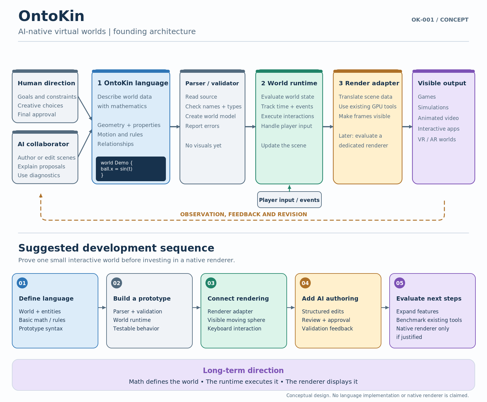
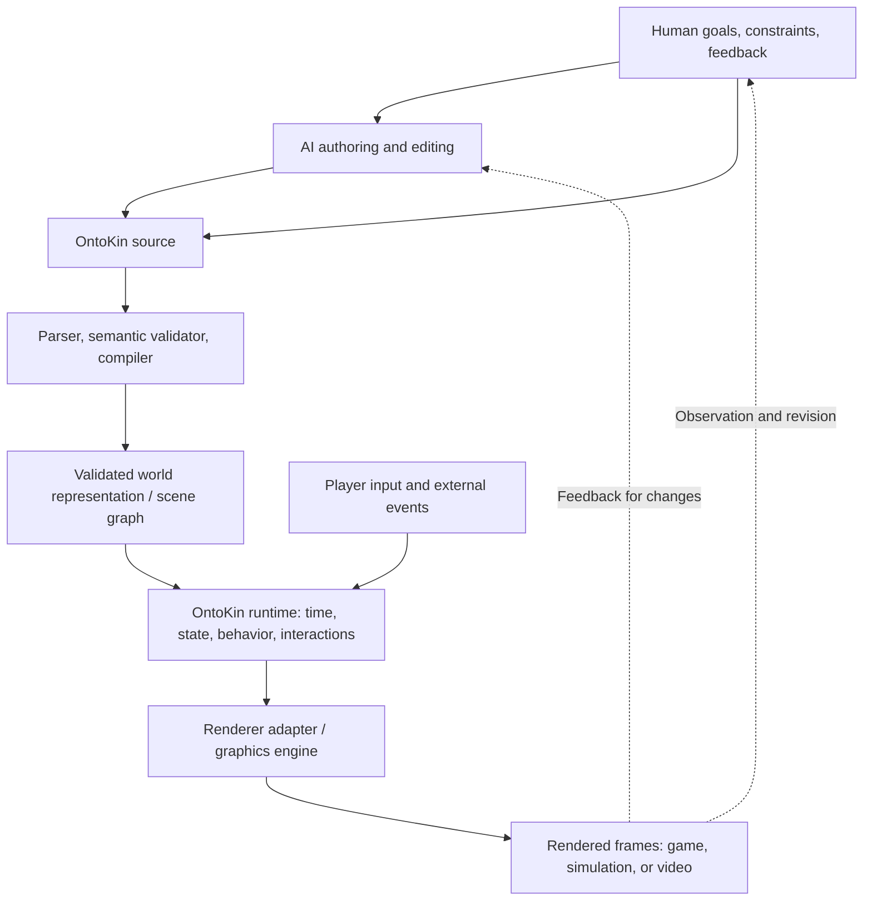

# OntoKin: Project Vision and Initial Architecture

**Document:** OK-001  
**Series:** OntoKin Project Documentation  
**Version:** 0.1.1, initial concept record (name standardization)  
**Date:** October 15, 2026  
**Revision:** Project name and pronunciation standardized October 15, 2026; conceptual design unchanged  
**Status:** Vision and proposed architecture; **not** an implemented language specification  
**Next proposed document:** OK-002, *Language Foundations and Minimal Specification*

> **Project intent:** Create **OntoKin**, an AI-native, mathematics-based programming language for describing, generating, animating, and interacting with virtual worlds. Humans establish goals and guide creative decisions; AI agents can author and modify the formal world descriptions. A runtime executes those descriptions, and a renderer makes the results visible in real time.

## 1. Why this project exists

The project began with a question about **SVG (Scalable Vector Graphics)**. SVG can describe two-dimensional graphics through shapes, paths, and coordinates instead of storing only a fixed grid of pixels, as PNG and JPEG usually do. Its vector descriptions can be rendered at different sizes without the shape boundaries becoming intrinsically pixelated.

The discussion then expanded to **Blender**, 3D modeling, shaders, animation, and video games:

- A 3D application can store mathematical scene data, including object geometry, transformations, materials, cameras, lights, and animations. It can also render that scene into ordinary pixel images or video.
- A game engine can repeatedly evaluate and render a changing scene while responding to player input. Its final display is still a stream of pixel images.
- **Shaders** are programs used by graphics hardware to calculate visual properties, such as surface appearance and lighting.
- Mathematical animation can describe motion as a function of time instead of storing a separate image for each frame.

From that starting point came a broader intent: **Why should AI primarily use graphics tools and workflows that were originally designed around manual human editing?** Rather than treating AI as an assistant clicking through conventional authoring interfaces, this project proposes a formal world-description language that AI agents can manipulate directly and humans can inspect and direct.

This is not intended to be merely a new SVG file format or another 3D modeling interface. The proposed destination is a **programming language for interactive virtual worlds**.

## 2. Name, scope, and central idea

**Chosen working name:** **OntoKin**  
**Proposed descriptor:** *An AI-Native Mathematical Language for Virtual Worlds*.

The name combines **onto-**, referencing ontology (entities and their relationships), with **kin-**, a shortened reference to kinematics (motion). The spelling was simplified during the brainstorming discussion to **OntoKin**, pronounced **ON-toh-kin** ("kin" rhymes with "win"). This is the agreed working name of the project; a formal naming or trademark clearance has not been performed.

### What OntoKin should describe

A world description may define:

1. **Geometry:** 2D and 3D primitives, curves, surfaces, transformations, and eventually more advanced mathematical representations.
2. **Time and animation:** Functions that determine how properties change over time.
3. **Behavior:** Events, state changes, rules, and interactive responses.
4. **Relationships and constraints:** Parent-child structures, dependencies, attachment points, spatial rules, and other explicit connections.
5. **Physics:** Physical properties and interactions, potentially implemented through integration with an existing physics engine.
6. **Appearance:** Materials, colors, lights, cameras, and rendering parameters.
7. **Execution requirements:** Optional constraints such as target platform, quality level, or performance budget.

**Intended applications:** Video games, real-time simulation, animated video production, interactive applications, and eventually VR/AR experiences.

**Important distinction:** Mathematical source descriptions do **not** eliminate pixels. A screen still displays pixels. The innovation is intended to occur in how worlds and their behavior are **represented, authored, verified, and executed** before rendering.

## 3. The AI-native design principle

Most existing digital-content tools can be automated, and several already have scripting, procedural modeling, and scene-description capabilities. OntoKin therefore needs a sharper goal than simply “AI can write code for it.”

The proposed distinguishing feature is **AI-native authoring and verification across the whole pipeline**:

- **Formal and predictable semantics:** An object, a motion rule, and a relationship have precise meanings, rather than relying on vague editor states.
- **Machine-readable structure:** AI tools can inspect a typed representation of the world, not only screen images or strings of source code.
- **Structured editing:** Agents can create, replace, and modify individual entities or rules without regenerating the whole world.
- **Validation and diagnostics:** The system reports syntax errors, type mismatches, invalid references, unsupported features, and violated constraints in structured form.
- **Reproducibility:** A defined scene, version, inputs, and execution settings can be recreated and tested.
- **Human oversight:** People specify goals, review results, constrain changes, and retain authority over accepted content.
- **Renderer independence:** World descriptions should not be permanently tied to one graphics engine.

These are **design goals**, not capabilities that have already been built or validated.

## 4. Proposed architecture

The discussion established three primary system layers. A parser/compiler and an integration adapter are additional components required to connect those layers in an implementation.



*Figure 1. Updated vector recreation of the founding concept diagram. It illustrates the AI/human authoring relationship, language, runtime, rendering layer, possible outputs, and a phased roadmap. The illustrated code is conceptual, not finalized OntoKin syntax.*

### 4.1 High-level data flow



The **scene graph** is a structured description of scene entities and their relationships, usually hierarchical. A compiler may produce a more general **intermediate representation (IR)** containing behavior and constraints alongside, or linked to, a scene graph. The exact internal representation remains an open design decision.

### Layer 1: OntoKin language

**Responsibility:** Express *what the virtual world is* and *how it should change*.

- Define entities, geometry, transformations, animation functions, and constraints.
- Represent behavior and interactions with explicit rules.
- Support reliable parsing, type checking, and machine inspection.
- Remain independent of any specific commercial game engine or renderer.

### Supporting component: Parser, validator, and compiler

**Responsibility:** Turn source code into a validated, executable description.

- Read OntoKin syntax and build an abstract syntax tree (AST).
- Check names, references, types, dimensions, and other language rules.
- Produce an IR and/or world/scene graph for the runtime.
- Return useful diagnostics to human developers and AI agents.

### Layer 2: World runtime

**Responsibility:** Make the world evolve over time.

- Maintain entities and their current state.
- Evaluate animation equations, event conditions, and behavior rules.
- Process external inputs, including player commands.
- Coordinate interactions, constraints, and physics integration.
- Send the necessary state changes to a rendering adapter.

A robust implementation may **separate fixed-rate simulation updates from rendering frames**. For example, rendering at 60 frames per second does not require running all gameplay or physics calculations at that same rate.

### Layer 3: Rendering and game-engine integration

**Responsibility:** Convert the runtime's scene state into visible frames.

- Initially **reuse an existing graphics system**, such as Three.js/WebGL, WebGPU-based technology, or a game engine like Godot.
- Develop an **adapter** that translates OntoKin entities, materials, cameras, and scene updates into the chosen rendering system.
- Keep rendering details separate from the core language so other adapters can be added later.

**Long-term option:** Investigate a dedicated OntoKin renderer optimized for mathematical representations. Some objects might be rendered from implicit equations or distance fields rather than always being converted into polygon meshes. This is a research and performance question, **not** a commitment to ban polygons, textures, or established graphics techniques.

## 5. How OntoKin would connect to gaming

The proposed workflow is **real-time execution**, not merely generating a video file.

### Example: A moving sphere in a game

1. A person asks an AI agent to create a sphere that moves from side to side and responds to the player.
2. The AI writes or edits an OntoKin world description.
3. The parser and validator check that description, then create the representation used by the runtime.
4. At game startup, an adapter creates the corresponding sphere, camera, and other required objects in the rendering engine.
5. While the game runs, the runtime evaluates the motion rule using the current simulation time.
6. If a player presses a key or triggers a collision, the game passes that event to the runtime. The runtime changes the relevant state or behavior.
7. The adapter applies the updated scene state. The graphics engine renders the next frame.

At 60 rendered frames per second, the time budget averages about **16.7 milliseconds per frame**. That is a performance target to test, not something OntoKin's language alone can guarantee.

### Conceptual source example

```text
world Demo {
    entity sphere_01 {
        geometry: sphere(radius: 1.0)
        position(t): (3 * sin(t), 0, 0)
        color: rgb(0.2, 0.6, 1.0)
    }
}
```

This hypothetical code creates a sphere whose horizontal position varies with time. It illustrates a core idea: **store an equation for motion rather than a sequence of recorded animation frames**.

**Not yet specified:** Whether `t` is measured in seconds, how angle units work, what spatial units are used, the exact function grammar, and whether positions are evaluated continuously or sampled by the runtime. The code is an *example of intent*, not valid code for an existing OntoKin interpreter.

### What the game engine supplies

In an early prototype, a game engine or graphics library may provide window creation, GPU drawing, cameras, lighting, audio, and possibly physics and collision detection. OntoKin supplies the declarative or programmatic world definition plus its runtime logic. Integration boundaries must be explicit to avoid duplicating functionality unnecessarily.

### Why this separation matters

The AI does **not** need to generate each rendered image. It can generate the world program and revise it when appropriate. The runtime and graphics system handle the rapid per-frame updates required for responsive gameplay.

## 6. Decisions established in the founding discussion

| ID | Decision or direction | Status | Reason |
| --- | --- | --- | --- |
| D-01 | Use the working name **OntoKin**. | Agreed | Reflects entities/relationships and motion. |
| D-02 | Treat OntoKin as a **language for virtual worlds**, not only a 2D image or animation format. | Agreed | Gaming and interactive 3D are central applications. |
| D-03 | Make the system **AI-native with human direction and review**. | Agreed | AI should work directly with formal world descriptions. |
| D-04 | Separate **language**, **runtime**, and **renderer**. | Agreed architectural direction | Clear responsibilities and room for independent evolution. |
| D-05 | Reuse existing rendering technology in the **first prototype**. | Recommended | Reduces scope and tests the language before investing in a renderer. |
| D-06 | Keep the language **renderer-independent** via adapters. | Recommended | Enables multiple gaming, visualization, and video targets. |
| D-07 | Consider a specialized mathematical renderer **later**. | Research direction | May enable optimizations not available through general-purpose pipelines. |
| D-08 | Build a **small interactive demonstration** before attempting large worlds. | Recommended first milestone | Makes feasibility and limitations measurable. |

“Agreed” records alignment during the discussion; it does not mean a design has been implemented or technically validated.

## 7. Proposed first development roadmap

The roadmap from Figure 1 is refined here into implementation-sized milestones.

### Phase 1: Define the minimum language

**Deliverables:**

- A short language specification for entities, primitive shapes, positions, transforms, and time-dependent properties.
- Basic grammar with explicit syntax and examples.
- Decisions on numeric types, units, coordinate system, and time semantics.
- An initial structured machine-readable representation.

**Exit criterion:** A developer can determine whether a small OntoKin program is valid and what it means without guessing.

### Phase 2: Implement parser, validator, and runtime prototype

**Deliverables:**

- Parser and AST or equivalent structured model.
- Basic semantic checks and machine-readable errors.
- Runtime able to instantiate objects and evaluate a changing position over time.
- Repeatable tests for syntax and mathematical behavior.

**Exit criterion:** The example scene is read, validated, and evaluated consistently over multiple time steps.

### Phase 3: Connect an existing renderer

**Deliverables:**

- One working renderer adapter, likely for a browser-based graphics stack or a selected game engine.
- Camera, primitive shapes, material/color support, and synchronized scene updates.
- A small real-time demonstration with user input.

**Exit criterion:** The program displays an animated object and reacts correctly to an input event; measured performance is reported for a stated test environment.

### Phase 4: Demonstrate an AI-assisted workflow

**Deliverables:**

- A constrained AI authoring interface that creates and edits small scenes.
- Structured validation feedback so the agent can repair invalid output.
- Human approval and a reversible change record.

**Exit criterion:** An AI agent can create or revise a scene from a user request, validate it, and produce a working demonstration that can be reviewed.

### Phase 5: Expand capabilities and assess a native renderer

**Potential additions:** Hierarchical scenes, constraints, physics, reusable objects, procedural environments, performance budgets, scene streaming, and richer materials.

**Decision gate:** Benchmark the current adapters and rendering technology. Develop a dedicated renderer **only if** specific requirements justify its engineering cost.

## 8. Suggested minimum viable prototype (OntoKin 0.1)

**Prototype:** *Interactive Mathematical Sphere*

The first complete demonstration should contain:

- One 3D sphere defined by OntoKin source.
- A mathematical horizontal motion rule.
- A camera and basic material to make the sphere visible.
- A player action, such as pressing a key to pause or change the sphere's speed.
- A parser, validation step, runtime update loop, and rendering adapter.
- A diagnostic message if the scene contains invalid syntax or a missing reference.

**Proposed acceptance checks:**

| Test | Expected observable result |
| --- | --- |
| Parse a valid scene | Structured scene representation is produced without errors. |
| Parse invalid syntax | Clear error with location and category is reported. |
| Evaluate motion | Sphere position matches the defined equation at selected time values. |
| Process input | Keyboard command changes the specified behavior in real time. |
| Render scene | A visible sphere moves while the application runs. |
| Repeat execution | Same program and controlled inputs produce the expected state sequence. |
| Measure performance | Update time and frame time are logged instead of assuming a frame rate. |

These checks prove a limited end-to-end pipeline, **not** that the system can already generate large-scale games.

## 9. Open technical questions

The following are **unresolved** and should be addressed before or during OK-002:

1. **Language style:** Primarily declarative scene descriptions, general-purpose programming constructs, or a restricted combination?
2. **Math types:** Scalars, vectors, matrices, quaternions, curves, fields, and physical units: which belong in version 0.1?
3. **Geometry model:** Built-in primitives first; meshes, parametric surfaces, implicit surfaces, and distance fields later? How should they interoperate?
4. **Time model:** Fixed-step simulation, variable-step evaluation, interpolation, time units, and deterministic replay.
5. **Interaction model:** How are events, collisions, state transitions, constraints, and physics integrations expressed?
6. **Compilation target:** A custom IR, scene graph plus executable rules, bytecode, or a hybrid?
7. **First renderer:** Browser-based 3D visualization or an engine integration? Which option best supports fast iteration and measurement?
8. **AI authoring interface:** Source-file edits alone, typed AST/IR editing, or both?
9. **Security and resource limits:** How are untrusted/generated programs sandboxed and constrained in CPU, GPU, and memory consumption?
10. **Versioning:** How will the language, runtime, and world files declare compatibility?

## 10. Constraints, risks, and engineering principles

- **Not unprecedented in every part:** Mathematical graphics, procedural content, scene graphs, scripting, and real-time engines already exist. OntoKin must demonstrate a coherent advantage through AI-native representation, authoring, and verification rather than assuming novelty.
- **Performance is an engineering challenge:** A compact equation can still be expensive to evaluate or render. Mathematical definitions do not automatically make scenes faster.
- **Physics requires care:** Visual animation equations are not substitutes for collision handling, rigid-body dynamics, or numerical stability.
- **AI output must be verified:** Validation, tests, resource budgets, and human review are essential, especially when agents can make broad changes.
- **Interoperability is a goal, not a guarantee:** Unreal, Godot, Blender, and other systems have different scene, animation, material, and scripting models. Adapters may support only subsets of OntoKin features.
- **Keep layers replaceable:** A renderer may change without forcing the project to redesign the language.
- **Start with measurable claims:** Demonstrate correct parsing, defined semantics, real-time interaction, and observable performance before pursuing a full game engine.

## 11. Documentation series proposed for the project

The project should maintain **numbered, versioned documents** so the original intent and later engineering decisions remain traceable.

| Document | Working title | Purpose |
| --- | --- | --- |
| **OK-001** | **Project Vision and Initial Architecture** | This founding record: motivation, goals, conceptual architecture, roadmap, and open questions. |
| OK-002 | Language Foundations and Minimal Specification | Define syntax, semantics, math/data types, time, and v0.1 examples. |
| OK-003 | Compiler, Intermediate Representation, and Runtime Design | Define parsing, validation, execution, error reporting, and testability. |
| OK-004 | Renderer Adapter and Gaming Integration | Define the first real-time graphics integration and event loop. |
| OK-005 | OntoKin 0.1 Prototype Implementation Plan | Define repository layout, milestones, test cases, and acceptance criteria. |
| OK-006 | AI Agent Authoring and Verification | Define structured editing, constraints, validation feedback, provenance, and approval flow. |
| Future | Dedicated Renderer Feasibility Study | Evaluate whether a native mathematical renderer offers measurable benefits. |

The numbering and titles originated in OK-001. **OK-002** was subsequently drafted as a brainstorming document.

## 12. Immediate next step

Create **OK-002: Language Foundations and Minimal Specification**. It should resolve a few tightly scoped questions before any significant runtime work begins:

- What is the minimum valid OntoKin program?
- What are the core object, geometry, vector, and animation types?
- How are time, units, coordinates, and events represented?
- What must a parser and validator reject?
- What machine-readable structure does the runtime receive?

The first implementation target remains a small interactive sphere. **The guiding architecture is: OntoKin describes the world; the runtime executes its rules; the renderer displays the result; AI agents author and revise it under human direction.**

---

*Document provenance: Compiled from the project's founding discussion on October 15, 2026. Statements marked as proposed, recommended, potential, or unresolved are not settled specifications. The architecture illustration has been recreated as editable SVG and PNG with standardized naming.*