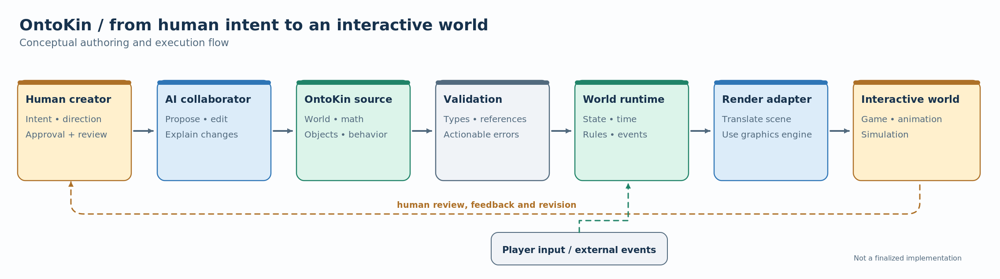
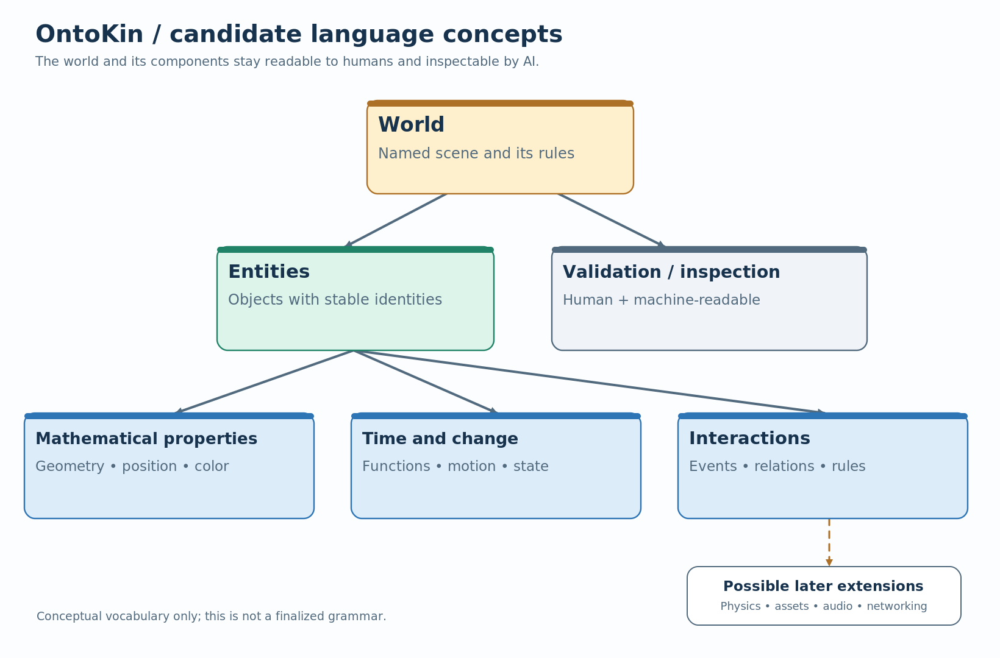

# OntoKin: Language Foundations and Conceptual Minimal Specification

**Document:** OK-002  
**Series:** OntoKin Project Documentation  
**Version:** 0.1.1, brainstorming draft (name standardization)  
**Date:** October 15, 2026  
**Revision:** Project name and pronunciation standardized October 15, 2026; conceptual design unchanged  
**Status:** Concept exploration, **not** a finalized language specification or implementation plan  
**Follows:** OK-001, *Project Vision and Initial Architecture*

> **Working definition:** OntoKin (pronounced **ON-toh-kin**, with "kin" rhyming with "win") is a proposed AI-native, human-understandable mathematical programming language for describing virtual worlds: what exists, how it changes, and how it responds to interaction. A runtime evaluates the world description, and a separate renderer displays it.

## 1. What this document is for

The first document captured the project’s origins, vision, high-level architecture, and initial development roadmap. This second document explores **what kind of language OntoKin should become**, without attempting to finalize a grammar, compiler, file format, or graphics engine.

This is a record of **human–AI brainstorming**. It must be understandable to a person revisiting the idea months from now and structured enough for a future AI agent to recover the intent without inventing missing decisions. Both audiences matter. Terms are explained in ordinary language, and important proposals, agreements, and unanswered questions are labeled separately.

The next stage is **conceptual language design**, not coding the complete system.

## 2. The problem OntoKin is intended to address

Conventional graphics tools already represent objects with mathematics, and existing systems support procedural generation, scripting, scene descriptions, and animation. OntoKin is not novel merely because it uses equations or because an AI can generate its source code.

Its proposed focus is different: **make virtual-world definitions a structured, directly editable medium for AI agents, while keeping them understandable and governable by humans.** The language should express objects, change over time, and interactions without depending on a particular graphical editor.

A user might request: “Make a sphere move side to side; let the player pause it.” An AI could produce or revise an OntoKin description, validation would check it, and a runtime would execute it. A game engine or graphics library would draw the result. Neither the human nor the AI needs to construct a separate image for every frame.

**Scope of ambition:** eventually, interactive 2D and 3D worlds used in games, animations, simulations, and other visual applications. **Scope of the first experiment:** a very small, verifiable interactive scene.

## 3. One language, two kinds of readers

OntoKin should have two equally important interfaces:

- **For humans:** readable concepts, concise source code, understandable errors, previews, change histories, and control over what an AI agent is allowed to modify.
- **For AI agents:** precise structures, explicit types and references, predictable behavior, machine-readable diagnostics, and narrowly scoped edits.

The goal is not to hide the system behind AI prompts. A person should still be able to read, inspect, teach, debug, and write OntoKin directly. Similarly, an AI should not be forced to “look at a screen and click” to understand a world that already has a formal representation.



*Figure 1. Proposed authoring-to-execution flow. The feedback arrows mean that people review results and can request revisions. Player input affects the runtime rather than requiring an AI to generate each frame.*

**Text equivalent:** Human intent → AI-assisted authoring → OntoKin source → validation → world runtime → renderer adapter → interactive experience. Player events enter the runtime; humans observe the result and direct revisions.

## 4. What might belong in the language?

The following vocabulary is a **candidate conceptual model**. These are ideas to discuss, not a formal set of reserved keywords or data types.

| Concept | Plain-language meaning | Illustrative use |
| --- | --- | --- |
| **World** | The scene or environment being described. | A named interactive demonstration. |
| **Entity** | An identifiable thing within that world. | A sphere, door, light, or character. |
| **Geometry** | Mathematical description of an entity’s shape. | A sphere with a radius; later a curve or surface. |
| **Properties** | Values that describe an entity. | Position, color, scale, orientation. |
| **Time and change** | How properties evolve as the world runs. | Horizontal motion controlled by a sine function. |
| **State** | Values that can change through interaction. | Whether an object is paused. |
| **Events and rules** | What happens when something occurs. | Pressing a key changes a state value. |
| **Relationships** | Explicit connections between entities. | A light follows a moving character. |
| **Constraints** | Conditions that must remain true. | An entity stays inside a defined region. |
| **Appearance** | Information used to present an object visually. | Material, lighting, and camera settings. |

A **minimal useful subset** could be: one world, named entities, basic geometry, position, color, time-dependent movement, one input event, and validation. More complex features can remain outside the first version.



*Figure 2. Candidate vocabulary for the language. Physics, asset support, audio, and networking are shown as future extension areas, not features promised for version 0.1.*

**Text equivalent:** A world contains entities; entities have mathematical properties, may change over time, and may participate in interactions. The world and its components should be inspectable and validatable. Some advanced domains may be extensions rather than part of the core.

## 5. What should “mathematical” mean?

OntoKin should make mathematical descriptions **first-class**, meaning they are ordinary parts of the language rather than opaque add-ons. For example, an object’s position could be a function of time, and its shape might be a primitive, a parametric surface, or another representation.

However, **mathematical does not mean equations only**. Games also require discrete state, events, input, asset references, and sometimes external physics systems. Nor does it mean every object must avoid polygon meshes. A useful language should allow alternative geometry representations where needed and let an appropriate renderer handle them.

Three levels of expressiveness are worth exploring:

1. **Describe things:** objects, their geometry, and properties.
2. **Describe changes:** animations and rules depending on time or state.
3. **Describe interaction:** responses to players, collisions, or other events.

These levels could grow independently, so the first OntoKin release does not need to contain every feature required by a commercial game engine.

## 6. An example of the intended experience

A person asks: **“Create a blue sphere that moves left and right. Space pauses or resumes the movement.”**

A conceptual representation could read:

```text
world Demo
    entity Ball
        shape = sphere(radius: 1)
        color = blue
        horizontal_position = 3 * sin(simulation_time)
        on Space_pressed: toggle_motion()
```

This is **illustrative pseudocode, not valid or finalized OntoKin syntax**. It intentionally leaves open how pauses affect simulation time, whether state changes are written as events or functions, the exact grammar, and the units involved. Those details belong in a later, precise language specification.

The user should be able to see the result, ask the AI to modify one aspect (“make it move more slowly”), inspect the proposed change, and accept or reject it. The AI should receive structured error messages if the modification is invalid.

## 7. Design directions worth testing

| Design question | Possible directions | Preliminary recommendation |
| --- | --- | --- |
| **What kind of language?** | Declarative scene description; imperative programming; a combination. | Start with **declarative world descriptions** and a small, controlled set of expressions and events. |
| **Who edits the world?** | Humans only; AI only; both. | Support **both**, with human review and AI-accessible structured edits. |
| **How is the world represented internally?** | Scene graph; typed intermediate representation; combination. | Keep options open; require a form that tools can inspect and validate. |
| **Which geometry should come first?** | Primitives; meshes; curves; implicit mathematical surfaces. | Start with simple primitives while avoiding a permanent geometry restriction. |
| **How do games integrate?** | Native renderer immediately; adapter to existing engine. | Use a **renderer adapter** first, consistent with OK-001. |
| **How much game logic belongs in the language?** | Visual-only animation; full gameplay scripting; bounded behaviors. | Support one simple interaction first; expand only after experiments. |
| **How should AI edit projects?** | Replace entire source; patches to source; structured component edits. | Prefer targeted, reviewable changes and useful diagnostics. |

These recommendations guide experiments; **none settles the full language design**.

## 8. Candidate principles for OntoKin

The project can use these as discussion criteria when evaluating future choices:

- **Human clarity and AI precision:** one definition should remain inspectable by people and machines.
- **Mathematics where useful:** support equations for shape and motion without pretending equations replace all game logic.
- **Separation of concerns:** language describes the world; runtime evaluates it; renderer displays it.
- **Interaction by design:** virtual worlds are not necessarily pre-recorded video.
- **Validation before execution:** detect invalid references, incompatible values, and unsupported features early.
- **Controlled AI changes:** preserve human direction, approval, and traceable revisions.
- **Portable semantics:** avoid baking any specific game engine into the language’s meaning.
- **Incremental growth:** prove a small example before introducing advanced physics, networking, or a specialized renderer.

## 9. What the first “minimal specification” needs to answer

For this **brainstorming draft**, a minimal specification is a checklist of language questions, **not yet a complete grammar**:

1. **Basic unit:** What is the simplest valid world description?
2. **Objects:** How does a world declare an entity with a name and properties?
3. **Mathematics:** Which basic numeric, vector, and expression concepts are essential?
4. **Time:** How should motion reference simulation time?
5. **Interaction:** What is the simplest supported player event or state change?
6. **Validation:** What errors must a developer or AI be able to detect and explain?
7. **Execution boundary:** What information passes from the language to the runtime and then to a renderer?

Only after these questions have clearer answers should we write a normative syntax specification with exact rules for units, coordinate systems, numerical behavior, event ordering, and compatibility.

## 10. Questions to carry into the next discussion

These questions have meaningful tradeoffs; they should not be silently decided by an implementation agent.

- **Declarative versus programmable:** Should early OntoKin mainly state *what is true about a world*, or allow arbitrary procedural code? A hybrid is a likely candidate but needs boundaries.
- **Meaning of time:** Does a motion formula receive global time, entity-local time, or simulated time that can be paused?
- **Meaning of an entity:** Should we use an object model, an entity-component system, or a simpler representation to begin with?
- **AI-facing representation:** Must agents edit human-readable source, a structured internal model, or both?
- **Geometry strategy:** How should primitive solids, meshes, and equation-defined surfaces coexist?
- **Security and budgets:** How do we limit untrusted generated programs and resource-heavy expressions?
- **What makes OntoKin distinctly useful?** What can it do *reliably* that is awkward or fragile with existing scripting and procedural tools?

## 11. One useful experiment before committing to syntax

Create a tiny end-to-end demonstration concept with a single moving sphere. Evaluate the intended interface from **both** viewpoints:

- **Human test:** Can a person read the scene, predict what it does, understand an error, and review a change?
- **AI test:** Can an agent change one property without unintentionally modifying others, and recover from a structured validation error?
- **Runtime test:** Can the same mathematical rule be evaluated reproducibly as time advances and player input changes?
- **Integration test:** Can an existing renderer display the scene without defining OntoKin in terms of that renderer’s API?

This is a suggested research exercise, not an assertion that any implementation has been completed or chosen.

## 12. Decisions, proposals, and boundaries

| Record | Position at the end of this discussion | Status |
| --- | --- | --- |
| **OK-002-D01** | The working language name is **OntoKin**. | Agreed and spelling standardized in the project naming discussion. |
| **OK-002-D02** | The goal is an AI-native language for interactive virtual worlds, **also readable and usable by humans**. | Agreed vision; dual-audience emphasis added in this discussion. |
| **OK-002-D03** | The documentation must support **human understanding and future AI implementation work**. | Agreed documentation requirement. |
| **OK-002-D04** | Use diagrams when they clarify architecture or concepts, with explanatory text. | Agreed documentation requirement. |
| **OK-002-P01** | Explore a declarative core plus bounded expressions and interactions. | Proposed, not decided. |
| **OK-002-P02** | Use one interactive sphere as the first evaluation scenario. | Carried forward recommendation from OK-001. |
| **OK-002-O01** | Syntax, type system, object model, execution rules, and supported renderers remain open. | Unresolved. |

**Deliberate exclusions from this document:** no parser implementation, no official grammar, no versioned API, no final numeric or physical units, no promise that all geometry is equation-rendered, and no assertion that an OntoKin engine exists.

## 13. Where the documentation goes next

**OK-001** established *why OntoKin exists* and the proposed architecture. **OK-002** explores *what the language should describe and how humans and AI would work with it*. The next step can either revise OK-002 after discussion or proceed to a **precise v0.1 language sketch** before detailed work on the compiler, runtime, or renderer.

A later **OK-003**, as proposed in OK-001, can address the compiler, intermediate representation, and runtime design once the language’s minimum meaning has been decided.

---

*Provenance: Drafted from the human–AI brainstorming conversation of October 15, 2026, with OK-001 as context. The status labels separate agreed direction from recommendations and unresolved questions. Figures are conceptual, recreated as editable SVG and PNG with standardized naming; no language or engine implementation is claimed.*