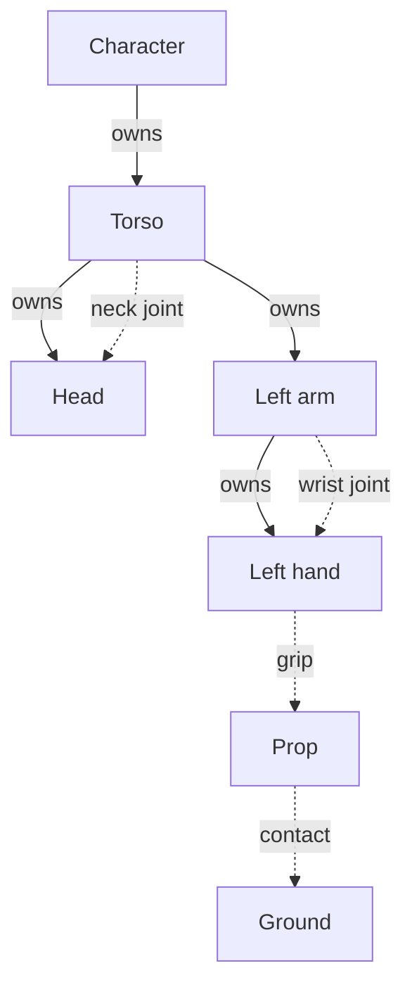

# OntoKin: Core Object, Motion, and Physics Semantics

| Document control | Value |
| --- | --- |
| Identifier | OK-SEM-001, version 0.1 |
| Status | Conceptual language design |
| Review state | Proposed semantic rules for review; no implementation or formal language specification is claimed. |
| Purpose | Define objects, their parts, movement, mechanical relationships, and physical behavior with enough precision to predict small examples. |
| Initial focus | Exterior 3D characters and objects, reusable parts, basic mechanics and physics, and short animations. |
| Audience | AI authoring agents, the project owner, language designers, and future developers. |
| Decision boundary | Defines meaning and observable behavior. Exact syntax, engines, compiler architecture, algorithms, and internal data structures remain open. |

## 1. Purpose and authority

OntoKin is a proposed object-oriented modeling and animation language designed primarily for AI agents. An agent describes meaningful objects, their parts, physical properties, connections, appearance, and intended actions. The language system supplies the supported construction and behavior needed to produce inspectable models and animations. The current direction begins with exterior models and short sequences, while preserving the ability to compose larger virtual worlds. [P1, sections 1 and 7]

The PRD establishes what the product should accomplish. OK-CAP-001 clarifies the modeling focus and the relationships that matter most. This document takes the next step: it proposes rules for what those relationships mean. It does not create another product requirements catalog.

The central distinction is:

**An object can belong to an assembly, have a pose relative to another frame, connect mechanically to another object, and receive an action. Each relationship has its own meaning.**

This makes the walking example understandable. A character can advance, its head can turn relative to its torso, and a hand can act independently. Their mechanical connections and applicable physical laws still constrain the resulting motion. Moving a containing object is not, by itself, an explanation of how every physical part moves.

### 1.1 How to read the proposed rules

Rules SEM-01 through SEM-28 are proposed language-design decisions. Within this draft, words such as “must,” “preserves,” and “rejects” define the intended behavior; they do not imply approval of a finished standard or a working implementation. Examples illustrate these rules. The numbered behavior checks describe expected outcomes, not executed tests.

The owner's October 17 brief governs this document. OK-CAP-001 v0.1 supplies the latest recorded modeling direction, and OK-PRD-001 v0.2 supplies the broader product requirements. Both remain review drafts in the repository. OK-001, OK-002, and OK-003 are founding design records. Their tentative architecture choices are not adopted here. [P1–P5]

The identifier OK-SEM-001 leaves the historical OK-004 renderer-integration proposal available. This document does not renumber or rewrite earlier records.

### 1.2 Reading route

| Question | Read |
| --- | --- |
| What are the fundamental concepts? | [2. Core vocabulary](#2-core-vocabulary) |
| What do classes, instances, and parts mean? | [3. Object-oriented structure](#3-object-oriented-structure) and [4. Object hierarchy](#4-object-hierarchy-and-related-representations) |
| When does a child move with its parent? | [5. Position and movement](#5-position-and-movement) |
| What connects parts and restricts movement? | [6. Mechanical relationships](#6-mechanical-relationships) |
| How do gravity, forces, materials, and control coexist? | [7. Physical behavior](#7-physical-behavior) and [8. Animation and control](#8-animation-and-control) |
| What happens when a prop is released? | [9. State transitions](#9-attachment-release-and-other-state-transitions) |
| Can the rules explain the intended character? | [11. Worked character example](#11-worked-example-a-modular-human-character) and [12. Behavior checks](#12-semantic-behavior-checks) |

## 2. Core vocabulary

These are semantic concepts. They do not prescribe keywords, file formats, object layouts, or a particular engine's classes.

| Concept | Meaning |
| --- | --- |
| Class | A reusable definition of an object's properties, parts, supported operations, and conditions that valid instances must satisfy. |
| Subclass | A specialization that preserves the applicable public contract of a more general class. |
| Instance or object | One identifiable realization of a class, with its own state. “Object” means an instance unless a definition is explicitly being discussed. |
| Part | An object that belongs to another object through composition. Being a part does not remove its identity. |
| Role | The meaning of a part within an assembly, such as left hand or support leg. A role is distinct from its display name and concrete class. |
| Frame | An origin and oriented axes used to express spatial quantities. A frame can exist without visible geometry or mass. |
| Pose | Position and orientation relative to a stated frame at a stated time. Dimensions and deformation are separate properties. |
| Physical body | A physical representation with the properties needed for its selected behavior. One semantic object need not equal one body. |
| Connection | An identified relationship between attachment sites or physical participants that defines permitted relative motion and, when physical, load transmission. |
| Contact | A temporary interaction between participating surfaces, governed by the selected collision and material rules. |
| Degree of freedom | An independently variable movement coordinate, such as the rotation of a hinge. Constraints reduce the movements that remain possible. |
| Motion source | A source of prescribed motion, a target, an applied physical influence, or a physical response. These sources do not all write poses. |
| Action | A timed request with a target, scope, preconditions, and defined completion or failure behavior. |
| Controller | A supported behavior that uses current state and goals to produce motion commands or physical actuation. |
| Support profile | A versioned contract for supported objects, models, assumptions, defaults, actions, interactions, and limits. It supplies detail without changing the common rules in this document. |

A “world” in the initial scope means the shared spatial, temporal, and environmental context of a small scene. It does not require a planetary simulation.

## 3. Object-oriented structure

### SEM-01. Definitions and instances have different identities and state

A class describes reusable construction and behavior. Creating two instances produces two objects with independent state, including their owned parts, active actions, and physical motion. They may share immutable geometry or other resources without sharing mutable simulation state.

An object has a stable identity independent of its display name. Renaming an arm does not redirect its wrist connection. References identify the intended object; names help people find and understand it. An unresolved or ambiguous reference is an error.

Copying a value copies that value. Copying a reference still refers to the same object. Creating a new object or cloning an assembly is an explicit operation. A clone receives new object identities and remaps references among its cloned parts. External references are preserved only where the cloning contract identifies them as intentional shared relationships; unresolved external links need a diagnostic.

Definitions are evaluated at a known revision. Editing a reusable class creates a revised definition. Existing instances do not silently change during a running animation. Applying the revision to selected instances is a separate, inspectable change.

### SEM-02. Specialization preserves the public contract

HumanCharacter can specialize Character. MechanicalHand can specialize Hand. A hand contained by a human is not a subclass of Human.

A compatible specialization can supply different defaults, construction, or operation behavior while retaining the types, attachment conditions, and guarantees required by the public contract through which it is used. For example, a replacement hand must satisfy the wrist interface expected by the arm. Similar appearance or a shared name is insufficient.

Operations act on a specific instance. Their effect on definition parameters, initial conditions, current state, or action requests must be identified. An operation exposed as an inspection must not modify those states.

An operation must resolve to one applicable behavior under the selected type contract. Ambiguous inherited definitions or incompatible specializations require a diagnostic. Single versus multiple inheritance, method-resolution order, interfaces, and exact dispatch notation remain language-specification decisions.

Encapsulation exposes useful controls while preserving the inspection needed to diagnose supported behavior. It does not make the object's physical assumptions or control sources invisible to an authorized author.

### SEM-03. Defaults, overrides, and derived properties have explicit origins

For an overridable property, the proposed precedence is an explicit instance override, then the most specific applicable class default, then inherited class defaults, then the selected model or preset's fallback. More specific values must remain valid under the property contract. Two incompatible values at the same precedence are unresolved; declaration order is not a hidden tie-breaker.

Mandatory conditions are checked after this resolution. They are not lower-priority defaults. Derived values follow their declared inputs and model assumptions rather than participating as competing defaults.

Each effective value is identifiable as authored, inherited, defaulted, derived, estimated, or unresolved, with its source. A filled-solid assumption may derive mass from density and volume. An authored mass that conflicts with that assumption requires an explicit override or alternative distribution model; the system cannot silently change the dimensions.

An instance edit changes only its declared scope. Supported dependencies, such as attachment positions or inertia, update with it. If they cannot be regenerated consistently, the revised result is incomplete and cannot be presented as successfully constructed. [P2, LNG-012, OBJ-006, PHY-003, PHY-016]

## 4. Object hierarchy and related representations

### SEM-04. Composition gives parts one lifecycle owner

In this proposed core, each object has at most one immediate lifecycle owner. Composition is finite and cannot contain a cycle. A scene can contain several top-level objects. Many other objects may reference the same object without owning it.

For example, a character owns an arm, the arm owns a hand, and the hand owns its fingers. The prop held by that hand can remain owned by the scene. A grip does not transfer ownership.

Removing an owner includes its owned descendants in the requested removal scope. If surviving objects depend on that scope, removal is rejected until the operation explicitly resolves those dependencies. A dependency can be detached, replaced, or transferred through a supported operation; dangling connections cannot remain valid.

Transferring ownership preserves object identity and does not, by itself, change pose, motion, or mechanical connections. Any compound operation that does more must identify those additional effects.

### SEM-05. Each relationship states what it changes

| Relationship | Establishes | Does not establish by itself |
| --- | --- | --- |
| Class inheritance | Type specialization and inherited definition contracts | A physical part inside another object |
| Composition | Membership and lifecycle responsibility | A transform, joint, or motion source |
| Frame reference | How a pose or spatial quantity is expressed | A force or a requirement to follow that frame |
| Spatial following | A declared dependency of a pose on another frame and a local pose rule | Dynamic force transmission |
| Mechanical connection | Allowed relative movement and the declared physical coupling | Ownership transfer |
| Contact | The selected surface interaction at the current state | A lasting grip or permanent parent |
| Deformation binding | How visible geometry follows pose or deformation controls | An extra physical body or extra mass |

A standard component can create several of these relationships together. Its resolved description must expose each one. “Attach this hand” can be a convenient operation while still identifying the owner, wrist frames, joint, visual binding, and active control.

Ownership and ordinary spatial-following dependencies cannot contain unresolved cycles. Mechanical connections may form loops and cross ownership branches. A two-handed grip or closed linkage therefore adds connections; it does not give a prop two owners or require duplicate bodies.

The following diagram shows only selected ownership and mechanical relationships:

*Figure 1. Ownership organizes the assembly. Joints, grip, and contact show possible mechanical relationships; they need not all be active at the same time. Frames and geometry are omitted from this view.*

### SEM-06. Logical, visual, control, and physical subdivisions are separate

A meaningful part need not have its own mesh, physical body, or independent degree of freedom. A continuous skin can span the torso and arms. Several deformation controls can shape one physical forearm. A foliage group can have many visible leaves and a simpler physical representation.

Mappings identify which visible surfaces, physical contributions, and controls correspond to each logical part. Mappings must resolve a visible pose or deformation without applying the same movement twice. Auxiliary visual controls do not acquire mass or mechanical joints automatically.

The exterior-modeling boundary allows invisible rigs, collision shapes, mass distributions, and joint locations. Their purpose is to support visible behavior. Biological organs and detailed internal anatomy are not required by this initial scope. [P1, section 5; P2, OBJ-018]

A compatible part replacement validates attachment sites, dimensions, supported motion, control roles, and affected mappings. The replacement object has its own identity; the containing role can remain stable. Rebinding references and transferring state are explicit parts of the replacement operation. A replacement must not silently leave actions controlling the removed object or alter unrelated sibling definitions.

## 5. Position and movement

### SEM-07. Spatial quantities have units, frames, and reference points

A position identifies its frame. A velocity identifies the frame relative to which motion is measured, the axes in which its components are expressed, and the point whose velocity it describes. For a rigid body's linear velocity, this draft uses its center of mass unless another point is stated. An angular velocity describes the body's rotational motion.

These distinctions matter for a rotating hand: the velocity of its wrist is generally different from the velocity of a prop held away from that wrist.

Every spatial quantity and operation must resolve these meanings unambiguously. Units must be dimensionally compatible. A local force must be converted before combining it with world-expressed forces. A position cannot be added to a force.

The initial examples use a shared inertial world frame for classical mechanics. Moving local frames remain available for authoring and inspection. Expressing dynamics in an accelerating frame must preserve equivalent physical meaning; it cannot omit the effects introduced by the changing frame. Exact axes, handedness, numeric formats, and rotation notation remain open.

### SEM-08. Spatial following composes the parent pose and local pose once

For a child whose local pose is prescribed relative to parent frame P, its world pose follows:

$$
T_{WC}(t) = T_{WP}(t)\,T_{PC}(t).
$$

Here, \(T_{AB}\) converts coordinates expressed in frame B to frame A. W is the world frame and C is the child frame. The notation is explanatory mathematics, not proposed OntoKin syntax. Rigid transforms combine position and orientation; their order matters. [S1]

If the parent moves while the child's local pose remains unchanged, the child moves with it. If the local pose also changes, both changes contribute. A head can therefore move through the world with the torso while turning relative to it.

A frame has one unambiguous reference for its ordinary pose expression at a time. Additional targets or mechanical connections constrain the result; they are not additional competing transform parents.

Frame conversion alone changes how a state is expressed. It does not physically move the object. A declared following rule, in contrast, holds or varies a local pose and thereby determines a changing world pose.

### SEM-09. Dynamically determined motion is not applied again through parenting

For a dynamic body, forces, actuation, and mechanical constraints determine its physical state. Its local pose relative to another object may be computed from that state for inspection or rendering. That local description does not authorize adding the parent's movement again.

An articulated system may express its configuration through a base pose and joint coordinates, or equivalent physical descriptions. Their meaning must produce one consistent pose for every body. This does not choose an internal representation or solver.

| Situation | Meaning of “move the parent” |
| --- | --- |
| Organizational owner only | Ownership alone causes no displacement. |
| Parent of prescribed followers | The declared parent pose changes and follower poses are composed once with their local poses. |
| Dynamic articulated assembly | A movement goal resolves to supported actuation or another declared physical action. Connections determine the coupled response. |
| Explicit placement or teleport operation | The identified state is relocated under a declared state-transition rule; the result is not described as force-generated movement. |

In a mixed assembly, a prescribed support may drive an attached dynamic part. The connection must disclose whether forces act in both directions or the prescribed support acts as an external driver. A dynamic child must not receive both a solved displacement and a second copied support displacement.

### SEM-10. Root motion, local motion, and physical resizing differ

A character's root frame locates or describes the complete character. It need not be a separate massive body. A walking clip can supply a root trajectory, local limb motion, or an in-place cycle. An in-place cycle does not produce forward travel by itself.

For any resolved degree of freedom, the root trajectory is applied once. A clip, a navigation action, and physical locomotion cannot each independently add the same forward displacement. Their combination must resolve through the action rules in section 8.

Looking right relative to the torso specifies a local orientation. Looking at a stationary world target requires the desired local orientation to be reevaluated from the current torso pose and target position. The orientation changes when their geometry requires it. A tracked target is reevaluated over time; a sampled target preserves the value taken at a stated time. Actions must identify which they mean.

Changing coordinate units preserves the physical object. Enlarging an object changes its dimensions and may change mass distribution, joint offsets, collision geometry, and bindings. Rigid pose composition does not define nonuniform scale, reflection, or shear. Such edits require supported model-specific conversion and dependency updates, or an explicit unsupported result. Zero scale cannot silently produce a valid physical body.

## 6. Mechanical relationships

### SEM-11. Connections define relative freedom and physical coupling

A connection identifies its participants, attachment sites, local connection frames, permitted relative movements, limits, and physical interpretation. An attachment site includes the role, orientation, dimensions, and compatibility conditions needed to use it.

| Connection concept | Intended relative movement |
| --- | --- |
| Fixed connection | No relative rigid movement |
| Hinge | Rotation about one specified axis |
| Slider | Translation along one specified axis |
| Ball-type joint | Relative rotation, subject to its specified angular limits |
| Flexible connection | Relative response determined by its stated stiffness, damping, and deformation model |
| Coupled mechanism | Related movement coordinates and load transmission under the stated ratio, direction, and ideal or lossy assumptions |

These concepts establish meanings, not a commitment that every connection is implemented in the first prototype. A named supported connection must enforce its declared behavior. Merely drawing two connected parts is insufficient.

A physical connection can transmit loads even if the parts have different owners. Closed connections must be evaluated together for compatibility. A duplicated constraint must not duplicate a body or its mass. An unresolved or inconsistent connection set produces a diagnostic; a numerical solver's failure alone does not prove that the mechanism is impossible.

### SEM-12. Constraints, drives, and goals do different work

A mandatory constraint defines an allowed state or relationship. A preference expresses a result that may be relaxed under a stated policy. An action goal describes the outcome being sought. A drive supplies the force, torque, or declared prescribed command used to pursue it.

A joint limit is not an actuator. A drive can reach its force or torque limit and fail to achieve the desired angle. A speed command or a motor limit must not silently become an infinitely strong physical clamp.

Goals cannot override mandatory constraints. A supported action may report an unreachable target, use an authorized alternative, or report the remaining error. It must not silently enlarge the allowed movement range or remove a connection.

Numerical tolerance concerns how closely an implementation satisfies the same rule. It does not authorize changing the rule. Exact tolerance values require later calibration.

### SEM-13. Contact is conditional and does not imply attachment

Contact depends on the current state and the selected collision representation, filtering, and material-pair policy. Objects can separate, slide, or remain supported according to that model. A contact does not create lifecycle ownership or a permanent joint.

The resolved model identifies ordinary collision response, trigger-only detection, disabled pairs, connected-part collision, and self-collision. A trigger reports an interaction without supplying collision response. A disabled collision pair must not be reported as physically protected against penetration.

The rule for combining two surfaces' friction or restitution is explicit and independent of declaration order. An explicit pair override takes precedence over the profile's material-pair fallback.

A simple fixed grip is an ideal mechanical attachment. It does not claim that individual fingers can supply the required friction or grasping force. Detailed gripping, slipping, and breaking require the corresponding model. Removing a grip does not remove an unrelated support contact or another grip.

## 7. Physical behavior

### SEM-14. Physical participation and motion mode are explicit

An object's semantic category, physical structure, motion mode, and control are separate choices. A human-shaped statue can be rigid and static. A nonliving robot can be articulated and actively controlled. A living tree can be anchored.

Rigid, articulated, and deformable describe physical structure. Static, kinematic, and dynamic describe how participating motion is determined. “Driven” below is a controlled dynamic case, not another way to impose an authoritative pose.

| Participation or mode | What determines movement | Meaning of external physical influence |
| --- | --- | --- |
| No physical participation | The declared visual or spatial rule | This representation supplies no physical response; a separate mapped physical representation may do so. |
| Static | A fixed world pose during the stated interval | It acts as a boundary or support; forces do not move it. |
| Kinematic, or prescribed | A declared trajectory or pose command | Physical neighbors can react, but those reactions do not change the prescribed motion. |
| Passive dynamic | The physical model, initial state, forces, and constraints | The body responds without active goal-directed actuation. |
| Driven dynamic | The same physical evaluation, with supported bounded actuation | A controller pursues a target; loads and limits can prevent success. |

The distinction between prescribed kinematic motion and dynamic response is standard in existing physical systems. It also explains why a moving prescribed support can drive a dynamic neighbor. [S3] OntoKin's proposed rule is to expose that interaction and its limits.

A static body cannot follow a moving platform while remaining fixed in the world. It needs a different mode or an explicit transition. Assigning gravity or a force to a prescribed body does not silently switch its mode; the effect's participation status must be reported.

A prescribed trajectory incompatible with a mandatory connection or contact condition must be rejected or interrupted under the declared failure behavior. Unlimited penetration, hidden teleportation, and unreported constraint removal are not valid resolutions.

### SEM-15. Mass and gravity apply to represented matter once

Each represented material contribution is counted once in the active physical model. The model distinguishes an object's own mass, the aggregate mass of its owned assembly, and externally connected loads.

A character container need not have mass of its own. If its torso and limbs already represent the character's matter, their total is the aggregate; another complete character mass is not added at the root. A parent may also represent distinct material of its own, which must be identified separately.

An aggregate physical body and detailed bodies representing the same matter cannot both count as independent active mass. Multiple references, meshes, collision shapes, or deformation controls do not multiply the represented material. Physical inertia also depends on distribution, orientation, and the reference point; it is not obtained by blindly adding unrelated component values.

A held external prop remains a connected load. Its weight can affect the hand and character through the grip without becoming part of the character's owned mass. Queries for “character mass” and “character plus carried load” therefore identify different sets.

Gravity applies once to each participating physical contribution, or through an equivalent aggregate model. Selecting an assembly as the affected scope does not apply gravity again at every ownership level. For uniform gravity in the initial classical model, a massive dynamic body receives its gravitational force and responds together with its other constraints and influences.

Whether that response is a fall depends on support and control. Joints retain their meaning when an unsupported dynamic character falls. A prescribed character will follow its prescribed motion until its authority changes. Anchoring is a motion restriction, not a claim that the object's material has infinite mass.

### SEM-16. Forces, materials, and environmental conditions retain distinct meanings

| Influence | Required meaning |
| --- | --- |
| Force | A physical contribution over a stated duration, acting on identified participants at a stated point and in a stated frame |
| Torque | A rotational physical contribution with declared units, frame, and scope |
| Impulse | A discrete change in momentum; applying it off-center may also change rotation |
| Environmental field | A condition evaluated at relevant positions and times, with explicit scope and combination rules |
| Material response | Properties interpreted through a stated physical model, rather than through appearance alone |

Several valid forces can act on the same body. They combine after consistent frame and reference-point conversion. This is different from two actions assigning incompatible positions.

The physical environment is resolved independently of class inheritance and ownership. A scene may supply one gravity field and one wind field to selected participants. Overlapping field selections do not duplicate an influence unless their explicit combination calls for distinct contributions.

Wind supplies a surrounding condition. It does not prescribe the same displacement for every object. A rigid anchored object, a free prop, and flexible foliage respond according to their different physical models and attachments. A wind-based decorative sway can be supported as an authored approximation, but must be identified as such.

Appearance does not establish density, friction, or flexibility. Skin color can change without changing mass; a surface called metal can use an explicitly authored fictional response. Density, thickness, distribution, stiffness, and damping need the meanings appropriate to the selected model. Invalid or inconsistent physical values cannot propagate as a successful physical state.

The selected physical, game-approximation, or art-directed policy exposes effective properties, active forces, ignored effects, and permitted departures from physical behavior. A moving kinematic support or an authored override is an identifiable source of external work. The language must not present such a driven system as passive. [P2, section 4.4; PHY-004, PHY-008, PHY-013–PHY-015]

## 8. Animation and control

### SEM-17. An action specifies intent, scope, timing, and an outcome

An action request identifies the target object or role, the intended result, the reference frame, start and duration or completion condition, preconditions, supported operating range, and its behavior on stopping, interruption, or failure.

The resolved action also identifies its affected motion coordinates and dependencies. A hand reach may use the shoulder and elbow. A walking action may include arm swing or torso stabilization. Checking only the names “hand” and “walk” would miss an overlap.

An action's authored scope and its physical consequences differ. A left-hand command must not rewrite the right hand's authored target. Forces transmitted through the body can still affect the right hand's observed world motion or the character's balance.

A class name does not guarantee an action. A valid three-legged character can exist even when a selected walking controller does not support its proportions. Supported standard actions include the required routine setup and wiring; an unsupported action is reported without invalidating an otherwise valid model.

### SEM-18. Each movement coordinate has one resolved authority

For each independent movement coordinate, the active system must resolve one authoritative way to determine its state. There may be multiple inputs, but their combination must have an explicit meaning.

| Inputs acting together | Proposed core result |
| --- | --- |
| Actions affecting disjoint control coordinates | Combine them, subject to shared physical and support conditions. |
| Two incompatible authoritative targets for the same coordinate, with no combination policy | Reject the conflicting request before it becomes active. |
| Explicit action override | The selected action owns the stated overlapping coordinates for the stated interval; displaced control follows its declared interruption behavior. |
| Explicit blend | Combine compatible targets using identified weights, reference frames, timing, and interpolation meaning; produce one target. |
| Explicit additive motion | Apply a declared offset relative to a stated base pose, frame, and order; produce one target. |
| Multiple physical forces or torques | Combine valid contributions within the physical model; retain their sources. |
| Dynamic body with joints and contacts | Resolve one coupled physical state satisfying the active model and constraints. |

The absence of a policy means a conflict, not “last instruction wins.” Priorities are meaningful only when explicitly part of the resolved action contract. Equal-priority incompatible commands remain unresolved.

Rotation blends must preserve valid rotations. Adding orientation components without a declared rotation convention is not a defined blend. Exact interpolation algorithms and numerical tolerances belong to later specification work; a concrete motion using them must identify its chosen contract.

### SEM-19. Animation targets and physical results remain separate

Prescribed animation supplies the pose or trajectory in its declared scope. A dynamic controller instead supplies supported actuation toward a goal. Its target is not the resulting physical pose. Control through forces or torques has to account for the body's dynamics. [S4]

In driven dynamics, animation can supply desired joint motion, and the controller can try to realize it. Gravity, contact, actuator limits, and other loads remain active. The final simulated pose must not be silently averaged with a separately imposed animation pose after the physical evaluation.

A mandatory joint limit cannot be bypassed by raising an action's priority. A balance or reach goal may remain unmet. If a permitted art-directed operation changes the physical participation or constraints, it must do so explicitly and report the changed interpretation.

A purely visual deformation can be added after physical motion when the mapping permits it. That deformation changes appearance; it does not claim an additional physical movement or collision response.

Physical walking produces progress through supported actuation and contact. An authored walk can instead use a prescribed root trajectory with stated contact assumptions. Both can produce useful short animations, but the resolved result must identify which kind it is.

Stopping the walk follows its own stopping contract. It does not cancel the look or hand action. The example in section 11 chooses a transition to supported idle control; this is an explicit example choice, not an assumption that every object can balance automatically.

## 9. Attachment, release, and other state transitions

### SEM-20. Attachment validates the state it is joining

Attaching an object identifies the new relationship, participants, compatible sites, pose alignment, and permitted state transition. It does not implicitly change ownership.

Ordinary attachment can require compatible current poses and velocities. Joining two bodies with incompatible velocities may require a modeled capture impulse, compliant connection, or explicit prescribed transition. The language must not promise velocity continuity while also imposing an incompatible rigid latch.

A supported attachment operation validates the resulting constraints, control authority, collision filtering, and affected mappings together. If the new relationship cannot be accepted, the existing valid relationship state remains in place.

### SEM-21. Ordinary release preserves the object's evaluated physical state

An ordinary release removes the named grip. At that event, the object retains its identity, world pose, center-of-mass linear velocity, and angular velocity. It then continues under its remaining relationships and selected post-release motion mode.

This proposed continuity rule assumes unchanged represented matter and mass properties, with no separately modeled release impulse or simultaneous impact. A throw may result from the carried object's existing motion. Any additional release impulse is a separately identified influence or transition. Releasing one grip does not remove a second grip, a tether, gravity, or ordinary contact. Changes to the physical representation follow SEM-22.

| State before release | Required handoff |
| --- | --- |
| A dynamic prop held by a physical constraint | Preserve its evaluated physical state and remove the specified constraint. Do not add hand velocity again. |
| A prop rigidly following a prescribed grip | Obtain its current world pose and velocity from the complete carried motion, then initialize the supported post-release physical state. |
| A prop with relative motion in a compliant or slipping grip | Use the prop's evaluated motion, including that relative movement. |
| Missing or discontinuous pre-release velocity | Require an explicit supported estimate or handoff rule, or report that the requested continuous release is unavailable. Do not silently assume zero. |

For a prop rigidly fixed to a moving grip, the linear velocity at its center of mass C is:

$$
\mathbf{v}_C = \mathbf{v}_G
  + \boldsymbol{\omega}\times(\mathbf{p}_C-\mathbf{p}_G).
$$

G is the grip origin; \(\mathbf{v}_G\) is its world velocity, including character and arm motion. The angular velocity \(\boldsymbol{\omega}\) is the prop's, which equals the grip's only when the grip prevents relative rotation. All vectors use the same world axes. Relative movement requires the corresponding additional contribution. [S2]

The equation explains why a rotating hand can give a released prop sideways velocity. It is not an equation the author must provide for each release.

The release event removes any carry-following rule that would continue to impose the old grip's pose. It preserves the same world state if the prop is subsequently expressed in another frame. Applicable collision filtering and remaining controls are updated at the event. Newly enabled contact can produce physical impulses, but the filtering change and its consequence must be identifiable.

The ordinary-release contract assumes a supported dynamic post-release model. If the prop has no usable physical representation or release state, the request cannot claim success. A separately requested prescribed continuation is a different, explicitly identified behavior.

### SEM-22. Mode changes and relocation have declared state-transfer rules

Prescribed-to-dynamic transition preserves the current pose and transfers meaningful linear and angular velocity, subject to the same conditions as release. Dynamic-to-prescribed transition starts from the current state and follows an explicit capture or blending rule. It cannot silently snap to an old animation pose.

Changing an object's coordinate reference preserves its world state. A teleport or placement operation deliberately changes that state and identifies its affected objects, velocity treatment, contacts, and connections. It must apply that declared scope coherently and preserve or explicitly revise the affected connections. It cannot leave an unintended partial transition or describe the relocation as force-generated movement.

Part replacement, physical resizing during a run, and changing the active physical representation require a supported transfer of state and dependencies. If such a transfer is unavailable, the edit can require reinitialization or return unsupported. A stale physical or visual representation cannot be relabeled as the revised valid result.

## 10. State and time

### SEM-23. Definition, rest configuration, initial state, and current state differ

| State or description | Meaning |
| --- | --- |
| Authored definition | Reusable properties, structure, and declared behavior |
| Rest or binding configuration | The reference configuration used by a mechanical or deformation model |
| Initial conditions | Pose, velocity, environment, actions, and other state declared for the start |
| Prepared start state | A valid state reached through explicitly identified supported initialization |
| Current state | The evaluated state at the current world time |
| Recorded output | Samples of evaluated results with time and interpretation information |

An action changes current behavior under its contract. It does not automatically overwrite source parameters or the rest configuration. Preparation must disclose temporary supports or settling actions and their removal.

Reset restores the declared initialization procedure, including controller history and relevant random state. It does not adopt the last pose as a new default. Recorded animation can reproduce sampled movement without preserving the controller or the physical process that produced it.

### SEM-24. Stopping or pausing an action does not pause the world

World time gives the shared meaning of scene evolution. Actions can have local timing, such as the phase of a walking cycle. Rendering cadence does not define physical elapsed time.

Pausing an action holds or suspends its local progression according to its contract. If this leaves a fixed desired pose, a dynamic body can still respond to forces while its controller attempts to hold that target. If actuation is disabled, its physical consequences remain active. Neither operation implicitly stops gravity or other actions.

Pausing the complete simulation stops world-time advancement. Resuming does not add the elapsed wall-clock pause to physical time. Reset is a separate operation.

Time scaling must identify whether it changes world evolution or an action's timing. Changing playback speed alone does not establish that the same motion is physically feasible at the new speed.

### SEM-25. Events have explicit ordering and inspection has no side effects

Attachment, release, action admission, interruption, and mode changes have identifiable before and after states at their event times. Related changes to connections, authority, and mappings are accepted together; an observer must not receive a partially updated relationship state as valid.

Events with causal dependencies follow those dependencies. Independent events at the same time may commute. Conflicting simultaneous events require an explicit ordering or resolution contract; without one, they are rejected as an unresolved combination. Arrival timing or incidental declaration order cannot secretly decide the result.

For example, “release, then apply a throw impulse” states an order. Two contradictory mode changes at the same timestamp do not. Repeated zero-time event chains require a bounded contract or a diagnostic rather than unlimited evaluation.

Read-only inspection and sampling of an already evaluated state do not advance world time or change state. A request to evaluate a later time is a distinct operation. The later execution specification must define event-boundary sampling and scheduling precisely while preserving these distinctions.

A claim that an interactive run can be replayed identifies the accepted definition and model versions, initial or supported checkpoint state, relevant random state, timestamped external inputs, environmental changes, and event/control configuration needed to reproduce it. Missing required history prevents that replay claim. Its numerical guarantee is stated separately; explicit event ordering does not imply identical numerical results across engines. A recorded clip may preserve movement without preserving this interactive history. [P2, ANM-020]

## 11. Worked example: a modular human character

This example is a conceptual description, not source code. It assumes a compatible body and a supported set of actions. It does not select a rig, controller algorithm, solver, or anatomical data set.

### 11.1 Object and relationship definitions

HumanCharacter specializes Character. One instance, Walker, contains a torso with a head, arms, and legs. Each arm contains upper and lower segments and a hand; the hands contain fingers. Those subdivisions are illustrative and can be refined without requiring biological interiors.

| Element | Object meaning | Movement and physical meaning |
| --- | --- | --- |
| Walker | Complete character instance with stable identity | Exposes overall placement and action controls; its container adds no duplicate physical mass. |
| Torso | A meaningful physical part | Contributes its own mass and connects the limbs and head. |
| Head | Independently addressable part | Connects through a neck joint; can receive a local orientation or world-target look action. |
| Left arm and hand | Nested parts with compatible roles | Reach can use the shoulder, elbow, and wrist; finger actions can have their own declared scope. |
| Legs and feet | Parts used by the supported walk | Their actions coordinate with ground contact and body movement. |
| Visible skin and clothing | Exterior surfaces mapped to relevant parts | Follow the resolved pose and any declared deformation; do not duplicate body mass. |
| Prop | Separate scene-owned object | Can connect through a grip and later continue as a free dynamic object. |
| Ground | Separate scene object | Supplies support and collision under its material and contact rules. |

For the principal example, the character uses driven dynamics. Gravity, joints, contacts, and bounded actuation affect the same physical evaluation. The supported walk has a declared operating range, and the chosen prop and requested poses remain within it. This is an assumption for interpreting the example, not evidence that such a controller has been built.

### 11.2 Concurrent actions

| Action | Target and scope | Combination decision |
| --- | --- | --- |
| Walk forward | Locomotion, support coordination, and permitted body/limb targets | Drives supported movement; does not also add an independent root translation. |
| Look right | A head orientation relative to the torso | Owns the selected neck target. Walk and idle exclude these coordinates from their authored targets; physical coupling remains active. |
| Reach with the left hand | A world-space hand target, using identified arm coordinates | Overrides the walking action's left-arm swing for the affected coordinates. The displaced swing follows its interruption contract. |
| Carry with the left hand | A torso-relative hand target reached through a supported transition after gripping | Receives the reach action's affected arm coordinates and retains them during walk and idle. |

These requests produce one resolved set of control targets. Physical evaluation determines the observed motion. The hand action can alter balance requirements and the neck drive can experience limits. Concurrent authoring does not guarantee that every arbitrary combination is physically achievable.

A supported combination supplies the routine coordination needed to meet its contract. If the current body or load falls outside that range, the result identifies the unsupported combination or unmet goal.

### 11.3 Sequence and expected meaning

1. **Start walking.** The controller coordinates body movement and support contacts. All connected parts remain part of the same physical assembly, while their local joint poses can change.
2. **Turn the head.** The neck target changes relative to the moving torso. The head's world pose contains both the torso motion and the resolved neck motion, without double application.
3. **Reach with the left hand.** The declared arm-swing override takes effect. The right hand's authored target is unchanged; the body's physical response can still alter observed movement.
4. **Grip the prop.** Compatible attachment conditions are checked and a grip is created. In this example it is an ideal physical attachment. The prop's load is transmitted through the grip; its ownership remains with the scene. After the grip succeeds, the world-space reach completes through a supported transition from the current state to a torso-relative carry target. This avoids leaving the hand fixed at its old world target while the character continues walking.
5. **Stop walking.** The walk transitions to supported idle control. Idle accepts locomotion and support responsibilities while leaving the active neck and left-arm target coordinates to the look and carry actions. Holding a local head orientation retains its target angle relative to the torso; a world-tracking look would instead continue evaluating its target.
6. **Release the prop.** The named grip ends. The prop keeps its evaluated world pose and velocity, then responds to gravity and remaining contacts. The carry action hands its arm coordinates to a local pose-hold action through a supported transition. The continuing hand control cannot carry the prop through a stale following rule.
7. **Remove support.** If the character has no remaining support or external lift, its center of mass responds to gravity. Joints and local actuation remain active. Internal limb actions do not create an unexplained world support.

A simpler short-animation example can use prescribed character motion and a dynamic released prop. It must identify the character as prescribed and the interaction as such. That example can demonstrate hierarchy and release, while the principal driven example also requires physical locomotion and load response.

## 12. Semantic behavior checks

These checks make the draft's rules concrete. They are conceptual fixtures for later conformance work, not a test report. Numerical tolerances, controller ranges, and implementation procedures are not established here.

| Check | Given and operation | Expected observable result | Rules |
| --- | --- | --- | --- |
| SC-01 | Rename an existing hand. | Its identity and valid references remain; only the display name changes. | SEM-01 |
| SC-02 | Instantiate two characters and change one hand's instance parameter. | The other instance's parameters, owned identities, and state remain unchanged. | SEM-01, SEM-03 |
| SC-03 | Clone an assembly with internal wrist references. | New parts have new identities; internal references point to the cloned parts. External links follow the declared cloning contract. | SEM-01 |
| SC-04 | Make an object its own ownership ancestor. | Reject the ownership cycle without accepting a partial revision. | SEM-04 |
| SC-05 | Move an organizational owner with no spatial or physical following relationship. | Ownership alone does not move referenced or owned parts. | SEM-05, SEM-09 |
| SC-06 | Translate a prescribed parent by 2 m with orientation and child local pose unchanged. | The child translates by the same world displacement once. Its local pose is unchanged. | SEM-08 |
| SC-07 | Inspect a dynamic child's local pose after physical evaluation. | Converting that pose back to world space reproduces the resolved physical pose; parent motion is not added again. | SEM-09 |
| SC-08 | Move the torso while tracking a stationary world target. | The desired local head orientation is reevaluated from the current torso pose and world target. It changes when their relative geometry requires it; maintaining a fixed local angle is a different action. | SEM-10, SEM-17 |
| SC-09 | Start a reach while the walk swings the same arm, with no policy. | Report the overlapping control coordinates; do not silently overwrite one action. | SEM-17, SEM-18 |
| SC-10 | Request incompatible equal-priority neck targets. | Reject unresolved overlap. No target is chosen by incidental execution order. | SEM-18 |
| SC-11 | Add gravity, wind, and motor torque to one dynamic system. | Valid physical contributions coexist; the system does not treat them as competing pose assignments. | SEM-14–SEM-19 |
| SC-12 | Represent 4 kg of torso matter and 1 kg of arm matter with several visual controls. | The owned physical aggregate is 5 kg. Repeated references and visual controls add no mass. | SEM-06, SEM-15 |
| SC-13 | Release a rigidly carried prop with the right-handed example \(\mathbf v_G=(1,0,0)\) m/s, \(\boldsymbol\omega=(0,0,2)\) rad/s, and \(\mathbf p_C-\mathbf p_G=(0.5,0,0)\) m. | The pre-release center-of-mass velocity is \((1,1,0)\) m/s and transfers unchanged in an ordinary release. This is an analytical example, not a simulation measurement. | SEM-07, SEM-21 |
| SC-14 | Release a dynamic prop already moving under a physical grip. | Preserve evaluated velocity; do not add the hand or character velocity again. | SEM-21 |
| SC-15 | Release one of two grips. | Only that grip ends. The other connection still affects the prop. | SEM-05, SEM-13, SEM-21 |
| SC-16 | Request a physical release from discontinuous prescribed motion with no velocity-transfer rule. | Report the unsupported handoff; do not invent a zero release velocity. | SEM-21 |
| SC-17 | Reach beyond a mandatory joint limit or with insufficient drive output. | The limit remains active; requested and achieved motion are distinguishable, with a failure or remaining error. | SEM-12, SEM-19 |
| SC-18 | Remove all external support and lift from a dynamic articulated character in gravity. | Its aggregate motion responds to gravity; joints persist and no descriptive root adds duplicate mass or displacement. | SEM-09, SEM-15 |
| SC-19 | Stop walking while a look action remains active. | The walk follows its stopping behavior; the look retains its own local-angle or tracking contract. | SEM-19, SEM-24 |
| SC-20 | Pause an action, inspect twice, then resume it. | Inspection adds no time. The action pause does not itself pause world physics or other actions. | SEM-24, SEM-25 |
| SC-21 | Express a model in centimeters rather than meters. | Its physical dimensions, mass, and behavior retain their meaning. Physical resizing is a separate change. | SEM-10 |
| SC-22 | Apply one wind field to anchored rigid geometry and supported flexible foliage. | Responses differ according to physical participation and material models; identical sway is not inferred from ownership. | SEM-14, SEM-16 |
| SC-23 | Replace a hand with an incompatible attachment contract. | Reject the replacement or report a required explicit adaptation; preserve the previous valid assembly. | SEM-02, SEM-06 |
| SC-24 | Add a closed mechanical linkage across ownership branches. | The relationship is representable without an ownership cycle or duplicated body; execution depends on its declared support and compatibility. | SEM-05, SEM-11 |

## 13. Inspection and failure meaning for AI agents

### SEM-26. Inspection explains both intent and effective behavior

An agent must be able to inspect an object at a known definition revision and world time. The result identifies enough context to distinguish what was requested, how it was resolved, and what happened.

The following is a conceptual information contract, not an API or serialization schema:

| Inspectable information | Question it answers |
| --- | --- |
| Identity, class, role, owner, and definition revision | Which object is this, and what definition created it? |
| Authored, defaulted, and derived values | Where did its effective parameters come from? |
| Frames and spatial relationships | Relative to what is this quantity expressed, and why does the part follow another object? |
| Mechanical connections and contacts | What currently permits, restricts, or couples its movement? |
| Physical representation and mass accounting | Which physical matter and response model does it represent? |
| Active actions and resolved authority | Which requests control these coordinates, and how was overlap resolved? |
| Targets, actual state, and available force information | What was requested, what occurred, and what affected it? |
| Support, approximation, and validity status | Which conclusions are supported, incomplete, approximated, or unavailable? |

The system should explain a moving hand through its parent/reference relationship, wrist or arm state, active action, and relevant physical coupling. It need not pretend that nonlinear coupled motion has a unique simple percentage attribution to each cause.

An AI language model authors, inspects, and repairs the description. The semantics do not require that model to calculate every simulation step or rendered frame.

### SEM-27. Failure and partial success have different meanings

| Outcome | Meaning |
| --- | --- |
| Invalid definition | The declared object or relationship violates a semantic rule, such as cyclic ownership or incompatible units. |
| Unresolved command conflict | The requested active combination lacks a valid authority or ordering resolution. |
| Unresolved model assumption | A necessary interpretation, such as the mass distribution or physical participation, has not been supplied or resolved. |
| Unsupported capability | The description is meaningful, but the selected configuration cannot construct or execute the requested behavior. |
| Unmet action goal | Evaluation was valid, but the requested outcome was not achieved. |
| Numerical failure | The calculation cannot produce a valid result under its stated conditions; this alone does not establish that the intended configuration is impossible. |
| Evidenced constraint violation | An identified state or declaration violates a stated condition, with the relevant values and evidence. |
| Incomplete or stale result | Required derivation, initialization, or revision updates have not completed consistently. |
| Successful result at an identified stage | The stated definition, construction, behavior, or delivery conditions were met at that stage. |

Diagnostics identify the relevant rule, objects, quantities, frames, time or revision, and the conflict or missing condition. Where available, they distinguish requested values from achieved values and provide a localized repair direction. Observed violations, suspected causes, and demonstrated infeasibility are separate claims. A failed solve is not proof that no valid solution exists. [P2, VAL-003, VAL-006]

A failed authoring edit preserves the prior accepted revision. A failure during physical evolution records the last valid state and the failed condition; later frames must not be labeled valid continuation unless an explicit recovery succeeds. Exact execution recovery mechanisms remain open.

A valid definition is not proof of successful construction. Constructed geometry is not proof of supported walking. A convincing image is not proof of active physics. A recorded clip is not proof that a destination preserves live controllers or interactions. These distinctions carry forward the existing PRD's stage-specific results. [P2, sections 9.1 and 9.3; AGT-006, BIO-014, VAL-011]

## 14. Initial scope and extension boundaries

### SEM-28. Extensions preserve the core relationships and disclose new physical assumptions

The initial design focuses on finite exterior models with meaningful parts, rigid poses, basic joints and attachments, supported contact and gravity, concurrent short actions, and a simple declared environmental response. It permits the invisible support structures needed for those results.

The broader product can add richer deformable bodies, clothing, hair, vegetation, liquids, vehicles, unusual body plans, environments, planets, and larger worlds. Those capabilities must preserve stable identity, distinct relationships, meaningful frames, explicit physical participation, resolved motion authority, and honest state transitions.

An extension can introduce new physical quantities and response models. It cannot quietly give “ownership,” “release,” or “dynamic” a conflicting meaning. If a domain needs different continuity, conservation, scale, or time assumptions, it must identify a compatible specialized contract.

This scope does not delete the broader PRD's intended capabilities or claim that every initial example is already supported. It identifies the concepts being resolved now. [P1, sections 7–9; P2, section 9]

### Decisions still open

| Later decision | Meaning already constrained here |
| --- | --- |
| Exact syntax, keywords, types, declarations, and source format | The concepts and their observable relationships must remain expressible and inspectable. |
| Full inheritance and method dispatch | Specialization must preserve compatible contracts; ambiguous behavior cannot be hidden. |
| Standard object/action vocabulary and precise defaults | A concrete model resolves defaults and publishes action scope and support. |
| Axes, handedness, rotation representation, numeric range and precision | Units, frames, reference points, valid rotations, and physical dimensions remain distinct. |
| Blending formulas and event-boundary rules | A resolved action has one authority, explicit combination meaning, and a consistent state transition. |
| Numerical tolerances and fidelity profiles | Tolerance measures satisfaction of the declared rule; it does not permit undisclosed relaxation. |
| Physical and geometry engines, controllers, solvers, and scheduling algorithms | Selected machinery must produce the meaning claimed for supported cases. |
| Compiler architecture, runtime storage, and internal data structures | Author-facing object semantics do not prescribe implementation layout. |
| Output formats and initial rendering/game destinations | Delivery must distinguish preserved live behavior, converted meaning, and recorded playback. |
| Detailed fluid, biological, planetary, or astrophysical models | New physical scope must be explicit; a small classical scene does not imply universal physical coverage. |
| Performance targets and prototype sequence | They require later engineering decisions and evidence. |

### Subsequent documents

| Stage | Role | Current position |
| --- | --- | --- |
| Product requirements and capability definition | What OntoKin should create and accomplish | Existing OK-PRD-001 and OK-CAP-001 drafts provide the reference. |
| Core semantic model | What objects, motion, mechanics, and physical behavior mean | This proposed OK-SEM-001 draft |
| Language specification | How agents express these meanings through types, definitions, operations, and formal rules | Next after semantic review |
| Implementation architecture and prototype plan | How the language is parsed, evaluated, tested, and connected to external tools | Later work informed by the earlier architecture proposals |

## 15. Traceability to the existing documents

This table records requirements addressed conceptually. It does not claim that those product requirements have been implemented, tested, or completely specified by this document.

| Subject | Capability reference | Selected PRD references | Semantic rules |
| --- | --- | --- | --- |
| Classes, instances, specialization, and reuse | CAP-01, CAP-03 | LNG-003–LNG-005, LNG-012, LNG-018; OBJ-006, OBJ-012 | SEM-01–SEM-03 |
| Recursive parts, identity, and distinct relationships | CAP-02, CAP-05, CAP-06 | OBJ-001–OBJ-004, OBJ-009, OBJ-015, OBJ-018 | SEM-04–SEM-06 |
| Frames, quantities, root motion, and resizing | CAP-07, CAP-09, CAP-12 | LNG-008, LNG-009; OBJ-005, OBJ-017; ANM-013 | SEM-07–SEM-10 |
| Joints, attachments, coupling, and contact | CAP-06, CAP-10 | MEC-002, MEC-003, MEC-006, MEC-007, MEC-009; PHY-005, PHY-006, PHY-010; LNG-021 | SEM-11–SEM-13 |
| Physical participation, matter, and environment | CAP-10–CAP-12 | OBJ-010, OBJ-011; PHY-001–PHY-004, PHY-008, PHY-013–PHY-015, PHY-017; MAT-003 | SEM-14–SEM-16 |
| Concurrent animation and supported control | CAP-08, CAP-09, CAP-12, CAP-13 | ANM-002–ANM-007, ANM-013, ANM-014, ANM-018, ANM-019; PHY-014 | SEM-17–SEM-19 |
| Attachment, release, and transfer of state | CAP-06, CAP-08, CAP-12 | OBJ-015, OBJ-017; MEC-009; ANM-007, ANM-017 | SEM-20–SEM-22 |
| State, time, and inspection effects | CAP-08, CAP-14, CAP-15 | OBJ-014; PHY-021; LNG-010, LNG-019; ANM-010–ANM-012, ANM-020 | SEM-23–SEM-25 |
| Inspection, localized repair, and stage-specific outcomes | CAP-14, CAP-15 | AGT-006, AGT-007, AGT-016; BIO-014; VAL-003, VAL-009, VAL-011 | SEM-26, SEM-27 |
| Exterior scope, delivery meaning, and extension | CAP-04, CAP-05, CAP-16–CAP-18 | OBJ-018; EXP-004, EXP-005; PRD sections 9 and 12 | SEM-06, SEM-27, SEM-28 |

## Appendix A. Repository review

The review used repository commit [f1bbfe0fab86ad78bec517bcebd3261376b6be6d](https://github.com/Omegapy/OntoKin/commit/f1bbfe0fab86ad78bec517bcebd3261376b6be6d). All 25 documentation artifacts were examined. The count includes alternate document and diagram formats; it does not mean 25 independent specifications.

| Existing material | Artifacts | Review role |
| --- | ---: | --- |
| Root README | 1 | Current entry point, historical positioning, and document navigation |
| OK-001 package | 4 | Main Markdown document, package README, SVG and PNG architecture diagram |
| OK-002 package | 6 | Main Markdown document, package README, two diagrams in SVG and PNG |
| OK-003 package | 12 | Markdown and HTML document editions, package README, three diagrams in DOT, SVG, and PNG |
| OK-PRD-001 v0.2 | 1 | Full intended-product requirements, semantics gaps, support distinctions, and acceptance context |
| OK-CAP-001 v0.1 | 1 | Latest modeling-first direction, nested objects, concurrent motion, exterior scope, and next semantic step |
| **Total** | **25** | **All existing documentation at the reviewed snapshot** |

The old root README omitted the PRD and capability companion and used incorrect capitalization in its documentation-directory link. Its world/sphere-first emphasis preceded the newer modeling direction. The accompanying navigation update points readers to current documents while retaining the founding records.

The earlier documents distinguish language, execution, and rendering responsibilities. That distinction remains useful. Their interpreter, compilation, adapter, and backend proposals remain historical options; this semantic model selects none of them.

## Appendix B. Project basis and technical references

The owner brief and project documents establish OntoKin's intended direction. The technical references support limited background distinctions and equations. They do not establish that OntoKin has implemented any capability or select a dependency. External primary sources were checked October 17, 2026.

**[U1] Project owner brief, October 17, 2026.** Create OK-SEM-001 as a conceptual core semantic model covering objects, hierarchy, motion, mechanics, physics, and animation. Preserve exterior models and short animations as the initial focus, human inspectability, and later decisions on syntax and implementation.

**[P1] OK-CAP-001 v0.1.** [Modeling, motion, and object structure](../Product_Requirements_Docs/OntoKin_Modeling_Motion_and_Object_Structure.md). Main reference for the current modeling focus, relationships, and capability IDs.

**[P2] OK-PRD-001 v0.2.** [OntoKin product requirements document](../Product_Requirements_Docs/OntoKin_PRD_v0.md). Broader product reference; still a product-review draft. Its filename retains the earlier v0 label.

**[P3] OK-001.** [Project vision and architecture](../OK-001/OntoKin_001_Project_Vision_and_Architecture.md). Founding vision, AI/human collaboration, responsibility boundaries, and historical document numbering.

**[P4] OK-002.** [Language foundations and conceptual minimal specification](../OK-002/OntoKin_002_Language_Foundations_and_Minimal_Specification.md). Founding concepts of objects, state, behavior, relationships, and unresolved language questions.

**[P5] OK-003.** [Compilation and runtime architecture](../OntoKin_003_Compilation_and_Runtime_Architecture_Package/OntoKin_003_Compilation_and_Runtime_Architecture.md). Prior architecture proposals and execution/rendering distinctions.

**[S1] Lynch and Park, Modern Robotics, section 3.3.1.** [Homogeneous transformation matrices](https://modernrobotics.northwestern.edu/nu-gm-book-resource/3-3-1-homogeneous-transformation-matrices/). Background for rigid-pose composition and changing reference frames.

**[S2] Drake documentation.** [SpatialVelocity](https://drake.mit.edu/doxygen_cxx/classdrake_1_1multibody_1_1_spatial_velocity.html). Background for velocity reference points and the rotational and relative-motion contributions in a moving frame. The release continuity rule is an OntoKin proposal informed by this mechanics.

**[S3] NVIDIA, PhysX 5.8.0 documentation.** [Rigid body dynamics: kinematic actors](https://nvidia-omniverse.github.io/PhysX/physx/5.8.0/docs/RigidBodyDynamics.html#kinematic-actors). A documented example of prescribed motion and its interaction with dynamic bodies.

**[S4] Lynch and Park, Modern Robotics, section 11.4.** [Motion control with torque or force inputs](https://modernrobotics.northwestern.edu/nu-gm-book-resource/11-4-motion-control-with-torque-or-force-inputs-part-1-of-3/). Background for separating actuation and desired movement from the physical result.

