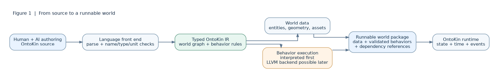
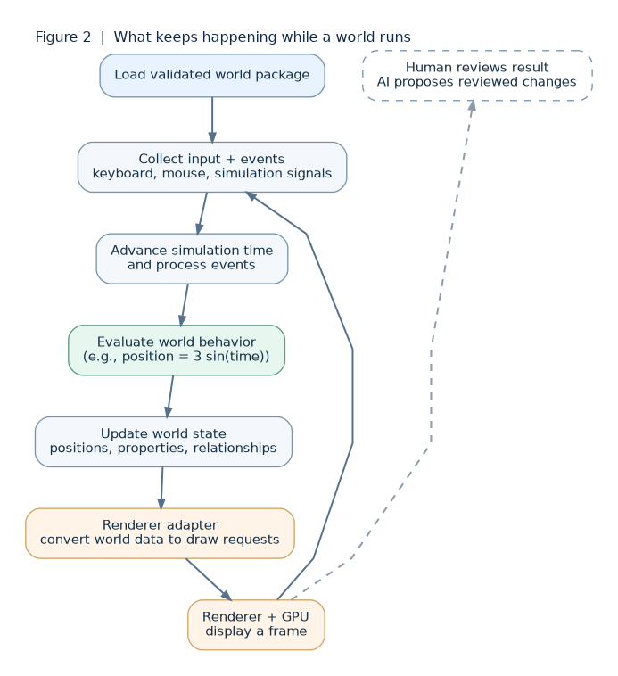
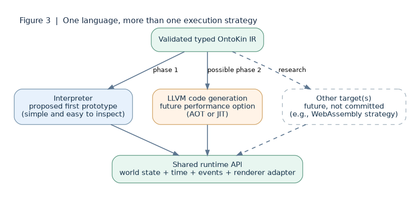

# OntoKin: Compilation and Runtime Architecture

**Document:** OK-003  
**Series:** OntoKin Project Documentation  
**Version:** 0.1, brainstorming draft  
**Date:** October 15, 2026  
**Status:** Architectural proposal, not an adopted implementation specification  
**Follows:** OK-002, *Language Foundations and Conceptual Minimal Specification*

> **Naming decision:** The project name is **OntoKin**. Earlier documents OK-001 and OK-002 were created under the working name *OntoKine*. Those documents are historical references; this document uses the newly confirmed name and does not silently revise their records.

> **Main idea:** OntoKin can be a new programming language without being based on C or C++. Its own front end would understand OntoKin programs. A runtime would maintain an interactive world. LLVM could eventually compile selected mathematical and behavioral code into machine code, but it is not necessary to prove the first version of the language.

## 1. Purpose and scope

The previous documents established the intended role of OntoKin: a mathematical language for describing interactive worlds that **humans can read and AI agents can inspect and edit**. This document explores the next question: **How could that language actually execute on a computer?**

It separates three responsibilities that are easy to confuse:

1. **Language and compiler:** understand OntoKin source, check its meaning, and prepare a valid representation of a world.
2. **Runtime:** maintain time, state, events, and the behavior of that world while the program runs.
3. **Renderer:** turn the current world state into an image. An existing renderer or game engine adapter is the preferred early experiment.

These are **proposed architectural boundaries**. No parser, compiler, runtime, renderer adapter, or executable OntoKin system has been built or verified by this document.

## 2. Does OntoKin need to be based on C, C++, or JavaScript?

**No.** A language's *syntax and meaning* are different from the machinery used to run it. C and C++ are separate languages that compilers can translate into machine code. Their machine-code targets do not make them "based on machine language" in the sense of requiring developers to write CPU instructions. JavaScript is generally executed by an engine that parses it and may interpret or just-in-time compile parts of it. These are implementation approaches, not rules that every new language must follow.

OntoKin could define its own words, statements, data types, mathematical expressions, and rules. It would still need software that reads those definitions, checks them, and executes them. **A novel language does not require a novel processor or a complete machine-code compiler built from scratch.**

### Three ways to execute a new language

| Approach | What happens | Strength | Tradeoff |
| --- | --- | --- | --- |
| **Interpreter** | A program reads validated OntoKin operations and performs them as the world runs. | Easier to inspect and change during early language design. | Repeated expression evaluation may be slower. |
| **Ahead-of-time (AOT) compilation** | Code is converted to native instructions *before* the world is launched. | Fast execution of prepared behaviors and potentially simple distribution. | Build steps and platform-specific binaries; changes may require rebuilding. |
| **Just-in-time (JIT) compilation** | Code is compiled while the application is running, usually when needed. | Supports optimized dynamic behaviors. | More engineering complexity and added execution/security considerations. |

An OntoKin **compiler** does not have to produce CPU machine code initially. It can compile source into a validated, typed representation that an interpreter runs. The term *compiled language* can therefore describe several implementations. We should define exactly what OntoKin compiles before choosing a label.

### What LLVM does, and does not do

**LLVM** is a collection of compiler technologies. Its **intermediate representation (LLVM IR)** provides a lower-level form for calculations, functions, and control flow. LLVM can optimize that representation and produce code for supported machine targets; its ORC infrastructure also supports JIT compilation. The OntoKin team would still have to build the language-specific front end and design the runtime. LLVM **does not automatically provide** entity definitions, game logic semantics, a physics engine, graphics rendering, or safe execution of untrusted programs. See the [LLVM frontend tutorial](https://llvm.org/docs/tutorial/MyFirstLanguageFrontend/), [LLVM IR reference](https://llvm.org/docs/LangRef.html), and [ORC JIT overview](https://llvm.org/docs/ORCv2.html).

## 3. Proposed separation: source, world model, execution, rendering



*Figure 1. Proposed compilation and package flow. The orange execution component may use an interpreter initially or an LLVM-based backend later. A "world package" means the runtime-ready result, not a settled file format.*

**Text equivalent:** Human/AI author OntoKin source → front end parses and validates it → typed OntoKin intermediate representation (IR) → world data and behavioral expressions are prepared separately → runtime-ready bundle → runtime.

### Why introduce a separate OntoKin IR?

An **intermediate representation (IR)** is a structured form between source text and execution. It is useful because the same world definition could be read by a human editor, checked by an AI assistant, interpreted for testing, and later compiled more efficiently.

For example, an entity named `Ball` might be represented internally by an identifier, a `sphere` geometry descriptor, a color value, an expression for its horizontal position, and a rule that responds to a key press. The internal form would contain **explicit typed fields**, rather than relying on an AI to guess what free-form text means.

This **OntoKin IR is not LLVM IR**. It preserves world concepts that LLVM does not know about. If LLVM is introduced, the compiler would lower suitable mathematical expressions or behaviors **from OntoKin IR into LLVM IR**. Scene data, relationships, assets, and renderer settings would usually be stored as validated data or managed through runtime APIs rather than forced into machine-code instructions.

The proposed abstraction is:

```text
OntoKin source
   -> parser and semantic checks
   -> typed OntoKin world IR
       -> world data / scene descriptions
       -> executable behaviors (interpreter first; LLVM later if useful)
   -> runtime-ready world bundle
```

**No extension or serialization format is assigned here.** Names such as "world bundle" and "OntoKin IR" describe roles, not finalized APIs.

## 4. What the compiler front end needs to do

| Stage | Plain-language purpose | Illustrative output or error |
| --- | --- | --- |
| **Read and tokenize** | Recognize names, numbers, operators, and punctuation. | Tokens for an entity declaration and an equation. |
| **Parse** | Check that statements follow the language grammar and form a syntax tree. | A syntax error pointing to a missing expression. |
| **Resolve references** | Check whether an entity, property, function, or event actually exists. | `Unknown entity: Sphere2`. |
| **Type and unit checking** | Check compatible values and mathematical operations. Units are a candidate feature, not an adopted rule. | Reject adding a position vector to a color. |
| **Validate world semantics** | Enforce world-level rules and acceptable event or state references. | Reject duplicate identifiers or an unsupported event. |
| **Generate typed OntoKin IR** | Convert valid source into inspectable structured data. | A world graph and typed expression nodes. |
| **Prepare execution output** | Interpret behavior now, or lower selected code to a native backend later. | A runnable package, or a build error with a source location. |

The front end should produce **human-readable diagnostics** and **machine-readable diagnostics** using the same underlying information: error code, message, source location, related object identifier, and possible fix if known. This is particularly important when a future AI agent proposes changes.

## 5. What the runtime does after compilation



*Figure 2. The runtime repeatedly evaluates changes to the world and asks the renderer to show the current state. Feedback from the person or AI can lead to a later validated revision; it is not itself a rendering step.*

**Text equivalent:** Load bundle → collect input/events → advance simulation time → evaluate behavior → update world state → renderer adapter → renderer/GPU displays frame → repeat. Human/AI observations can initiate a separate edit-and-validate cycle.

Compilation happens **before** execution for an AOT path, or for individual behaviors **during** execution if a JIT path is chosen. Neither approach means an AI must generate every frame. A running application can evaluate the *same* mathematical rule thousands of times with changing inputs.

The runtime is responsible for at least five ongoing tasks: **world state**, **simulation time**, **events and input**, **behavior evaluation**, and **calls to the renderer adapter**. Advanced physics, collision handling, networking, and asset streaming are later integration questions rather than assumed first-version features.

**Time requires a precise contract.** For example, the runtime could maintain a simulation clock that stops when an object is paused, even while the user interface continues processing input. A fixed simulation update step may improve reproducibility. Whether OntoKin will require fixed steps or support other timing models remains open.

### Does LLVM render the world?

No. LLVM could compile a mathematical function used to compute a position, a curve, or another calculation. The runtime calls that function and supplies its result to a **renderer adapter**. The renderer then uses graphics APIs and often the GPU to produce pixels. Graphics shaders have their own compilation and execution paths; a normal LLVM CPU backend is not, by itself, a GPU rendering pipeline.

## 6. Walk through one example

Imagine the same first experiment proposed in OK-002: **a blue sphere moves left and right, and Space pauses or resumes it**.

The next sketch is **not official OntoKin syntax**:

```text
world Demo
    entity Ball
        shape = sphere(radius: 1)
        color = blue
        horizontal_position = 3 * sin(simulation_time)
        on Space_pressed: toggle_motion()
```

**At compilation time**, the language front end would check the `Ball` definition, ensure `sin` receives a suitable numeric input under whichever time/units convention is eventually adopted, and represent the shape, properties, motion rule, and event action in OntoKin IR. The mathematical expression could initially remain a small expression tree evaluated by the interpreter. In a later LLVM implementation, that behavior could be compiled into an efficient function.

**At runtime**, the engine creates the sphere, advances simulation time, evaluates its horizontal position, updates the entity, and sends its position to the renderer. When Space is pressed, the runtime updates a state value. The runtime must define how that state affects the motion clock or position so that "pause" has the intended meaning.

**What does not happen:** OntoKin does not need to recompile the source for each frame, and an AI is not required to compute each position or paint each pixel. The renderer does not need to understand OntoKin syntax.

For clarity, even if the expression `3 * sin(t)` is converted into native machine code, **the runtime still controls which time value `t` is passed in** and when the function is called. That is the distinction between **compiled behavior** and **live world state**.

## 7. Where should LLVM fit in the roadmap?



*Figure 3. A suggested evolution path, not a promise to support multiple backends. The runtime API is the stable conceptual boundary, so the language is not tied to one compilation strategy.*

**Text equivalent:** Validated OntoKin IR → an interpreter in the first prototype; later, potentially an LLVM backend for AOT or JIT execution; perhaps other output targets in the future. Each path should interact with shared runtime services.

### Candidate approaches

| Strategy | Benefit | Cost or risk | Present recommendation |
| --- | --- | --- | --- |
| **Direct interpretation of typed OntoKin IR** | Fastest way to test whether the language actually describes a useful world. | Performance constraints for complex behaviors. | **Prototype first.** |
| **Translate OntoKin to C++ or another established source language** | Can reuse mature compilers and libraries. | Introduces generated-source complexity, language leakage, and debugging problems. | Useful alternative to evaluate, not required. |
| **LLVM backend for selected behaviors** | Native optimization, AOT builds, possible JIT later. | Compiler integration, toolchain maintenance, native-code trust and debugging. | **Research after language semantics stabilize.** |
| **Other formats or targets, including possible WebAssembly route** | May broaden deployment choices. | Runtime integration and platform/tooling tradeoffs. | Future question; not a v0.1 requirement. |

**Why not start directly with LLVM?** LLVM is powerful, but it cannot tell us what a world, an entity, or an event *means*. Those definitions have to be stable enough for an accurate front end and runtime. An interpreter allows the same moving-sphere experiment to test the important semantics before spending substantial effort on native code generation. LLVM can be added behind the OntoKin IR boundary if performance measurements justify it.

This recommendation still permits **compiled OntoKin programs** in the future. "Interpreter first" is a research sequence, not a rejection of native compilation.

## 8. What the renderer adapter should guarantee

The initial renderer should be treated as an **implementation detail behind an adapter**. A sphere's radius and current position in OntoKin should keep the same intended meaning regardless of the chosen graphics library, within documented differences and capabilities.

For a minimal prototype, the runtime-to-renderer contract could contain: stable entity identifiers; create/update/remove notifications; basic shape type; position and orientation; color or material; camera configuration; and a frame presentation request. A separate contract should send **input events back to the runtime**.

It is not necessary to select a custom GPU pipeline or physics engine before proving this contract. Existing tools can display the first scene. Later requirements will determine whether an adapter is sufficient or a dedicated OntoKin renderer is warranted.

## 9. What makes the system suitable for humans and AI?

The important feature is **a precise, inspectable model**, not simply the ability to generate source code with an AI. A future AI agent should be able to request: "Change only the sphere's movement amplitude from 3 to 2," and receive a targeted, reviewable edit rather than rewriting the entire world.

A proposed safe edit cycle is:

1. A human provides intent, or an authorized AI agent proposes a specific change.
2. The editor produces a **diff or structured patch** against a known world version.
3. The front end validates syntax, types, references, and applicable policy restrictions.
4. A human can review and approve changes where required.
5. The runtime loads the new validated version; state-preserving hot reload is an **optional future feature**, not assumed behavior.
6. Errors include stable codes and locations that both human and AI can use to repair the change.

The AI should not receive unlimited execution privileges simply because it authored a world. OntoKin should distinguish **editing a definition**, **building executable code**, and **running it** as separate permission boundaries.

## 10. Practical engineering constraints

- **Untrusted programs:** Native code and JIT output are not inherently sandboxed. Validate inputs and consider process isolation, limited capabilities, and resource budgets before running untrusted AI-generated programs.
- **Reproducibility:** Decide the clock and event order, and test whether repeated simulations produce compatible results. Hardware-dependent floating-point results may still vary unless the project defines and implements stricter rules.
- **Performance:** Measure scene size, expression evaluation cost, build times, and frame times before committing to LLVM. High frame rate is not proof that compilation is necessary.
- **Platform support:** Native targets, binary formats, libraries, and graphics backends vary by operating system. A portable world description is not automatically a portable executable.
- **Compatibility:** Version the OntoKin source format, typed IR schema (if serialized), world package, and renderer/runtime interfaces separately when they become real.
- **Error handling:** An AI needs actionable structured diagnostics; a human needs the same problem explained in straightforward terms.
- **Debugging:** Preserve source-to-IR locations so errors in a running world can be traced back to the corresponding OntoKin declaration.
- **State during edits:** Reloading compiled behavior may require rebuilding or transferring live state. This must be specified before advertising "instant edits."

## 11. Suggested proof-of-concept sequence

These are **proposed experiments**, not an implementation commitment.

| Phase | Build just enough to test | Exit criterion |
| --- | --- | --- |
| **A. Define one tiny scene** | One world, one sphere, color, motion equation, one Space event. | A person and an AI can both describe the expected behavior unambiguously. |
| **B. Parse and validate** | A minimal source parser, identifiers, type checks, typed OntoKin IR, useful errors. | Valid source produces consistent IR; deliberate errors are rejected with clear diagnostics. |
| **C. Headless runtime** | Simulation clock, state, event, interpreter for the motion rule, no renderer required yet. | A test can assert positions and pause/resume behavior at known simulation times. |
| **D. Renderer adapter** | Display the sphere through an existing graphics system. | The sphere moves and responds to Space without recompiling each frame. |
| **E. AI-assisted edit test** | Change a single typed property; validate and review a diff. | Changes are targeted and invalid edits are safely rejected. |
| **F. LLVM feasibility study** | Compile **one** numeric behavior from the same typed IR and compare it with interpretation. | Results meet a defined tolerance and performance/complexity measurements justify any next step. |

An early success is a trustworthy **source → validation → running interactive scene** path, not a large feature list.

## 12. Decision register: agreements, proposals, unresolved questions

| ID | Item | Status |
| --- | --- | --- |
| **OK-003-D01** | The project name for new documentation is **OntoKin**. Earlier *OntoKine* records remain historical references. | **Confirmed by the human participant**, October 15, 2026. |
| **OK-003-D02** | Documentation must be understandable to humans and structured enough for future AI collaborators, with diagrams where useful. | **Previously agreed**, carried from OK-002. |
| **OK-003-D03** | The language describes interactive worlds; a runtime evaluates them and a separate renderer displays them. | **Previously agreed direction**, carried from OK-002. |
| **OK-003-P01** | Introduce a typed, world-specific OntoKin IR between source syntax and execution. | **Proposed**. |
| **OK-003-P02** | Interpret a minimal OntoKin IR first; investigate LLVM later for compiled behaviors. | **Recommended research sequence**, not approved implementation. |
| **OK-003-P03** | Keep renderer integration behind an adapter and use an existing renderer for the first experiment. | **Carried-forward proposal** from OK-002. |
| **OK-003-P04** | Separate world data, executable behaviors, and runtime APIs at the compiler/runtime boundary. | **Proposed**. |
| **OK-003-O01** | Exact grammar, file extension, type system, numeric/units semantics, and serialized IR format. | **Open**. |
| **OK-003-O02** | Interpreter versus AOT/JIT in eventual releases; native target(s); LLVM commitment. | **Open**. |
| **OK-003-O03** | Clock semantics, event ordering, pause rules, and deterministic execution guarantees. | **Open**. |
| **OK-003-O04** | Renderer/physics choices, security model, live editing, and AI permission boundaries. | **Open**. |

**Instruction for future AI collaborators:** Do not treat the **P** entries as approved implementation instructions or invent technical standards for **O** entries. Check with the human project owner before deciding matters that substantially constrain the language or runtime. When a prototype is authorized, record its scope, dependencies, assumptions, and results in a new revision or implementation document.

## 13. Short glossary

| Term | Meaning in this document |
| --- | --- |
| **Compiler front end** | The part that reads source text, checks the language rules, and produces a structured representation. |
| **Parser / syntax tree** | The parser recognizes language structure; the resulting tree captures that structure. |
| **Semantic analysis** | Checks meaning such as names, types, and the validity of references. |
| **IR (intermediate representation)** | A structured form between source code and execution. OntoKin IR preserves world concepts; LLVM IR supports lower-level computation. |
| **AOT** | Ahead-of-time compilation, before an application runs. |
| **JIT** | Just-in-time compilation, while an application is running. |
| **Runtime** | Software that manages state, time, events, and evaluation of a running world. |
| **Renderer adapter** | The boundary translating OntoKin world state into operations supported by a graphics system. |
| **Native code** | Instructions generated for a specific processor and platform environment. |
| **Hot reload** | Updating parts of a running application without restarting everything; not yet defined or implemented for OntoKin. |

## 14. Technical references and provenance

These primary references substantiate the described LLVM capabilities, **not** the proposed OntoKin architecture:

- LLVM Project. [My First Language Frontend with LLVM Tutorial](https://llvm.org/docs/tutorial/MyFirstLanguageFrontend/). Illustrates parsing a new language, generating LLVM IR, JIT execution, and object code.
- LLVM Project. [LLVM Language Reference Manual](https://llvm.org/docs/LangRef.html). Defines LLVM's intermediate representation.
- LLVM Project. [ORC Design and Implementation](https://llvm.org/docs/ORCv2.html). Documents LLVM's modular JIT compilation infrastructure.

**Source of project-specific decisions:** Human–AI design discussion on October 15, 2026, plus the earlier OK-002 *Language Foundations and Conceptual Minimal Specification* (which still bears the historical *OntoKine* name). The architecture, examples, tables, and figures in this document are **new conceptual proposals**, not quotations from LLVM and not records of implemented features.

---

*End of OK-003, version 0.1. Prepared for review by a human project owner and future AI development agents. No compiler/runtime implementation or benchmark is claimed.*
