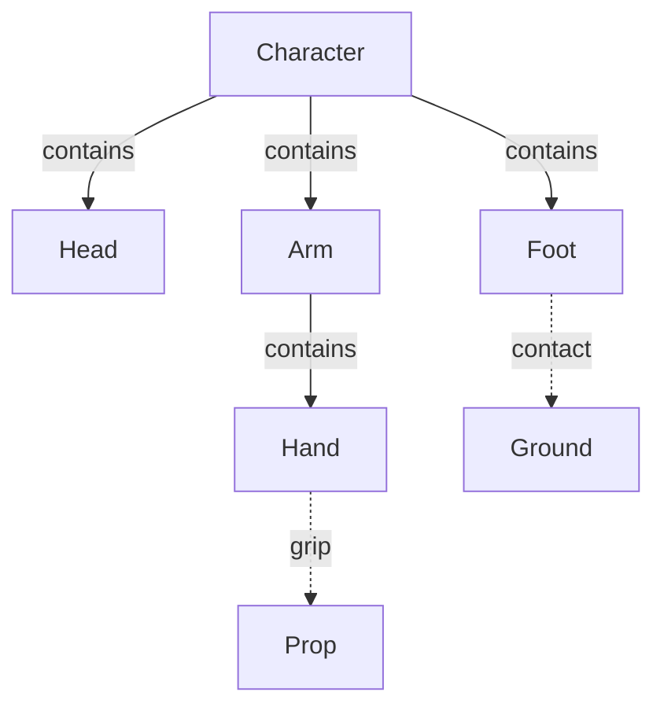

# OntoKin: Modeling, motion, and object structure

**High-level language capabilities for AI-authored 3D models and animation**

| Document control | Value |
| --- | --- |
| Identifier | OK-CAP-001, version 0.1 |
| Date | October 16, 2026 |
| Status | Draft for concept review. |
| Purpose | Define what OntoKin should create and the object, motion, and physical meanings it must express. |
| Current focus | Modular 3D models, characters, props, and short animations. |
| Direction | Increasingly complex virtual worlds assembled from reusable objects. |
| Relationship | Conceptual companion to OK-PRD-001 v0.2 and the repository's three founding documents. |
| Decision level | Capability requirements and conceptual relationships. Grammar and implementation remain open. |

## 1. Language purpose and current direction

**OntoKin is a proposed object-oriented modeling and animation language designed primarily for AI agents. It defines reusable 3D objects, their constituent parts, appearance, physical properties, permitted movement, and interactions. Its first purpose is to create complete models and short animations. Those models should remain usable as building blocks for larger virtual worlds.**

The agent should work with meaningful objects: a character with hands and feet, a tree with branches and foliage, or a mechanism with connected moving parts. The language system must give those descriptions explicit meaning and provide supported ways to turn them into visible, moving results.

The project owner's latest clarification establishes these priorities [U1]:

- Strong object orientation, including classes, subclasses, object instances, properties, and operations.
- Recursive composition: objects contain identifiable objects that may contain further parts.
- Independent control of a part together with coherent movement of the complete assembly.
- Physics and mechanics as foundations of the model's meaning.
- Exterior shape, appearance, and visible behavior, with no requirement to model biological interiors.
- Efficient reuse and gradual growth from small models and animations toward virtual worlds.

AI agents are the primary authors and operators. Human understanding remains necessary for directing, reviewing, and correcting the work; it does not change the primary audience. Games are one possible use of the resulting content. The broader purpose is the creation of virtual objects and worlds.

This is a capability definition rather than another complete product requirements document. The earlier PRD already contains detailed requirements for many of these ideas. This companion clarifies their relationships and records the narrower initial focus. The current owner clarification governs differences in emphasis or scope. [P1]

## 2. Object orientation and modular structure

### 2.1 Four relationships that need different meanings

The user's body example combines four relationships. OntoKin must be able to express each one explicitly.

| Relationship | Meaning | Example |
| --- | --- | --- |
| Class inheritance | A specialized type reuses or refines the definition and contract of a more general type. | HumanCharacter is a kind of Character. |
| Object composition | A complete object contains independently identifiable parts. | A character has an arm; an arm has a hand; a hand has fingers. |
| Spatial parenting | A part's position and orientation are expressed relative to a reference frame that moves with another object. | Moving the forearm carries the hand's frame while preserving the hand's local pose. |
| Mechanical connection | A relationship permits, limits, or couples movement and physical interaction. | A wrist joint connects hand and forearm; a grip connects hand and prop. |

A hand is a part of a human, rather than a subclass of Human. A MechanicalHand could be a specialized kind of Hand. This distinction preserves both the requested class hierarchy and the requested hierarchy of parts. The C++ Core Guidelines provide a relevant distinction between type specialization and containing another object; that principle does not require OntoKin to use C++. [S1]

The hierarchy organizes an assembly, but it cannot describe every connection. Two hands may grip the same object. A foot contacts ground outside the character. These relationships must remain expressible without confusing ownership or giving a part incompatible spatial parents. MuJoCo similarly distinguishes nested bodies and joints from relationships that refer to multiple bodies. [S4]

*Figure 1. A simplified part hierarchy with connections to other objects. Only selected parts are shown. Containment organizes the character; grip and contact add mechanical relationships. Spatial frames and physical representations are defined separately.*

### 2.2 What an object should expose

An object should have a stable identity, a class, parameters, properties, permitted operations, and inspectable relationships. A composite object also exposes its meaningful parts. An agent can operate at the level appropriate to the task: the whole character, one arm, a hand, or a finger.

A reusable class should supply defaults and useful behavior contracts. Instances retain their own state and supported overrides. The system must distinguish changing one instance, changing a reusable part definition, and changing a class used by many instances.

Encapsulation means that a module exposes understandable controls while managing its internal construction. It does not prevent an authorized agent from inspecting the structure needed to diagnose a problem. Parameterized assets in Houdini demonstrate a useful precedent: a character or prop can expose a small set of controls while containing a more complex reusable construction. [S14]

Compatible replacement is part of modularity. Replacing a hand should preserve the surrounding model when the replacement satisfies its attachment and behavior requirements. A different attachment size or movement range must trigger an adjustment or a clear incompatibility report. Superficial similarity is insufficient.

Class specialization and compatible interfaces should allow different object families to support the same operation in their own way. The exact rules for inheritance, method selection, and interfaces belong in the later language specification. Strong object orientation at the authoring level does not dictate the runtime's memory layout.

## 3. Physics, mechanics, and animation

Mechanics is part of physics. It concerns motion, forces, and the behavior of bodies and connected systems. For OntoKin, the useful distinction is between **shared physical conditions** and **the mechanisms and controls of particular objects**.

| Concept | Role in OntoKin |
| --- | --- |
| Physical environment | Conditions such as gravity, wind, surrounding media, and illumination, with a declared scope. |
| Physical properties | Mass, inertia, friction, stiffness, flexibility, and other properties relevant to the chosen model. |
| Object mechanics | Joints, attachments, contact, support, limits, and the transmission of motion or forces. |
| Kinematics | Descriptions of position, orientation, and movement without deriving them from forces. |
| Dynamics | Motion determined through forces, mass, inertia, and constraints. |
| Animation control | The intended pose, action, trajectory, timing, or target supplied by the author. |

These responsibilities interact. Gravity influences a falling character; joints keep its parts connected; its parts may rotate relative to one another. A wind condition can influence hair, clothing, and foliage, while their materials, attachments, and response models determine the resulting movement. PhysX documents the distinction between force-driven motion and prescribed kinematic targets; Modern Robotics explains how contact and forces constrain manipulation. [S6] [S7]

**Consistent physical meaning does not require identical responses from every object.** An anchored tree, flexible leaf, loose prop, and posed character may participate in different supported ways. A model's physical participation and approximations must be discoverable. A disabled effect or simplified response must not silently appear to be a complete physical simulation.

Gravity must apply to the physical mass represented by the model without duplicating that mass at every descriptive level. If the character's represented parts already account for its mass, a parent container must not add another complete character's mass. A parent may represent physical material of its own. Its own mass must be distinguished from the total mass of the assembly, so each physical contribution is counted once. This is a required accounting rule inferred from the separation between logical assembly and physical representation. [P1: OBJ-011] [S6]

Physical laws and environmental conditions are not simply copied from a parent object as class properties. Class defaults, spatial relationships, and physical response are different mechanisms.

## 4. How whole-object and local motion work together

### 4.1 Walking while looking to the side

A character needs both a placement in the world and local poses for its parts. Moving the character through the scene carries its parts through the scene. The head can retain its own orientation relative to the body. This use of local and accumulated transforms is established in hierarchical scene representations. [S2]

The intended result is:

1. A walking action coordinates the body, legs, and feet within a supported motion model.
2. A separate action turns the head relative to the torso.
3. The left hand can perform another permitted action.
4. Stopping the walk follows its declared stopping behavior and does not automatically erase the head's independently controlled pose.

Looking right relative to the torso and looking continuously at a stationary object are different instructions. The latter requires a world-space target whose relationship to the moving character changes. OntoKin must make the intended reference frame explicit.

A walking cycle can move legs while the character stays in place. Forward locomotion requires a defined relationship between body movement, limb movement, and ground contact. An initial animation may use authored movement with stated contact assumptions. Physically generated walking requires an appropriate controller and contact model. Naming an object Human does not, by itself, provide arbitrary walking or balance capability.

### 4.2 Independent control and physical coupling

Changing the left hand's authored pose should not rewrite the right hand's authored pose. That independence does not imply that the parts are physically isolated. A joint, contact, balance rule, or load may affect the larger assembly.

A prop can follow a hand through a declared grip. Alternatively, moving a prop toward a target may require the hand and arm to follow through a constraint or control system. A two-handed grip adds another connection. These are explicit relationships, rather than automatic consequences of nesting.

On release, the grip ends and the prop continues according to its current state and applicable physical model. A simple supported attachment can establish the initial behavior. Finger contact, slipping, and detailed grip forces can use richer models later. [S7]

### 4.3 A clear source of movement

Each controlled property must have an understandable source of motion:

- Prescribed pose or animation.
- Dynamic response to forces and constraints.
- A controller that drives physical motion toward an authored target.
- A declared combination of these.

Two systems must not silently impose incompatible values on the same property. Concurrent actions on different parts should compose predictably; overlapping control requires a defined policy or a diagnostic. The policy must also define transitions, such as releasing a held object or switching a posed body to dynamic motion. The earlier PRD already identifies these concerns. [P1: PHY-014, ANM-018]

An AI authoring agent should be able to inspect why a part moved. An AI language model is not required to calculate every simulation step or rendered frame. [P2]

## 5. Exterior models with sufficient physical support

The current modeling boundary is the object's visible exterior and the supporting information needed for its behavior. A clothed character may be represented primarily through clothing and exposed skin. A tree needs bark, branches, and foliage. Organs, biological tissue, and internal botanical processes are outside the current focus.

Exterior scope still permits an invisible rig, joint locations, simplified collision shapes, mass distribution, and deformation controls. These are functional representations rather than a requirement for internal anatomy.

| Representation | Purpose |
| --- | --- |
| Logical object and parts | What an agent identifies, edits, assembles, and reuses. |
| Visible geometry and appearance | The surfaces, materials, textures, and details that are rendered. |
| Animation controls | The structure used to pose and deform the model. |
| Physical representation | The bodies, contact shapes, properties, and constraints used for supported physical behavior. |

These representations need explicit mappings, but they need not have identical subdivisions. A continuous skin can cover multiple named parts; vertices can respond to several joints. A logical hair or foliage group may use an appropriate aggregate representation. Requiring each semantic part to be a separate mesh and simulation body would unnecessarily restrict this model. [S3] [S5]

Flexible response belongs to the intended language capabilities. Hair research demonstrates models based on bending and twisting; procedural vegetation research illustrates approximate responses to a shared wind field. The language should disclose which kind of response it supplies. Approximate surrounding-fluid forces can also be modeled without computing a complete evolving fluid volume. [S8] [S9] [S10]

Light and liquids remain part of the broader physical direction. Basic lighting and material appearance are relevant to the first previews. Flowing liquids, buoyancy, and more complex optical behavior can grow through declared capability levels. Their inclusion does not imply that the first motion system must solve all fluid dynamics or electromagnetism. Physically based rendering itself uses physical models selected for a visual purpose. [S11]

## 6. High-level capability requirements

The following requirements consolidate the owner direction and its design implications. They are proposed language requirements for concept review, not a claim that an implementation exists or that every behavior ships in the first prototype.

| ID | Capability | Required meaning |
| --- | --- | --- |
| CAP-01 | Object-oriented definitions | Support reusable classes, subclasses, instances, typed properties, operations, encapsulation, and compatible specialization. |
| CAP-02 | Recursive parts | Give meaningful sub-objects their own identities, properties, and permitted behavior within a complete assembly. |
| CAP-03 | Controlled reuse | Distinguish shared definitions from instance state; support scoped overrides and compatible part replacement. |
| CAP-04 | Model creation | Generate and revise complete 3D geometry and appearance through supported mathematical, procedural, parameterized, and reusable constructions. Accept existing geometry where useful. |
| CAP-05 | Related representations | Preserve mappings among logical parts, visible surfaces, animation controls, and physical models without forcing them to share one subdivision. |
| CAP-06 | Explicit connections | Represent containment, spatial frames, joints, attachments, contact, and other necessary cross-object relationships separately. |
| CAP-07 | Meaningful quantities | Associate positions, orientations, dimensions, times, and physical values with defined units and reference frames. Exact notation remains open. |
| CAP-08 | Concurrent motion | Support reusable actions with clear targets, timing, start/stop behavior, and rules for maintaining poses and combining controls. |
| CAP-09 | Coordinated behavior | Provide supported ways to coordinate whole-object movement and local parts, including contact expectations; expose the limits of generated actions. |
| CAP-10 | Physical properties | Represent relevant mass, inertia, material response, and physical connections; keep aggregate quantities consistent without double-counting. |
| CAP-11 | Environmental response | Allow applicable objects to respond to shared physical conditions according to their properties, constraints, and declared response model. |
| CAP-12 | Motion authority | Distinguish prescribed, dynamic, and controlled physical movement and define how they interact or change over time. |
| CAP-13 | Useful abstractions | For supported object families, supply reusable construction and behavior capabilities so agents do not rebuild routine geometry, rigs, or physical setup for every asset. |
| CAP-14 | Agent inspection | Expose relevant types, parts, parameters, defaults, relationships, dependencies, and control sources in structured form. Allow focused inspection. |
| CAP-15 | Actionable verification | Return localized diagnostics and inspectable results. Distinguish valid definitions, constructed models, successful behavior, and acceptable visual results. |
| CAP-16 | Reusable delivery | Preserve an editable native description and support external viewing or delivery with explicit records of preserved, converted, and unsupported features. |
| CAP-17 | Efficient flexibility | Permit shared assets, focused regeneration, and independently chosen visual and physical detail while exposing the consequences of customization. |
| CAP-18 | Progressive composition | Keep small assets reusable in larger scenes and worlds. Add domain capabilities without requiring every object to use the same behavior model or detail level. |

An operation such as changing one hand should have a precise edit scope and produce a reviewable change. Structural validation must not be presented as proof of convincing animation or physical fidelity. The glTF Validator demonstrates machine-readable reporting of asset errors; that kind of feedback supports agent repair without resolving artistic judgment. [S16]

Repeatable evaluation should record the source and dependency versions, relevant inputs, random seeds, and execution settings. Numerical guarantees require later definition and measurement.

## 7. Initial focus, growth, and meaningful examples

### 7.1 Scope progression

| Horizon | Intended scope |
| --- | --- |
| First modeling focus | Complete exterior characters and props with modular parts, parameterized variation, appearance, posing, and short animations. |
| Initial behavior demonstrations | A limited supported set of concurrent motions, attachments, gravity/contact, and a simple flexible environmental response. These demonstrate the concept rather than define a release schedule. |
| Growing virtual scenes | More interacting objects, richer mechanisms, hair/clothing/vegetation behavior, liquids, reusable environments, and broader delivery support. |
| Long-term world ambition | Progressively larger connected environments, planets, and universe-scale settings. Physical scope, precision, detail, and computational limits must remain explicit. |

A valid model can exist before every desired behavior is supported. An unavailable walking controller should not prevent creating and inspecting the character. Conversely, successful geometry creation does not establish that walking, simulation, or export has succeeded. This follows the earlier PRD's distinction between represented, constructed, animated or simulated, and delivered results. [P1: AGT-006, BIO-014, AC-18]

The following scenarios clarify the intended capabilities through small, observable demonstrations. Algorithms and numerical thresholds remain open.

| Scenario | What it should demonstrate |
| --- | --- |
| Create and vary a character | Construct visible geometry and identifiable parts; create a second instance and change one compatible hand without silently changing the first. |
| Walk and look | Combine supported walking and head motion; stop the walk while preserving the head's declared pose or target behavior. |
| Carry and release | Make a prop follow a grip, then end the grip and continue with a declared physical response. |
| Lose support and fall | Let a dynamically participating assembly fall while its mechanical connections remain meaningful; avoid duplicate mass or motion. |
| Respond to wind | Use one wind condition with hair or foliage and a rigid object; obtain different responses explained by their properties and supported models. |
| Repair a local error | Identify an invalid relationship or conflicting control and correct it without replacing unrelated model definitions. |
| Deliver a short animation | Produce a viewable result and state whether motion remains editable/live or has been recorded for playback. |

## 8. Efficiency, interoperability, and the next definition

Modularity must remain practical at different scales. Repeated objects should be able to share definitions, while an agent can request a local variation deliberately. Shared data and arbitrary independent edits have costs and restrictions; OpenUSD instancing provides a concrete example of that tradeoff. OntoKin must make edit scope and resulting resource implications understandable. [S13]

Visual detail and physical detail should be chosen separately. A distant character does not necessarily need the same surface or simulation detail as a close view of its hand. The conceptual model should permit selective loading, evaluation, and regeneration. This does not promise a particular speed, memory usage, or world size.

An external asset format does not automatically preserve OntoKin's classes, procedural definitions, controllers, or physical behavior. An export may preserve a supported behavior, translate it, or bake it by recording evaluated motion over time. The native definition must remain available for further work. OpenUSD distinguishes scene description from rigging, while glTF's core animation representation leaves important playback choices to applications. [S12] [S15]

The next conceptual deliverable should be a **minimal semantic model**: precise meanings for one reusable object class, one instance, a nested part, a local frame, a connection, a motion source, and a physical response. It should express the walk-and-look and carry-and-release examples on paper before implementation choices are made.

Decisions still open include exact class and inheritance rules, syntax, geometry operations, units notation, motion-combination rules, the first supported body plans, physical fidelity levels, and output contracts. Compiler technology, runtime storage, rendering systems, solvers, and schedules remain later decisions.

## 9. Relationship to earlier work

The earlier PRD already separates ownership, transforms, physical connections, and deformation; requires independently scoped motion; and covers walking while looking. This document retains those ideas and makes them central to the explanation. It strengthens explicit object orientation, changes the initial priority from game production to modeling and short animation, and places detailed biological interiors outside the current focus. [P1]

| Earlier reference | Treatment here |
| --- | --- |
| LNG-004, LNG-005, LNG-011 | Strengthen the explicit class, subclass, and operation requirement while leaving formal language rules open. |
| OBJ-002, OBJ-003, OBJ-005, OBJ-006, OBJ-018 | Retain and explain modular parts, separate relationships, scoped reuse, and local/whole-object movement. |
| OBJ-011, PHY-014, ANM-009, ANM-013, ANM-018 | Retain physical accounting, motion authority, secondary motion, and concurrent actions. |
| BIO-015 | Detailed muscles, tendons, soft tissue, and biological interiors are outside the present modeling focus. |
| ENV-006, NFR-013 | Retain separate visual/physical detail and focused regeneration. |
| PRD sections 9 and 10 | Treat broad full-product coverage and numerical acceptance proposals as later context, not prerequisites for the first modeling capability. |

The identifier **OK-CAP-001** creates a capability-definition companion without reusing **OK-004**, which the previous roadmap reserved for renderer integration. No earlier document or requirement identifier is renumbered.

## Sources and project basis

The owner brief establishes the intended product. The project documents establish prior context. The technical sources below support specific modeling distinctions and precedents; they do not establish that a particular implementation is selected or that OntoKin has demonstrated these capabilities. Primary sources were checked October 16, 2026.

**[U1] Project owner clarification, October 16, 2026.** Current conversation: strong object orientation; nested parts; independent and coordinated motion; exterior modeling; physical response; modeling and short animation first; virtual worlds as the longer-term purpose.

**[P1] OntoKin product requirements document, OK-PRD-001 v0.2, October 16, 2026.** Existing standalone project document, reviewed in full. Its prior requirements remain proposals subject to the current scope clarification.

**[P2] OntoKin repository documents at commit cfadf988e627112e9cf24ad9787d9b861e97d32d.** [OK-001: Project vision](https://github.com/Omegapy/OntoKin/blob/cfadf988e627112e9cf24ad9787d9b861e97d32d/Defining_Ontokin_Docs/OK-001/OntoKin_001_Project_Vision_and_Architecture.md), [OK-002: Language foundations](https://github.com/Omegapy/OntoKin/blob/cfadf988e627112e9cf24ad9787d9b861e97d32d/Defining_Ontokin_Docs/OK-002/OntoKin_002_Language_Foundations_and_Minimal_Specification.md), and [OK-003: Compilation and runtime](https://github.com/Omegapy/OntoKin/blob/cfadf988e627112e9cf24ad9787d9b861e97d32d/Defining_Ontokin_Docs/OntoKin_003_Compilation_and_Runtime_Architecture_Package/OntoKin_003_Compilation_and_Runtime_Architecture.md).

**[S1] Stroustrup and Sutter, C++ Core Guidelines, C.120.** [Class hierarchies](https://isocpp.github.io/CppCoreGuidelines/CppCoreGuidelines#c120-use-class-hierarchies-to-represent-concepts-with-inherent-hierarchical-structure-only). Distinguishes genuine specialization from containment; used for the conceptual distinction only.

**[S2] Khronos Group, glTF Tutorials.** [Scenes and nodes](https://github.khronos.org/glTF-Tutorials/gltfTutorial/gltfTutorial_004_ScenesNodes.html). Local transforms and accumulated placement through a hierarchy.

**[S3] Khronos Group, glTF Tutorials.** [Skins](https://github.khronos.org/glTF-Tutorials/gltfTutorial_020_Skins.html). Joint influences and deformation of a continuous visible surface.

**[S4] Google DeepMind, MuJoCo documentation.** [Modeling](https://mujoco.readthedocs.io/en/stable/modeling.html). Nested bodies, joints, coordinate frames, and relationships involving multiple bodies.

**[S5] Google DeepMind, MuJoCo documentation.** [Overview](https://mujoco.readthedocs.io/en/stable/overview.html). Distinct roles for bodies, geometry, sites, constraints, and deformable representations.

**[S6] NVIDIA, PhysX 5.8.0 documentation.** [Rigid body dynamics](https://nvidia-omniverse.github.io/PhysX/physx/5.8.0/docs/RigidBodyDynamics.html). Mass properties, gravity, forces, constraints, and kinematic control.

**[S7] Lynch and Park, Modern Robotics.** [Grasping and manipulation](https://modernrobotics.northwestern.edu/nu-gm-book-resource/grasping-and-manipulation/). Grip, contact constraints, friction, and force transmission.

**[S8] Google DeepMind, MuJoCo documentation.** [Fluid forces](https://mujoco.readthedocs.io/en/stable/computation/fluid.html). Approximate forces from a surrounding medium without full fluid-state simulation.

**[S9] Bertails et al. (2006).** [Super-helices for predicting the dynamics of natural hair](https://researchportal.ip-paris.fr/en/publications/super-helices-for-predicting-the-dynamics-of-natural-hair-2/). Research precedent for bending and twisting in a mechanical hair model. Publication abstract reviewed; no algorithm is adopted.

**[S10] Zioma, GPU Gems 3, chapter 6.** [GPU-generated procedural wind animations for trees](https://developer.nvidia.com/gpugems/gpugems3/part-i-geometry/chapter-6-gpu-generated-procedural-wind-animations-trees). A historical example of hierarchical vegetation and approximate wind response; its hardware claims are not used as current performance evidence.

**[S11] Pharr, Jakob, and Humphreys, Physically Based Rendering, 4th edition.** [Photorealistic rendering and the ray-tracing algorithm](https://pbr-book.org/4ed/Introduction/Photorealistic_Rendering_and_the_Ray-Tracing_Algorithm). Physical models for light, surfaces, and image formation.

**[S12] OpenUSD documentation.** [Introduction to USD](https://openusd.org/release/intro.html). Reusable scene composition and the distinction between scene description and rigging.

**[S13] OpenUSD documentation.** [Scenegraph instancing](https://openusd.org/release/api/_usd__page__scenegraph_instancing.html). Shared definitions and the restrictions and costs of independent instance edits.

**[S14] SideFX, Houdini documentation.** [Introduction to digital assets](https://www.sidefx.com/docs/houdini/assets/intro.html). Encapsulated, parameterized, reusable assets with exposed controls.

**[S15] Khronos Group, glTF 2.0 specification.** [Animation](https://registry.khronos.org/glTF/specs/2.0/glTF-2.0.html#animations). Animation representation and application-defined playback behavior; export does not establish complete source-language semantics.

**[S16] Khronos Group.** [glTF Validator](https://github.com/KhronosGroup/glTF-Validator). Structured reports for invalid asset data, references, and supported features.
