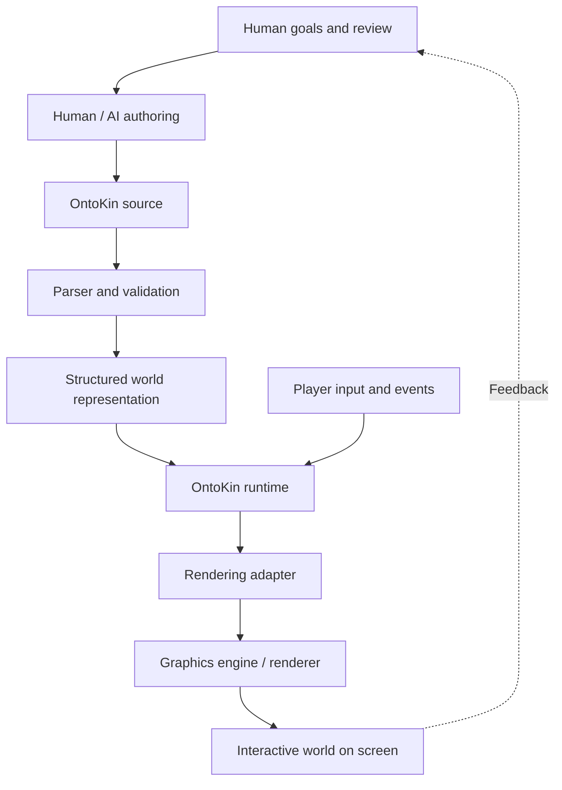

# OntoKin

**An AI-native mathematical programming language for interactive virtual worlds.**

OntoKin (pronounced **ON-toh-kin**) is a proposed programming language for describing, creating, and animating virtual worlds through mathematics and explicit rules. The goal is to make it possible for **AI agents and human developers** to work with the same structured world descriptions, rather than requiring an AI to operate a graphics editor through its interface.

OntoKin is intended for interactive 2D and 3D environments, video games, animation, and simulation. A world could define its objects, geometry, properties, motion, relationships, and responses to input. The language would describe the world; a runtime would execute its behavior; and a renderer would turn the current scene into visible images.

> **Project status:** Early concept and architecture exploration. The documentation records goals, proposals, and open questions. A working OntoKin compiler, runtime, or rendering engine has **not** been released.

## The idea

Existing tools such as Blender and game engines already use mathematics for geometry and animation. OntoKin's proposed focus is **AI-native authoring and verification**: a language designed from the beginning so that AI agents can inspect, generate, validate, and modify individual parts of a world, while humans can understand the definitions and direct or approve changes.

The aim is to support:

- **Mathematical world descriptions:** Shapes, spatial properties, transformations, and motion expressed as data and mathematical rules.
- **Interactive behavior:** Events, state changes, constraints, and responses to player input.
- **Human and AI collaboration:** Readable source for developers and structured, verifiable representations for AI agents.
- **Renderer independence:** The same underlying world definitions should not be tied permanently to one graphics engine.
- **Incremental development:** Validate the language with small examples before attempting a full virtual-world engine.

## Proposed architecture



The proposed compiler would first check and transform OntoKin source into a structured representation. The **runtime** would manage time, world state, and behavior as the scene changes. A **rendering adapter** would connect that state to an existing graphics system. Using an interpreter first, and potentially an LLVM-based compilation backend later, are architectural options under investigation, not finalized implementation decisions.

### Conceptual example

The following is **illustrative pseudocode**, not a finalized OntoKin syntax:

```text
world Demo {
    entity Ball {
        geometry: sphere(radius: 1.0)
        position(t): (3 * sin(t), 0, 0)
        color: rgb(0.2, 0.6, 1.0)
    }
}
```

The moving sphere is defined by an equation rather than a stored sequence of animation frames. During execution, the runtime would evaluate its position over time, and the renderer would draw the current result.

## Defining OntoKin: project documents

The [`Defining OntoKin Docs`](Defining_OntoKin_Docs/) directory contains the numbered documents created during the initial human–AI design discussions:

| Document | Topic | Purpose |
| --- | --- | --- |
| **OK-001** | Project Vision and Initial Architecture | Explains the origins, goals, intended use cases, and high-level system design. |
| **OK-002** | Language Foundations and Conceptual Minimal Specification | Explores what the language should describe and how people and AI might work with it. |
| **OK-003** | Compilation and Runtime Architecture | Examines parsers, intermediate representations, interpretation, LLVM, the runtime, and rendering integration. |

These documents are **design records**, not finished technical standards. Where relevant, they distinguish ideas already agreed upon from recommendations and unresolved decisions. Their diagrams are intended to help both people and future AI collaborators understand the architecture.

## Direction of development

The first proposed milestone is intentionally small: define a valid OntoKin world containing a sphere, move it with a mathematical expression, and respond to a simple player input. This would test the complete path from authoring and validation to runtime execution and real-time rendering.

Later work may explore more expressive geometry, physics integration, game-engine adapters, optimized compilation, AI-guided structured editing, and possibly a dedicated renderer. Those capabilities remain research and engineering goals.

## About the name

**OntoKin** combines **onto-**, referring to ontology (what exists and how entities relate), with **kin-**, referring to kinematics (motion). Earlier drafts used the working name *OntoKine*; **OntoKin** is the current project name.

---

*OntoKin is currently a concept-stage research and development project. This README describes its intended direction, not implemented functionality.*
