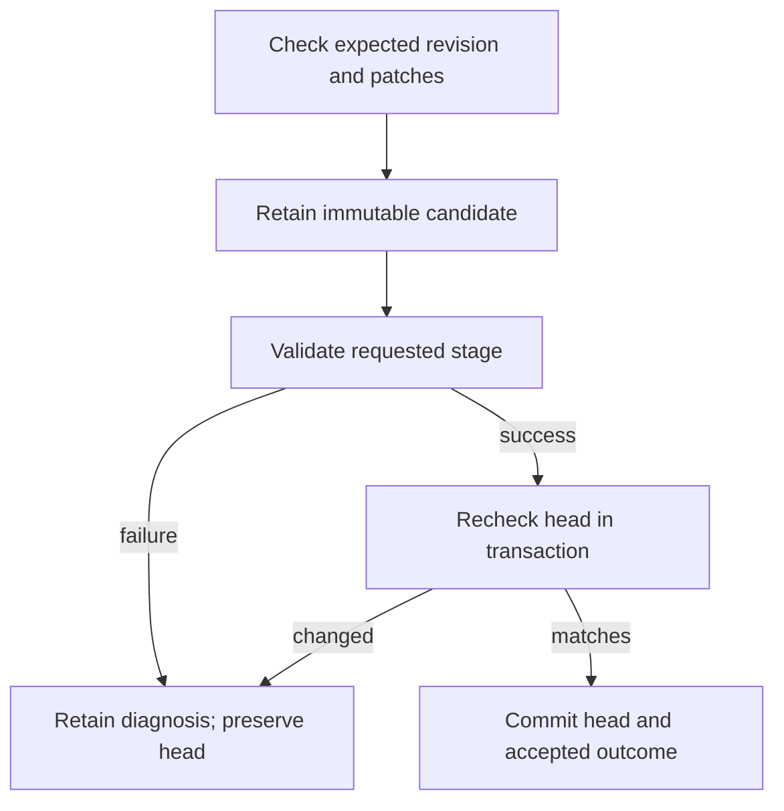
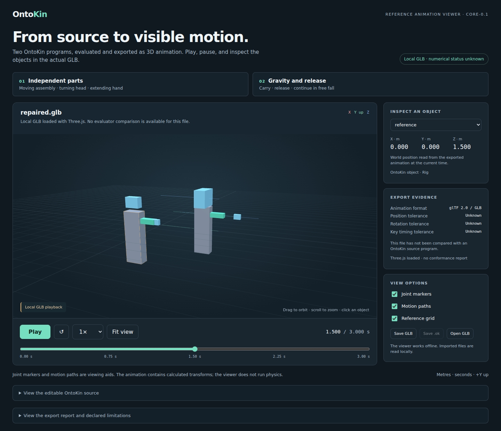

# AI agent authoring and inspection interface

## 1. Objective and authority

Give an agent an executable path to discover OntoKin, create source, inspect a specific revision, diagnose and repair a local problem, evaluate its behavior, and obtain the resulting 3D animation. Every result must identify the source and run that produced it. A failed candidate must remain available for diagnosis while preserving the accepted project.

The project owner's October 18, 2026 stewardship instruction authorizes this finite milestone toward the mission in [GOAL.md](../../GOAL.md). The complete product goal includes reusable programming abstractions, richer models and mechanisms, purposeful actions, and the broader domains retained there. A local authoring service does not satisfy that entire goal.

[OK-LANG-001 section 11](../language-design/OK-LANG-001-core-language-specification.md#11-ai-agent-authoring-inspection-and-repair-contract), rules LANG-025–028, defines the source-authority, operation, retry, inspection, and diagnostic requirements. [Section 13.4](../language-design/OK-LANG-001-core-language-specification.md#134-agent-operation-cases) supplies A01–A10. This document selects a concrete local implementation of those contracts. It does not replace the adopted source semantics or reinterpret the historical requirement-coverage register as completed implementation.

[OK-ENG-001](OK-ENG-001-core-reference-implementation-and-conformance-plan.md) established the parser, validator, and evaluator. [OK-ENG-002](OK-ENG-002-3d-scene-animation-export-and-visual-validation.md) established primitive scene generation, GLB export, and visible playback. This milestone connects those capabilities to durable authoring operations. `ontokin.glb/0.1` is the explicitly named destination extension; an unnamed `delivered` request remains unsupported.

**Evidence status:** local implementation, protocol, transaction, source-regression, animation, and browser checks have passed for the identified 0.3.0 implementation. Section 12 records the measured results and their limits. GitHub publication and CI for this new implementation remain pending; the finite release gate is not yet closed.

## 2. Scope and identities

The first service uses Python's standard library and a local SQLite store. A project contains one named UTF-8 source file, immutable snapshots of that file, an accepted-revision pointer, durable request records, runs, inspection continuations, and binary artifacts. The [store implementation](../../ontokin/agent_store.py) maintains `agent.sqlite3` in the chosen store directory. It adds no HTTP server, authentication system, distributed scheduler, module/package resolver, or hosted language-model provider.

| Identity | Meaning |
| --- | --- |
| `project_id` | Namespace for one source project and its requests, snapshots, runs, and artifacts. It is not a filesystem path or an access-control credential. |
| `request_id` | Nonempty identity of one canonical operation within the project. Retrying it cannot create a second effect. |
| `source_revision` | Immutable identity of exact snapshot bytes, including a rejected candidate. It does not imply successful validation or acceptance. |
| `accepted_revision` | Project head accepted by a successful create/edit at its requested level. It is null before the first successful create. |
| `run_id` | Identity of a particular initialized/evaluated history for one source revision. Different runs may refer to the same source. |
| `element_id` | Stable source identity path supplied by the language, distinct from an object's display name or position. |
| `artifact_id` | Identity of a retained output whose metadata supplies its source revision, byte length, MIME type, and SHA-256. |
| Inspection cursor | Continuation of one bounded query in its pinned context. It is not permission to inspect a newer head or a later sample. |
| Implementation identity | Package version and a SHA-256 over the Python package source used for the request/run. Source equality alone does not imply the same evaluator implementation. |

An accepted historical revision remains identifiable after the project advances. Runs stay pinned to their original revision. Ordinary evaluation/reset may use an accepted historical snapshot; a rejected candidate can only have an isolated diagnostic run produced by validation. A repository commit may contain source and evidence, but it is not a protocol revision or simulation run.

Source is authoritative. Inspection indexes, elaborated objects, run descriptors, and GLBs are derived views. The service never maintains a second editable object graph that can diverge from `.ok` bytes. Preserving the SQLite store preserves the retained protocol history; publishing the project source in Git is a separate repository action.

Identical source bytes share their source revision within a project. The first stored filename is the canonical diagnostic filename for those bytes; submitting another filename does not mutate that immutable snapshot. A changed implementation cannot replay an old run and relabel the result as its original history. Retained terminal responses still retry exactly, and retained source/run descriptors remain readable for reconciliation. Queued work recorded for another implementation is rejected before effects; a deliberate reset can start accepted source under the current implementation.

Keep the Python package unchanged for the life of a service process. After updating the package, restart the Python process before opening the store; closing and reopening an instance in the same process does not reload cached Python modules. The implementation identity is pinned for the loaded process. This binding provides no hot reload or live package-change watcher.

## 3. Public interface

### 3.1 Python and JSON Lines

The public entry point is [AgentService](../../ontokin/agent.py):

```python
from pathlib import Path
from ontokin.agent import AgentService

service = AgentService(Path("/tmp/ontokin-agent-store"))
try:
    result = service.handle(request, wait=True)
finally:
    service.close()
```

`request` is a JSON-compatible dictionary conforming to the [request schema](../language-design/agent-v0.1/request.schema.json). `submit(request)` persists an ordinary job and returns its queued envelope, or returns the appropriate existing result for a retry. Status/cancellation are handled without waiting behind the work they address. `work_next()` processes one available job and returns whether work was taken. `handle(request, wait=True)` provides a convenient local wait for a result. `close()` releases the service resources.

`read_source(project_id, revision)` retrieves the retained `Source`; `get_run(project_id, run_id)` retrieves its durable descriptor; `accepted_revision(project_id)` reads the current accepted head. `expire_result(project_id, request_id)` is an explicit local maintenance operation that retains an unknown-outcome tombstone. It is not a source-edit operation or permission to repeat a forgotten effect.

The command-line binding is:

```bash
python3 -m ontokin agent --store /tmp/ontokin-agent-store
python3 -m ontokin agent --store /tmp/ontokin-agent-store --request request.json --wait
```

The default input is one JSON object per line. Ordinary work is queued for the local worker; status and cancel requests can observe or interrupt it. Each input line receives one JSON response. A queued receipt is not followed by an unsolicited terminal response: obtain that outcome with `status`, or use `--wait` to process requests synchronously. The default worker drains queued work when input reaches EOF. With `--request FILE` and no `--wait`, the invocation records the request without starting a worker for it.

JSON decoding rejects duplicate object members, invalid UTF-8, non-finite numbers, and oversized requests. A malformed JSONL line receives an explicit error; the following line can still be processed. Request identity, rather than a client's current editor buffer or screen order, ties each response to its operation.

### 3.2 Request and result context

Every request identifies `schema_version: "ontokin.agent/0.1"`, `project_id`, `request_id`, and `operation`. The schema specifies required operation fields and rejects unsupported members rather than silently ignoring a misspelled option. The [protocol validator](../../ontokin/agent_protocol.py) also checks semantic combinations and byte limits. Exact times use nonnegative decimal seconds strings with no exponent or sign. UTF-8 byte offsets are integers, not character indices.

Count, budget, and offset fields require JSON integer tokens: use `1`, not `1.0` or a Boolean. Standard JSON Schema's mathematical `integer` category can accept `1.0`; this concrete transport/runtime restriction is an additional check, just as UTF-8 byte caps are additional to string-shape validation.

The [response schema](../language-design/agent-v0.1/response.schema.json) separates request status, requested/achieved level, source/accepted revision, run identity, diagnostics, protocol errors, and operation payload. A queued operation is not a successful evaluation. An achieved lower level explains partial progress; it does not turn rejection of a higher request into success.

| Operation | Main request data | Observable effect |
| --- | --- | --- |
| `discover` | Profile, optional supported catalog filters, bounded limit | Return versioned language/operation capabilities, domains, defaults, examples, stages, and unavailable behavior. Discovery describes the implemented profile; it does not certify a particular program. |
| `create` | `filename`, full `source`, `expected_revision: null`, `requested_level`, budgets | Store one candidate; accept it only when the requested stage succeeds and the project still has no accepted revision. |
| `edit` | `expected_revision`, nonempty `patches`, `requested_level`, budgets | Form one candidate against the expected accepted snapshot; atomically accept it only after its requested checks and the final head precondition succeed. |
| `validate` | `source_revision`, `requested_level`, budgets | Check that snapshot without changing the accepted head or advancing an existing run. Evaluated validation creates an isolated run through the full horizon. |
| `inspect` | `source_revision`, `selector`, `fields`, `limit`; optional cursor, run, time, frame | Read source or an already available evaluated interval. Never advance time. |
| `evaluate` | Accepted `source_revision`, `run_id` or null, `until_seconds`, budgets | Create or continue a matching run forward to the requested prefix, with an explicit valid interval. |
| `reset` | Accepted `source_revision` | Create a distinct run at initialization; retain prior runs. |
| `status` | `target_request_id` | Return the known state/outcome of a prior request without executing it again. |
| `cancel` | `target_request_id` | Cancel pending work or disclose that acceptance/completion already occurred. |
| `export` | `source_revision`, `destination: "ontokin.glb/0.1"`; optional `options`, budgets | Produce and retain a revision-bound GLB and its conversion report without changing the editable source. |
| `artifact` | `artifact_id`; optional `offset`, `max_bytes` | Return a base64-encoded chunk with byte/hash/source metadata and the next offset. |

`export` and `artifact` are concrete delivery operations added by this binding. They do not change the nine language-level operation meanings. The exact request shapes, limits, and allowed settings are maintained in the versioned schema rather than inferred from this table.

### 3.3 Discoverable language catalog

[agent_catalog.py](../../ontokin/agent_catalog.py) supplies `ontokin.agent-catalog/0.1` data with a content-derived `revision`. It includes the validator's complete built-in type/quantity-alias and callable name sets, callable signatures/result types/domains, object fields and defaults, read-only value members, sites/joints/events, supported feature descriptions, unavailable capabilities, and the named GLB destination. Complete source fixture references accompany context-dependent snippets. Discovery returns descriptions; it does not run their examples or establish program validity.

A text `filter` searches catalog records. An object filter combines exact `kind`, `name`, and/or `capability` fields; for example, `{"kind":"builtin","name":"sphere"}` finds the radius-based geometry constructor. Item names distinguish `Object.geometry` from `sphere`. The discovery cursor pins catalog revision, profile, and filter so a catalog change cannot silently alter continuation.

Capability values in these records are discovery labels. They do not introduce supported source extensions: this core still reports a nonempty `requires` declaration as unavailable construction. A quantity type such as `Force` also does not imply a force solver. Catalog metadata includes the prototype's numeric limitations and does not claim universal correct rounding, all-time range proofs, or full product conformance.

## 4. Candidate acceptance and scoped edits

Create/edit acceptance has two separate checks: the candidate must reach its requested stage, and the expected accepted head must still hold when acceptance commits. Validation can take place outside the final transaction. Another request can advance the project in the meantime; an older candidate must then be rejected as stale. A successful transaction records the accepted pointer and its corresponding request outcome together.



The `expected_revision` field implements LANG-025's expected accepted revision. It is not an instruction to patch whichever revision is currently open in a client. A stale precondition, malformed patch, or patch-scope error cannot partially update accepted source. If valid patch preconditions produce an invalid candidate, diagnostics identify that candidate's bytes and it remains inspectable.

Every patch supplies `element_id`, `start_byte`, `end_byte`, `expected_text`, and `replacement`. The service verifies all of the following before forming the candidate:

- The half-open range lies within the original snapshot and both boundaries align with UTF-8 characters.
- The selected bytes exactly equal the UTF-8 encoding of `expected_text`.
- The named stable element exists and grants that writable source span.
- Patches do not overlap; two insertions at the same byte offset conflict.
- The completed source respects the source-size and operation budgets.

All patches use coordinates in the same original snapshot. The operation applies them together, preserving bytes outside their selected ranges. Rebinding and validation happen on the complete candidate. The service performs no implicit rename repair, dependency removal, semantic merge, or comment rewrite outside the submitted patches.

An inherited value does not grant an occurrence writable access to the shared class declaration. To change one sphere's radius, inspect that occurrence and insert or edit its initializer override. To change the shared default, explicitly target its definition identity in the `definitions` namespace. The acceptance workflow must demonstrate that a scoped override leaves an unselected sibling and the shared declaration unchanged.

Inspection's `source.initializer_target` identifies the enclosing occurrence and public parameter path when a local override is available. It does not make an inaccessible private/nested path writable. Normal parameter edits and identifier renames preserve occurrence keys; replacing an occurrence with another class definition requires a new occurrence key. The service compares the complete before/candidate object identity map and rejects a comparison that exceeds its result budget instead of checking only a truncated subset.

Diagnostic repair coordinates belong to the diagnostic's `source_revision`, which can be rejected. A client may repair that candidate locally, then calculate new patches against the current accepted revision. It must not submit the rejected candidate's offsets as if they belonged to the accepted source. When no accepted revision exists, submit corrected full source with a fresh `create` identity.

## 5. Requests, retries, cancellation, and recovery

### 5.1 Durable request identity

The store retains the canonical request and its lifecycle/result. JSON member order does not distinguish otherwise identical requests; meaningful values and array ordering do. A repeated identity with the same canonical payload returns its recorded in-progress or terminal result. A changed payload under that identity returns `OKL-E-REQUEST-ID` and cannot repeat or replace its original effects.

The protocol statuses are `queued`, `running`, `succeeded`, `rejected`, `failed`, `cancelled`, and `unknown_outcome`. Validation rejection, numerical failure, and resource exhaustion remain distinguishable through diagnostics and progress data. Ordinary retries must work after closing the service and reopening the same store, including from another Python process.

Status queries have their own request identities and are idempotent too. A new observation uses a new status request ID with the same `target_request_id`; retrying the old status request returns its original observation. A query for an unknown target can itself succeed while its nested target outcome is `unknown_outcome` with disposition `unknown_identity`. It supplies no invented source location or permission to replay unknown work.

### 5.2 Cancellation and the commit boundary

Cancellation of a queued operation prevents it from beginning its acceptance work. Running work checks cancellation cooperatively. The observable boundary is the committed effect: if an edit has already accepted its candidate, cancellation must return that accepted result. It cannot claim the old source was restored or invent a cancelled state after success.

The same rule applies when the client loses contact with the worker. A transport interruption alone does not establish whether an effect committed. The client queries the recorded request and reconciles source/run context before deciding what to do next.

### 5.3 Tombstones and crash recovery

The service must retain a result or a tombstone. Explicit result expiry changes the retained outcome to `unknown_outcome`; it does not delete the identity so a retry can execute again. A tombstone discloses that the original operation outcome is unavailable and requires reconciliation. Source snapshots, accepted history, run records, and artifact identities supply context for that reconciliation; none makes an unobserved replay automatically safe.

The store uses write-ahead logging and `synchronous=FULL`. Accepted source changes, run updates, artifact bytes, and the corresponding terminal request result share the final SQLite transaction. Source candidates may have been retained earlier, but a candidate's existence does not establish that acceptance committed.

Queued requests remain eligible for a worker after restart. Each running request belongs to a recorded local worker session. On opening a store, recovery marks a request `unknown_outcome` only when its worker session is closed or its local process can be established to have ended. Linux process-start information disambiguates a reused process ID. A live worker, a worker recorded on another host, or one whose liveness cannot be established is not displaced merely because time passed. A request fenced by recovery is never automatically requeued. Closing a service with unfinished owned work also retains an unknown-outcome record.

Sources, request identities/results or tombstones, runs, and artifacts have no automatic expiry in this profile. Explicit `expire_result` discards the retained result payload while keeping the original request identity/digest fenced against replay. The store is not a storage-quota or garbage-collection service. These are the implemented recovery/retention decisions; the independently executed restart and crash cases are reported separately in section 12.

This is a local service for cooperating processes using the same store. SQLite durability and expected-head transactions do not establish a distributed consensus service, remote permissions, high availability, power-loss behavior on every filesystem, or an exactly-once external renderer side effect. The operations retained here act on the local store.

## 6. Bounded inspection

`inspect` accepts a combination of `element_id`, `kind`, `path`, `class_name`, `role`, and `relation` selector fields. Nominal class selection includes compatible subclasses; relation selection identifies the connection/follow record and its participating objects/sites. Names assist discovery, while stable IDs and revision context determine edit scope.

The selected field groups are:

| Group | Returned meaning and limits |
| --- | --- |
| `identity` | Kind, stable key path, display name, class/definition revision, role, owner, and child identities. |
| `source` | Revision-bound declaration/definition spans and writable scopes. Full source text is bounded by the source-size limit. An expanded inherited occurrence does not acquire its definition's writable bytes. |
| `values` | Typed canonical values, displayed units, origin/source, dependency identities, and resolved/stale status. |
| `geometry` | Authored geometry and appearance, kept distinct from the generated display mesh. |
| `matter` | Body model, own mass, owned aggregate mass, and disclosed sphere inertia. Connected-load results are explicitly unavailable in this core. |
| `relations` | Object frames, sites, following and joint endpoints, coordinates/offsets, current authority when sampled, prescribed physical interpretation, and disabled collisions. |
| `actions` | Action/description identity, target, channel, authored duration/parameters, and available lifecycle/current values. |
| `state` | Source/run/sample context, available interval, world pose, world-measured velocity, angular velocity, and existing evaluator state. |
| `support` | Profile, stage availability, budgets, assumptions, requested capabilities, and unavailable operations. |

Value origins use the adopted categories `authored`, `inherited`, `defaulted`, `derived`, `estimated`, and `unresolved`. This core does not silently create estimates. The implementation observes dependencies during pure elaboration; these records are the reads used to calculate effective values, not a guarantee of a minimal incremental rebuild plan. Display units use disclosed canonical presentation rather than claiming to preserve every original unit spelling.

An unresolved candidate can expose source and whatever stable declaration context was recovered. Unresolved effective values and physical state are labeled unavailable. A definition has no occurrence pose. A source-only request for current state returns unavailable with `run_required`, not an invented initialization sample.

### 6.1 Pagination pins the observation

The explicit item limit is at most 1,000 and cannot exceed the request's result budget. A truncated result says so and returns `next_cursor`; a completed result returns null. The cursor binds the source revision, run, effective sample time and boundary side, frame, selector, and field set. A continuation cannot silently switch to a newer accepted revision or a later point in an advancing run. A mismatched context is stale/unavailable, not a fresh first page presented as continuation.

Inspecting the same context repeatedly leaves the durable run unchanged. A supplied time requires a matching run and must lie in its available interval. Sampling outside the authored horizon, beyond a failed boundary's last valid side, or using another revision's run yields an explicit `OKL-E-SAMPLE` result.

### 6.2 Frame meaning

World pose and world-measured center-of-mass velocity remain the defaults. A requested local pose applies the sampled inverse frame transform at the same exact time. Velocity components may be expressed in another frame's axes, but their `measured_in` field remains `world`. The service does not subtract that moving frame's translation or rotational velocity and label the result relative motion. A10 exercises this distinction with a moving, rotated frame.

## 7. Prefix runs and budgets

### 7.1 Full validation and partial evaluation

`create`, `edit`, and `validate` at `evaluated` request a fresh run from initialization through `scene.duration`, including the horizon's after-state. They never advance an existing run. If a candidate fails later in that timeline, its isolated diagnostic run identifies what was available before failure; the requested stage has not succeeded.

Explicit `evaluate` can request a shorter prefix through `until_seconds`. A null run identity creates a fresh run. A supplied run must exist, match the source, and move forward from its available endpoint. Evaluation of a prefix does not execute a later authored action simply to reject the earlier interval. Static source, typing, and support requirements still apply to the program.

`reset` produces a distinct run at `0` **before** the time-zero event transaction. Evaluating it through `0` produces the after-state, including any actions started there. Old runs retain their identities. If a transition fails at a later exact boundary, the descriptor can retain that boundary's before-state while explicitly denying its after-state and later samples. A failed run remains for diagnosis; start a new run deliberately rather than silently resuming beyond unresolved failure.

The bounded reference evaluates analytical trajectories and exact rational event times. Inspection or continuation may rebuild the deterministic prefix from the immutable source; it does not imply an incremental production simulation cache. Replayed work must still obey the declared budget.

### 7.2 Cooperative work limits

The initial runtime budget maxima are:

| Budget | Maximum/default | Meaning |
| --- | --- | --- |
| `max_objects` | 1,000 | Elaborated object occurrences. |
| `max_operations` | 100,000 | Instrumented semantic/evaluation/inspection work checkpoints. |
| `max_result_items` | 1,000 | Bounded returned records and relevant patch-list limits. |
| `max_elapsed_ms` | 30,000 | Elapsed local work checked cooperatively. |

A caller may request smaller positive integer budgets. Unknown budgets or values above the supported maxima are rejected. The existing source/parser/evaluator/exporter resource ceilings also apply; the agent budget is not permission to exceed them. Geometry and animation delivery retain the independent limits and tolerances of OK-ENG-002.

The protocol limits one canonical request to 4 MiB, one source snapshot to 2 MiB, a patch list to 1,000 entries, and an artifact chunk to 65,536 bytes. Byte limits and element-path limits are additional checks in the protocol validator; JSON Schema's structural shape alone does not enforce all of them.

An operation checkpoint is an implementation work counter, not a Python instruction, physical integration step, or a time-complexity guarantee. Cancellation and elapsed limits are cooperative. Work between checks, parsing, SQLite operations, and exporter phases may take time before control returns; this service does not promise hard real-time preemption or an operating-system memory cap.

The service keeps a request-wide counter and elapsed clock across patching, validation, and other runtime calls. Cancellation is polled when checkpoints execute, with a five-millisecond polling cadence during continuous checked work. The existing export kernels are checked before and after execution; they can overshoot a requested elapsed limit before reporting termination. Queue residence is separate from elapsed active work.

Resource exhaustion reports `resource_limit`, separately from invalid source, unsupported capabilities, or numerical failure. A result identifies any retained valid prefix; if no usable partial result was committed, it says so. No cancelled or exhausted job may advance the accepted source merely because a lower stage had passed.

A request-wide cancellation/resource termination discards uncommitted run advancement, source acceptance, and artifact bytes. Existing committed history remains available. This differs from an ordinary delivery failure after a completed isolated validation: that evaluation may be retained as explicitly named diagnostic evidence even though source acceptance and delivery did not succeed.

## 8. Named GLB delivery and artifact retrieval

The agent can request only the explicit `ontokin.glb/0.1` delivery contract supplied by OK-ENG-002. Generic delivery, another target name, live physics, and unsupported source behavior fail explicitly. Successful delivery means the bounded GLB conversion and its numerical checks succeeded; it does not mean Blender or every game engine was tested.

Create/edit/validate can request `requested_level: "delivered"` with `destination: "ontokin.glb/0.1"` and optional `options`. Destination settings with a lower requested level are rejected rather than ignored. An evaluated/delivered acceptance still requires the full authored evaluation horizon. `options.end` bounds an exported clip; it does not turn full-stage validation into the shorter-prefix `evaluate` operation or bypass the exporter's full-timeline preflight.

The service reads the immutable source bytes, validates/evaluates that revision, and exports through the existing scene/export implementation. The stored result contains an `artifact_id` and conversion report. The report's source identity must match the request revision; the stored bytes' SHA-256 must match their metadata. Export does not modify source, silently reuse a stale clip, or add another motion authority. A released body's track remains the evaluated world trajectory described by OK-ENG-002.

Artifacts are stored as SQLite BLOBs and retrieved through bounded JSON chunks. An artifact result identifies `artifact_id`, `offset`, `total_bytes`, `data_base64`, `next_offset`, `mime_type`, `sha256`, and `source_revision`. Each `max_bytes` request is at most 65,536; base64 increases the JSON representation's size. A client decodes and concatenates the chunks in order, verifies total size and the complete SHA-256, and writes the resulting `.glb` to its chosen path. An offset is a byte position in the stored artifact, not a source patch offset.

The source and conversion report remain necessary context. The GLB contains sampled motion and retained metadata, with declared approximation/loss; it cannot reconstruct all source classes, callables, comments, action arguments, or editable mechanical relationships. A bounded artifact response avoids embedding an arbitrary-size file in every status reply.

## 9. Diagnostics and honest outcomes

Source-related diagnostics retain [ontokin.diagnostic/0.1](../language-design/core-v0.1/diagnostic.schema.json), registered `OKL-*` codes, source-relative UTF-8 spans, stable identities where resolved, exact time/boundary context, relevant rule IDs, and blocked output levels. Export-specific details remain in the existing diagnostic `details` extension under the named destination contract.

A malformed protocol request may have no valid source snapshot. Its `protocol_error` identifies the request failure without fabricating a source diagnostic location or revision. Conversely, an invalid candidate that was stored has a real `source_revision`; its language diagnostic must refer to those actual bytes.

Response-schema validity does not establish correct source spans, atomic acceptance, numerical state, resource accounting, or retry semantics. Verification must execute those behaviors with real programs. Requests and responses must serialize as finite JSON; arbitrary Python objects and non-finite values are not valid output.

## 10. Acceptance cases

The following executable cases are required before closing this milestone. Their IDs and expectations come from the adopted language manifest; the service tests supply real requests and inspect resulting state. The existence of a test function is separate from its measured outcome in section 12.

| Case | Required observation | Executable coverage |
| --- | --- | --- |
| A01 | An edit with a stale expected head fails and preserves current accepted source. | `test_A01_stale_edit_preserves_current_revision` |
| A02 | A multi-patch candidate with a semantic error fails atomically; accepted bytes remain unchanged and candidate diagnostics remain inspectable. | `test_A02_invalid_multi_patch_candidate_is_atomic` |
| A03 | The same canonical request returns its original outcome without duplicate edits/runs, including reopening the store. | `test_A03_same_canonical_request_has_one_durable_effect` |
| A04 | Reusing an identity with different meaningful payload returns `OKL-E-REQUEST-ID`. | `test_A04_request_identity_cannot_change_payload` |
| A05 | Repeated inspection of the same revision/run/sample leaves the run unchanged. | `test_A05_inspection_is_repeatable_without_advancing_run` |
| A06 | A continuation cannot change revision, run, sample, frame, selector, or fields. | `test_A06_continuation_cannot_switch_context` |
| A07 | An unsupported higher stage/target cannot return downgraded success. | `test_A07_requested_support_is_not_silently_downgraded` |
| A08 | Cancellation after commit reports the accepted result. | `test_A08_cancel_after_commit_reports_accepted_result` |
| A09 | Result expiry retains an unknown-outcome tombstone, forbids automatic replay, and exposes reconciliation context. | `test_A09_expired_result_retains_unknown_outcome_tombstone` |
| A10 | Velocity expressed in rotated axes retains its world measurement frame. | `test_A10_rotated_velocity_keeps_world_measurement_frame` |

These functions live in [tests/test_agent.py](../../tests/test_agent.py). Additional required coverage includes UTF-8 comments and offsets; wrong element scope, expected text and overlapping patches; two competing queued edits; cancellation before work; independent-process retries and crash recovery; rejected first-create repair; isolated occurrence overrides; full-horizon validation versus shorter valid prefixes; reset before time zero; stale/missing runs; source-only unavailable state; and budget exhaustion without acceptance.

[Transaction tests](../../tests/test_agent_transactions.py) synchronize workers after real semantic computation to check competing candidate acceptance and run advancement. They also exhaust the actual deadline/operation check before commit, verify canonical filenames for identical bytes, and distinguish nominal replacement from a lexical rename. [Catalog tests](../../tests/test_agent_catalog.py) compare discovery's type/callable/object-field coverage with the executable validator, check content identity and mutation isolation, and feed the shown callable examples through real construction/evaluation. [CLI tests](../../tests/test_agent_cli.py) exercise JSONL and request-file transport with persistent stores, including malformed-line recovery. These are distinct from a schema-only shape check.

The integrated workflow must use the actual service to discover → create → inspect → reject an invalid candidate → repair with revision-bound patches → evaluate → export → retrieve and verify GLB bytes. It must show an unchanged sibling, exact source/artifact provenance, and compatible destination playback. Scripted requests establish an agent-usable protocol exercise. They do not establish that an LLM authored the program autonomously or that OntoKin improves authoring cost/quality over direct tools.

The [agent demonstration guide](../../examples/agent/README.md) describes that workflow. Its retained [workflow transcript](../../examples/agent/workflow.json) connects the initial source, rejected candidate, scoped repair, numerical inspections, and retrieved [repaired GLB](../../examples/agent/repaired.glb). The [driver](../../tools/build_agent_demo.py) uses the service for source acceptance, validation, run inspection, and output retrieval; its independent assertions check the intended edit and unchanged sibling. Reported execution status belongs to the actual transcript and section 12, not merely to the driver's existence.

## 11. Reproduction and evidence records

The [agent validation guide](agent-validation/README.md) indexes the actual retained results and their reproduction commands. The ordinary regression commands remain:

```bash
python3 -m unittest discover -s tests -v
python3 -m ontokin conformance --output /tmp/ontokin-core-conformance.json
python3 docs/maintenance/reorganization-2026-10-17/verify_reorganization.py
```

Agent-only service tests can be selected with:

```bash
python3 -m unittest discover -s tests -p 'test_agent*.py' -v
python3 tools/run_agent_conformance.py --output /tmp/ontokin-agent-conformance.json
```

The [agent conformance runner](../../tools/run_agent_conformance.py) executes the concrete A01–A10 test methods against fresh stores and retains their actual request/response observations. It checks the case map against the original manifest and reports skips/failures as unsuccessful cases. Its fixture digest identifies the tests, schemas, runner, manifest, and diagnostic contract used; the implementation digest identifies the runtime separately.

Build a new, isolated authoring demonstration and check its actual GLB with the pinned independent verification tooling:

```bash
python3 tools/build_agent_demo.py --output-dir /tmp/ontokin-agent-demo
npm ci --prefix tools
node tools/verify_gltf.mjs /tmp/ontokin-agent-demo --output /tmp/ontokin-agent-external.json
node tools/node_modules/playwright/cli.js install chromium --only-shell
node tools/verify_agent_viewer.mjs --demo-dir /tmp/ontokin-agent-demo --output-dir /tmp/ontokin-agent-browser
```

The exporter/service needs only Python's standard library. The pinned Node packages and Chromium installation are development verification tools, as documented in OK-ENG-002. The format/importer checker compares the retrieved GLB's Three.js playback against revision-bound samples from the agent inspection API. The browser checker opens the actual GLB in the offline viewer, compares selected world poses, exercises playback, and captures its rendered state. On a clean CI image, the Chromium installer additionally uses `--with-deps`. No Blender import result is inferred from these commands.

Use a separate temporary store for each independent experiment unless testing durability intentionally. Reusing a request identity is a retry of its original operation. Deleting a local store discards its retained history and is not a protocol reset or a demonstrated recovery procedure.

The evidence record must identify the implementation digest/revision, Python/environment, actual test cases and outcomes, workflow request/response context, source hashes, generated artifact hashes/settings, destination checks, and relevant exact-head CI. Existing ENG-001/ENG-002 reports remain historical; fresh regression results belong to this milestone's evidence directory.

## 12. Measured results and remaining work

### 12.1 Identified local results

The [validation summary](agent-validation/validation-summary.json) records the October 18, 2026 local checks for `ontokin-reference` **0.3.0**, `core-0.1`, `ontokin.agent/0.1`, and `ontokin.glb/0.1`. Python tests ran on **CPython 3.12.14, Linux**. The package-source SHA-256 is `8a2eae260e2adfb28d6e1fd254cfefdb5fe47841509122ec1ad01e515a311142`; this identifies the measured runtime independently of the pending GitHub commit. The summary also records sizes and hashes for the retained evidence files.

| Check | Measured result | Retained evidence |
| --- | --- | --- |
| Complete Python suite | **150 tests passed in 26.878 seconds**, including 47 new service, transaction, catalog, and CLI tests. | [unit-tests.txt](agent-validation/unit-tests.txt) |
| Actual agent-operation conformance | **A01–A10: 10 passed, 0 failed**, with fresh stores and retained requests/results. | [conformance.json](agent-validation/conformance.json) |
| Existing source conformance | **43 cases passed, 694 assertions, 0 failures**: 12 expected valid, 29 expected invalid/conflicting, 2 expected unsupported. This source command does not execute A01–A10; the separate report above does. | [core-conformance.json](agent-validation/core-conformance.json) |
| Integrated authoring cycle | **41 actual operations and 18 checks passed**, including rejection, an instance-only repair, an unchanged sibling, prefix evaluation, and bounded artifact retrieval. | [workflow.json](../../examples/agent/workflow.json) |
| Agent artifact format and playback | One **125,892-byte GLB**; Khronos reports **0 errors and 0 warnings**; Three.js loads it and passes **200 world-pose comparisons**. | [external-results.json](agent-validation/external-results.json) |
| Existing GLB regression | All **six** original/visual artifacts load; **347 world-pose comparisons** pass; Khronos reports **0 errors and 0 warnings**. | [legacy-external-results.json](agent-validation/legacy-external-results.json) |
| Actual browser playback | **8 checks and 16 world-pose comparisons passed**; rendered capture reviewed by the integration owner and documentation reviewer. | [viewer-results.json](agent-validation/viewer-results.json), [capture](agent-validation/agent-authoring.png) |

The persistence checks use real stores and semantic work. They include independent-process retries, two prepared candidate commits, competing prepared run extensions, cancellation before a prepared candidate commits, and recovery after a controlled worker termination. A live local worker is not stolen, and work/results from another implementation are fenced as specified in section 5. These results establish the tested local lifecycle and transaction behavior; they do not certify arbitrary power-loss recovery, every filesystem, or distributed execution.

### 12.2 Source, repair, and animation evidence

The [initial program](../../examples/agent/authoring-demo.ok) contains two occurrences of one reusable `Rig` class. A candidate that sets `head.radius` to `1[kg]` is rejected with a real unit diagnostic and retained as [rejected-candidate.ok](../../examples/agent/rejected-candidate.ok). The accepted head remains unchanged. A subsequent patch against the accepted bytes inserts the public instance override `head.radius = 0.35[m];` into `rig` alone. The shared class default and the `reference` occurrence retain `0.2[m]`. In this program, the radius parameter controls a box-shaped head's dimensions; the visual demonstration therefore compares a larger moving box head with the unchanged reference head.

The accepted [repaired source](../../examples/agent/repaired.ok) has SHA-256 `d9b63c16c2efc92e947b0a39564234d9e14693cc9afb32bcffeabd08350cc324`. The service retrieves [repaired.glb](../../examples/agent/repaired.glb) in four bounded chunks, reassembles the 125,892 bytes, and verifies SHA-256 `2cf4c92768ed6b5b07446f6b8e9d53ca13415a2596d8305f9401c2082bf92f3f`. The source, workflow, inspection references, conversion report, and independent importer checks agree on those identities.

The [conversion report](../../examples/agent/repaired.export.json) records 60 frames per second over 0–3 seconds, 181 keys, 893 validation probes, and 12,502 node-pose comparisons including display helpers. Against the decoded GLB, the maximum position component error is **1.6689300519345807 × 10⁻⁷ m**, the maximum rotation-angle error is **7.115158760987411 × 10⁻⁸ rad**, and the maximum time error is **1.1126200361033511 × 10⁻⁷ s**. They are within the requested 0.001 m, 0.001 rad, and 0.000001 s limits. These are the finite sampled checks specified by OK-ENG-002, not an all-time proof or a bound on a sphere's tessellated surface.

Independent checks use **Khronos glTF Validator 2.0.0-dev.3.10** and **Three.js r180**. Across 25 inspection samples and eight authored objects, Three.js's 200 comparisons have maximum position error **7.152557390810443 × 10⁻⁸ m** and rotation error **3.422854299336317 × 10⁻⁸ rad**. The six-artifact legacy regression has maximum position error **0.0003406810760497869 m** and rotation error **5.262958596067704 × 10⁻⁸ rad**. These reports preserve the sampled references and identify the actual bytes loaded.

The browser check uses **Playwright 1.56.1**, **Chromium 141.0.7390.37**, and **Three.js 0.180.0** on Linux with SwiftShader/WebGL2. It verifies the imported artifact at selected times, play/pause behavior, and selection of the unchanged reference. It reports no page errors or HTTP(S) requests. The actual rendered capture shows the two assemblies and their different head sizes:



The viewer's custom-file interface intentionally labels numerical validation as unknown when it has only the GLB. The independent reports establish validation for this specific source/artifact pair; the viewer does not infer that claim from an arbitrary uploaded file. The screenshot provides visual review evidence, while the numerical/format claims come from the identified checks. Blender import remains untested.

### 12.3 Release state and unmet scope

**Local gates have passed; GitHub publication and exact-head CI are pending.** No remote CI success for 0.3.0 is claimed here. The integration owner must publish the identified implementation and evidence, inspect its actual CI, and record that outcome in [STATUS.md](../../STATUS.md) and the validation summary before closing this finite release gate. Historical ENG-001/ENG-002 records remain unchanged.

The full OntoKin goal remains in progress. Unmet scope includes broader source modules and reusable libraries/generators; rich geometry and appearance; contact/general dynamics and mechanisms; creature/environment/control domains; multi-user authorization and distributed execution; calibrated performance guarantees; and a real agent-versus-direct-tool benchmark. The scripted workflow demonstrates a usable interface and observable repair. It does not certify autonomous LLM authoring or a productivity improvement. STATUS must continue to name the next unmet goal rather than declare OntoKin complete from this interface release.
