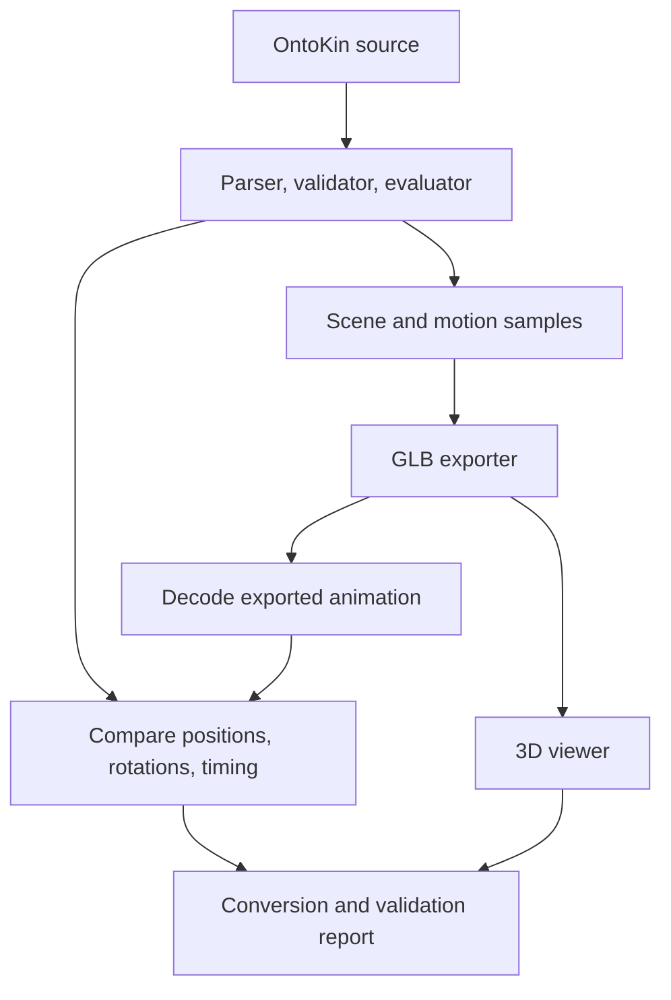

# OntoKin 3D scene representation, animation export, and visual validation

## 1. Objective and authority

Turn an evaluated OntoKin program into a visible, playable 3D animation. This milestone adds primitive meshes, a scene representation, binary glTF export, a conversion report, and visual demonstrations to the reference implementation. The source program remains the editable definition. The exported animation records its calculated movement over a finite interval.

The project owner's October 17, 2026 instruction authorizes this work and identifies two demonstrations: an assembly whose parts move independently, and a carried sphere that is released under gravity. This is the next bounded engineering step after [OK-ENG-001](OK-ENG-001-core-reference-implementation-and-conformance-plan.md). It does not adopt every draft product requirement or select a production compiler, physics engine, or graphical editor.

The adopted [OK-LANG-001 baseline](../language-design/OK-LANG-001-core-language-specification.md#16-engineering-baseline-adoption-and-clarifications) continues to govern source meaning. The exporter reads evaluated state; it does not introduce another motion authority. Existing language fixtures and their expected outcomes remain unchanged. The [PRD](../product/OK-PRD-001-product-requirements.md), [capability definition](../product/OK-CAP-001-modeling-motion-and-object-structure.md), and [semantic model](../language-design/OK-SEM-001-core-object-motion-and-physics-semantics.md) retain their recorded status and broader requirements.

## 2. What this milestone provides

| Component | Responsibility | Result and boundary |
| --- | --- | --- |
| Existing parser, validator, and evaluator | Read `.ok`, resolve definitions, validate the full timeline, and calculate world state. | Source-language behavior remains governed by `core-0.1`. |
| Scene builder | Associate source objects with generated geometry, appearance, sampled world transforms, and relationship metadata. | A derived inspection/export representation; it is not a replacement source language or a production intermediate representation. |
| Geometry generator | Produce visible spheres and boxes; optionally add aids for inspecting assemblies and joints. | Finite polygon meshes for preview. A visual aid supplies no matter, collision shape, or mechanical force. |
| GLB exporter | Serialize scene data and sampled animation under `ontokin.glb/0.1`. | One self-contained binary glTF 2.0 asset and a JSON conversion report. Playback has no live OntoKin controller or physics solver. |
| Numerical validation | Decode the emitted data and compare playback with reference evaluation. | Checks file values and interpolation at defined observations; no universal continuous-time accuracy proof. |
| Viewer and independent checks | Load the actual GLB in a rendering destination and run a separate format validator. | Visual evidence, importer evidence, and format evidence remain separate from evaluator conformance. |



The viewer consumes the exported asset. It does not re-create the animation from a second set of handwritten motion equations. The same source revision and output identity connect the source, conversion report, numerical checks, and visible demonstration.

### 2.1 Success belongs to a named output

`export` requests the specific `ontokin.glb/0.1` contract. A successful result means that the requested file was produced under its declared conversion and numerical checks. It does not mean that every destination preserves all OntoKin semantics.

The generic `check --level delivered` request remains unsupported because it names no destination or retention contract. Represented, constructed, evaluated, and exported results must remain distinguishable. A lower-level success cannot replace a failed export, and a format-valid file alone does not establish successful import in an untested application. This follows [PRD section 9.3](../product/OK-PRD-001-product-requirements.md#93-levels-of-successful-output) and EXP-016.

## 3. Scene representation

The scene builder consumes the resolved model and reference evaluator. Its `BakedScene` record identifies contract `ontokin.glb/0.1` and schema version `0.1`. It keeps exact sample times internally, their float32 output values, semantic boundaries, and per-node translation/rotation tracks. Exact times become decimal strings in JSON so inspection does not round them again. It retains the following information for inspection and export:

| Information | Required treatment |
| --- | --- |
| Source identity | Record the source URI, SHA-256 of its original bytes, language profile, and export settings. A display filename alone is insufficient provenance. |
| Object identity | Retain each stable occurrence identity, display path/name, class, and original owner. Source identity allows that occurrence to be resolved against the correct `.ok` revision. |
| Geometry | Keep the authored description distinct from its generated mesh. `empty()` has no authored visible surface. |
| Appearance | Map the authored RGBA color to a simple display material. Record exporter-selected shading defaults and visual aids as derived presentation choices. |
| Transforms | Store each object's evaluated position and orientation in the world frame. Geometry remains centered on the corresponding object frame. |
| Relationships | Retain ownership, following, joint endpoints/type, and release information as distinct metadata. None is inferred merely from a node name. |
| Physical assumptions | Preserve the distinction between visible geometry and a sphere body proxy, prescribed motion and dynamic motion, and enabled gravity and disabled collisions. |
| Animation | Retain the source interval, exact source boundary times, sampled times, object tracks, and conversion tolerances. |

The CLI computes the revision from the actual input bytes. The lower-level Python API receives a validated model rather than the original bytes, so any supplied source URI/revision is caller-provided provenance. Its metadata discloses that limitation; omitted source identity is marked unavailable. A caller-supplied digest is not independent proof that the model came from those bytes.

### 3.1 One world transform per authored object

Every authored object becomes a root node in the exported scene. Its transform is its evaluated world transform. Source ownership and mechanical relationships are retained as metadata, rather than reproduced as glTF transform parenting.

This deliberately simple representation avoids applying the same carrier movement twice. A head's world rotation already includes its torso's rotation; a hand's world position already includes its arm's placement and joint displacement. A released prop already has its independent world trajectory. Parenting those already transformed nodes to their source owner would change their displayed movement.

The flattening is a declared conversion. It preserves evaluated rigid poses, object identities, and relationship records. It does not preserve a destination-editable mechanical rig. A future exporter can use a richer hierarchy if it proves equivalent transforms and handles changing attachment without changing source semantics. See [LANG-012 through LANG-014](../language-design/OK-LANG-001-core-language-specification.md#72-sites-and-spatial-following--lang-012) and [CAP-05](../product/OK-CAP-001-modeling-motion-and-object-structure.md#6-high-level-capability-requirements).

### 3.2 Units and rotations

The adapter keeps OntoKin's right-handed basis and meter/second units. It does not resize an object or apply an additional carrier transform. OntoKin exposes quaternion components as `(w, x, y, z)`; the exporter writes them in glTF's `(x, y, z, w)` order. Equivalent quaternion signs represent the same orientation. Consecutive output signs are chosen consistently for playback.

glTF defines meter distances, a right-handed coordinate system with +Y up, quaternion rotations, and translation/rotation/scale transforms. It requires strictly increasing floating-point animation timestamps. These format rules constrain the adapter; they do not change OntoKin's exact event scheduling. [G1]

### 3.3 Primitive geometry and appearance

`sphere(radius)` becomes a triangulated surface using 32 longitude segments and 16 latitude bands, with radial normals and 960 triangles. `box(size)` becomes a centered box using the three authored full side lengths, not half extents. Boxes have 24 vertices with separate face normals and 12 triangles. Mesh positions, normals, indices, and bounds must be finite and valid. The decoded geometry check rejects degenerate triangles after float32 conversion, including individual faces that collapse while the overall solid retains nonzero extents.

Sphere tessellation approximates a mathematical surface. This profile reports its settings and vertex-encoding error, but does not claim a maximum deviation between the complete triangle surface and the ideal sphere. The position tolerance is not a promise of submillimeter curved-surface approximation.

The source's RGBA appearance remains distinct from physical matter. This adapter interprets the source RGB values as linear RGB and records that display convention. The display material uses a metallic value of zero and roughness of `0.7`, with alpha blending when alpha is below one. These shading defaults are exporter choices. A blue box with a sphere body proxy continues to have the reference evaluator's sphere physics. Generated normals and a simple material make its surface visible; they do not infer density, friction, contact, or a new inertia model. No texture, skinning, morph target, or imported mesh support is implied.

Optional helpers show otherwise invisible assembly origins or joint locations through small crosses or site markers. Each is marked `kind: visual_helper` with `physical_participation: none`, its helper type, and the related source identity/frame. Authored empty nodes remain meshless. A joint marker identifies its parent site even after release; its continued visibility does not mean the grip remains active. Helpers can be omitted with `--no-helpers`; this removes no authored geometry and changes no numerical state. They are not substitute robot limbs or evidence of a dynamic joint solution. The exporter adds no camera, light, or ground automatically; the viewer supplies its own recorded viewing setup.

## 4. Recorded animation and release

### 4.1 Sampling policy

Export begins at world time zero and ends at the requested `--end` time, or the scene horizon when no end is supplied. This profile requires a positive-duration interval and at least one object occurrence. The evaluator preflights the complete authored timeline before export. A request outside its supported horizon fails rather than silently truncating the intended clip.

The base cadence is 60 samples per second. The exporter includes the interval endpoints and every relevant event or natural-completion boundary, even when those times fall between cadence samples. It can add samples to prevent large angular motion from becoming a misleading shorter rotation. The recorded settings identify the requested rate and actual key count; changing the requested rate changes sampling, not the reference program's speed or physics.

Translation channels use linear interpolation. Rotation channels use spherical linear interpolation, which follows the rotation between neighboring quaternion orientations. The contract therefore requires an importer that interprets those channels accordingly. glTF stores the animation data while applications decide how and when to play a clip. [G1]

### 4.2 Event time conversion

Source event times remain exact in the evaluator. glTF stores animation times and track values as 32-bit floating-point numbers, which can round those values. The report retains the original boundary times and measures the conversion error. If distinct required times collapse to the same exported timestamp, export fails. It does not merge source events, shift a transition by an undocumented epsilon, or silently drop a boundary.

The `core-0.1` motion operations used here preserve position and orientation across starts, stops, pauses, completions, and release. Velocity or motion authority can change at a boundary. The output records the resulting poses; it does not claim to encode the evaluator's entire before/after event transaction or exact derivative history as a live destination operation.

### 4.3 Carry, release, and free fall

At release, the existing evaluator calculates the body's incoming world pose and velocity from the complete support chain, including rotational offsets and changing joint coordinates. It transfers that state to the free-sphere equations. Identity, ownership, matter, and outgoing massless followers remain intact. [LANG-017](../language-design/OK-LANG-001-core-language-specification.md#83-release-transaction--lang-017) supplies the meaning; the exporter must not independently approximate this state handoff.

The released object's exported node remains a world-level node throughout the clip. Before release, its samples agree with the carried trajectory. After release, they agree with the free trajectory. Stopping its former carrier does not stop it. Its original owner and released joint may remain in metadata, but neither applies an additional transform during playback.

Gravity and release are **baked**: evaluated motion is recorded for later viewing. Opening the file in Blender or another viewer does not start gravity again. The source's collision setting remains disabled, and there is no implicit physical ground plane. If a display grid is shown, it is a viewing aid. A falling sphere may pass below it.

## 5. Conversion contract and loss reporting

The writer emits one glTF 2.0 scene and one animation clip in a GLB version 2 container. Its JSON and embedded binary chunks use the required alignment. Geometry uses indexed triangles with float32 positions/normals and unsigned 16- or 32-bit indices. All nodes have translation and rotation channels sharing one float32 time accessor. No external asset URI, required extension, skin, or live physics payload is needed for this profile. These choices define the adapter's narrow output subset. [G1]

Global source and relationship metadata lives at `extras.ontokin`. Each node's `extras.ontokin` identifies its source occurrence or helper role. Animation metadata retains exact sampled and boundary times. Geometry buffers and materials can be shared while each object retains its own node identity and tracks. The bounded reader in `ontokin.gltf` checks this specific layout; it is not a general-purpose glTF importer or a replacement for the Khronos validator.

| Source feature | `ontokin.glb/0.1` treatment | What the destination receives |
| --- | --- | --- |
| Spheres and boxes | Converted to meshes; sphere curvature approximated | Visible rigid polygon surfaces with recorded construction settings. |
| Empty geometry | Retained as an object identity without an authored surface | An inspectable node; an optional separately marked display helper. |
| Object occurrence identity | Preserved in metadata | Mapping from an output node back to the source occurrence. |
| Source ownership and relationships | Preserved as metadata; spatial hierarchy flattened | Inspectable records, without executable mechanical constraints. |
| Evaluated positions and orientations | Baked to sampled tracks | Playback within the measured output tolerances. |
| Concurrent actions, holding, and release | Baked to their combined evaluated result | One authoritative recorded pose per object at each sample. |
| Gravity and physical body descriptions | Evaluated by OntoKin; relevant assumptions retained as metadata | Recorded motion and traceability, without a destination physics simulation. |
| RGBA appearance | Converted to a basic display material | Authored color/alpha plus disclosed exporter shading defaults. |
| Classes, pure methods, parameters, and action definitions | Remain authoritative in `.ok` | The GLB is a derived result, not a round-trip source editor. |
| Textures, skins, morph targets, collisions, general dynamic joints, and live controllers | Outside this profile | No implicit approximation or claim of destination support. |

The JSON report uses schema `ontokin.glb-report/0.1` and identifies the target contract separately. Its `source`, `scene`, `sampling`, `tolerances`, `representation`, `geometry`, `retention`, and `budgets` sections expose the corresponding decisions. The `retention` section distinguishes preserved metadata, baked motion, semantics that are not executable in the GLB, known conversion losses, helpers, and any source interval intentionally excluded by `--end`. Source syntax, callable definitions, source spans, complete site definitions, and source action/event arguments are not embedded for program reconstruction. The `.ok` must supply them.

Output identity and decoded numerical observations identify the checked artifact. The report also records the exporter version, Python/operating-system environment, and `source_code_sha256` over the sorted `ontokin/*.py` filenames and exact bytes, using the existing conformance report's hashing convention. This implementation digest is distinct from both the authored program's revision and the output GLB hash. A warning about an allowed presentation conversion is distinct from a blocking unsupported capability or exceeded tolerance.

Explicit export authorizes the recorded-pose conversion described here. It does not authorize silently substituting recorded playback when a user requests live destination physics, new interactive input, a skeletal rig, or a feature outside this profile. Such a request needs its own supported contract.

Metadata can help a downstream tool find an OntoKin source object, but an arbitrary importer may discard application-specific metadata. The authoritative `.ok` must remain available alongside the derived file when further editing or source delivery is required. A successful GLB write does not prove that another tool preserved the mapping after editing and re-export.

## 6. Numerical and visual acceptance

### 6.1 Fixed output tolerances

The defaults below belong to this experimental export profile. They are separate from the tighter source-evaluator conformance tolerances in [OK-ENG-001 section 4](OK-ENG-001-core-reference-implementation-and-conformance-plan.md#4-build-sequence-and-conformance-gates). They are also separate from the PRD's proposed skeletal-delivery targets.

| Quantity | Default limit | Meaning |
| --- | --- | --- |
| Position | `0.001 m` | Maximum absolute component error in world position at the checked observations. |
| Orientation | `0.001 rad` | Angular difference between evaluated and exported rotations; quaternion sign changes do not count as motion. |
| Time | `0.000001 s` | Maximum permitted error when a source key time is represented in the file. |

Mesh-vertex float32 encoding also uses the position tolerance as its maximum component error. It compares generated vertices with their encoded values, separately from the sphere-surface approximation described in section 3.3. A further decoded check compares mesh axis bounds and box-corner coordinates with the authored half extents, and sphere-vertex radii with the authored radius. Its maximum is reported as `validation.max_geometry_dimension_error_m`. Full box-length error can be twice the per-coordinate error; this metric is not a bound on the complete triangulated sphere surface.

The numerical checker reads the actual float32 payload, reconstructs track interpolation, and compares it with evaluator state. Checks include keys, interval quarter points, midpoints, three-quarter points, and exact semantic boundaries. These observations detect errors that agreement only at authored endpoints would miss, including free-fall interpolation and carrier rotation. Rotation comparisons measure orientation, not raw differences between quaternion components. An independent angular-path check rejects decoded key spacing that could hide large intervening rotations; agreement at the finite probes alone is insufficient.

The checker also verifies that default node transforms match the initial keys, scale remains identity, the authored geometry and material choices agree with the supplied model, and source/helper identities are retained exactly once. Joint/follow declarations and boundary lifecycle/pose-authority metadata are compared with the model and fresh evaluator state. These checks prevent an apparently correct pose track from concealing different source mapping or display geometry.

Too coarse a rate, insufficient coordinate precision, timestamp collapse, an unrepresentable non-finite value, or exhausted work budgets produces a failure. Increasing the sample rate can reduce interpolation error; it cannot recover coordinates that float32 cannot represent accurately enough. The exporter does not weaken a requested tolerance after observing a failure.

These are finite comparisons, supplemented by angular sampling safeguards. Passing them is evidence for the measured clip and checked observations. It is not a proof of the largest possible error at every real-valued time, every possible source program, every destination implementation, or every operating system. The reference evaluator's previously disclosed numerical limitations also remain.

### 6.2 Independent evidence

| Check | What it establishes | What it does not establish |
| --- | --- | --- |
| Existing source conformance | The original language cases retain their required numerical and diagnostic behavior. | File format or visible quality. |
| Generated geometry checks | Mesh indices, coordinates, winding/normals, and dimensions meet the primitive contract. | General procedural modeling or collision fidelity. |
| Decoded animation comparison | The actual serialized poses and interpolation agree with the evaluator at the defined observations. | A complete proof over continuous time or live destination physics. |
| Khronos glTF Validator | The asset passes the validator's applicable format checks, under its recorded version and coverage. | Correct OntoKin semantics or successful import in an untested destination. |
| Actual destination playback | The emitted GLB loads and its animation is usable in the named destination/configuration. | All other glTF viewers or a full game integration. |
| Visual inspection | Parts remain identifiable, independent motion is visible, and release can be followed without confusing display aids with physical bodies. | Numerical correctness by appearance alone. |

Khronos provides structured format validation for GLB/glTF assets. Its result is recorded separately from the adapter's numerical report and the destination observations. [G2] The verification tooling uses pinned versions; it is not a runtime dependency of `python3 -m ontokin export`.

### 6.3 Failure reporting

Export failures use the existing structured diagnostic envelope, original source revision, and source spans. Existing registered diagnostic codes and phases classify unsupported capability, invalid numerical output, resource exhaustion, and unavailable samples. `details.target_contract` identifies `ontokin.glb/0.1`; `details.export_code` carries an `OKE-E-*` adapter code, and `blocks` includes `delivered`. The source-language diagnostic schema is unchanged.

| Registered diagnostic | Export classification |
| --- | --- |
| `OKL-E-CAPABILITY-UNSUPPORTED`, phase `support` | Unsupported model/geometry, an incompatible output path, or a pose discontinuity outside the continuous playback contract. |
| `OKL-E-NUMERIC`, phase `evaluation` | Float32 conversion failure, collapsed boundary times, rotation aliasing, or exceeded output tolerance. |
| `OKL-E-RESOURCE`, phase `support` | Export key, pose, geometry, validation, or file-size budget exhaustion. |
| `OKL-E-SAMPLE`, phase `inspection` | Invalid export settings or an end time outside the available interval. |

An invalid source remains a source failure. A valid source that exceeds the output precision or sampling contract remains valid OntoKin, while its requested export fails. Neither case may be reported as a successful delivered result merely because some geometry or an earlier sample was available.

### 6.4 Export work budgets

| Work item | Experimental limit |
| --- | --- |
| Requested base cadence | Finite, greater than zero, at most 10,000 samples per second |
| Key times | 10,000 |
| Baked node poses | 250,000 |
| Numerical validation poses | 1,000,000 |
| Retained boundary state records | 100,000, counted as boundaries × (objects + joints + actions) |
| Generated mesh vertices | 250,000 |
| GLB size | 64 MiB |

These limits bound exporter work in addition to the source-processing limits in OK-ENG-001. More objects, added event samples, helper nodes, or angular subdivisions can exhaust a budget even when the requested cadence is individually valid. A budget failure reports the limit; it does not silently lower detail, omit objects, shorten the clip, or claim a logical source cycle.

## 7. Reproduce and inspect the demonstrations

Use Python 3.11 or later from the repository root. The exporter requires only the standard library. The two visual source programs are separate from the unchanged original conformance programs.

```bash
python3 -m ontokin export examples/visual/01-independent-parts.ok --output /tmp/independent-parts.glb --report /tmp/independent-parts.export.json
python3 -m ontokin export examples/visual/02-gravity-and-release.ok --output /tmp/gravity-and-release.glb --report /tmp/gravity-and-release.export.json
python3 tools/build_visual_demos.py
```

Open `examples/visual/viewer.html` after building the demonstration data. It loads the bundled graphics library and the actual generated GLB bytes for local playback. No source rewriting, language-model call per frame, or online account is required to play the prepared examples. The viewer's playback controls change viewing time; they do not edit or rerun source physics.

### 7.1 Independent parts

The [visual independent-parts source](../../examples/visual/01-independent-parts.ok) provides a visible assembly for the same central relationship tested by the [original P01](../language-design/core-v0.1/01-independent-parts.ok): whole-object movement coexists with independently controlled local parts. Inspect the head's turn and the arm's action while the carrier moves. After a movement finishes, inspect the retained endpoint instead of assuming that every action resets.

Visible shape variation makes orientation and part identity easier to assess. These are simple generated shapes; the reference images in the owner brief are conceptual examples, not source assets or claims that OntoKin generated a detailed commercial robot model.

The visual source has the following expected world positions. These values follow from its declared root speed, shoulder offset of `0.45 m`, and slider endpoints; they are reference expectations, separate from measured exported playback. The shoulder offset places the green arm beside the torso so both are visible. The head reaches its authored 90-degree local yaw at one second and retains it.

| Time | Rig origin, m | Head origin, m | Hand origin, m |
| --- | --- | --- | --- |
| 1 s | `(1, 0, 0)` | `(1, 1, 0)` | `(1.95, 0.5, 0)` |
| 2 s | `(2, 0, 0)` | `(2, 1, 0)` | `(3.2, 0.5, 0)` |
| 3 s | `(2, 0, 0)` | `(2, 1, 0)` | `(3.2, 0.5, 0)` |

### 7.2 Gravity and release

The [visual gravity/release source](../../examples/visual/02-gravity-and-release.ok) shows a sphere accompanying a moving carrier before release and continuing independently afterward. Inspect the same release boundary on both sides with the existing evaluator if numerical state is needed. The [original P02](../language-design/core-v0.1/02-gravity-and-release.ok) and [rotating-release P03](../language-design/core-v0.1/03-rotating-release.ok) retain the independent numerical expectations for state continuity and velocity transfer.

The visual source places the grip `0.42 m` ahead of a carrier moving at `1 m/s`. At release, the payload center is `(1.42, 2, 0) m` with velocity `(1, 0, 0) m/s`. For world time `t >= 1`, using seconds and meters, its expected path is `x = 1.42 + (t - 1)` and `y = 2 - 4.905 × (t - 1)²`, with `z = 0`. The carrier stops at `1.25 s`. These independently calculated expectations make an erroneous retained carrier attachment observable:

| Time | Expected carrier position, m | Expected payload position, m |
| --- | --- | --- |
| 1 s | `(1, 2, 0)` | `(1.42, 2, 0)` |
| 1.25 s | `(1.25, 2, 0)` | `(1.67, 1.6934375, 0)` |
| 1.5 s | `(1.25, 2, 0)` | `(1.92, 0.77375, 0)` |
| 2 s | `(1.25, 2, 0)` | `(2.42, -2.905, 0)` |

Open either `.glb` through Blender's glTF import path or a compatible glTF viewer, select its animation, and play the recorded interval. These are reproduction instructions, not a claim that every Blender or viewer version has been tested. The actual tested destinations and versions are recorded below.

### 7.3 Command options

| Option | Purpose |
| --- | --- |
| `--output PATH.glb` | Choose the binary glTF destination. |
| `--report PATH.json` | Choose the conversion report path; otherwise `name.glb` receives `name.export.json` alongside it. |
| `--fps 60` | Choose the base sampling cadence; boundary and angular safeguards can add keys. |
| `--end SECONDS` | Select the end of the interval beginning at zero, within the available source horizon. |
| `--no-helpers` | Omit derived display helpers while retaining authored geometry. |
| `--position-tolerance METERS` | Set the permitted position error for export validation. |
| `--rotation-tolerance RADIANS` | Set the permitted orientation error. |
| `--time-tolerance SECONDS` | Set the permitted source-to-file timestamp error. |

For programmatic use, `ontokin.scene.ExportOptions` holds these settings and `ontokin.gltf.export_glb(model, options=..., source_uri=..., source_sha256=...)` returns the GLB bytes, conversion report, and scene representation. This is an experimental Python adapter API. It is not the future revision-safe agent-editing service.

The source, GLB, and report paths must be distinct, including existing aliases through symbolic or hard links. Complete output files are staged before replacement. Each file replacement is atomic, but the two destination paths do not form one filesystem transaction. The report's artifact hash identifies its GLB; after an interrupted write, that hash determines whether a report and asset belong together. Normal export leaves `.ok` unchanged.

### 7.4 Rebuild or rerun the independent tools

The prepared viewer includes its graphics bundle. Rebuilding that bundle and rerunning independent format/import checks use the pinned developer tools in `tools/package-lock.json`; they require Node.js and npm. They are separate from the Python exporter's dependencies.

```bash
npm ci --prefix tools
node tools/build_viewer.mjs
node tools/verify_gltf.mjs examples/visual --output /tmp/ontokin-external-validation.json
python3 tools/build_visual_demos.py --output-dir /tmp/ontokin-export-corpus --include-conformance
node tools/verify_gltf.mjs /tmp/ontokin-export-corpus --output /tmp/ontokin-corpus-external-validation.json
node tools/node_modules/playwright/cli.js install chromium --only-shell
node tools/verify_viewer.mjs --output-dir /tmp/ontokin-viewer-evidence
```

The demonstration builder also writes evaluator-reference sidecars tied to the source and GLB hashes. The independent import check uses those references at eighth-second samples and exact semantic boundaries, compares Three.js world poses against the evaluator, and fails on object-mapping, source/artifact-identity, or numerical mismatches. The `--include-conformance` build includes the four unchanged original source fixtures in a temporary six-program export corpus.

The independent validator is Khronos glTF Validator `2.0.0-dev.3.10`; the viewer and import sampler use Three.js `0.180.0` (revision 180). The bundle build uses esbuild `0.25.10`. The optional browser check uses Playwright `1.56.1` and its installed Chromium to exercise the local viewer and capture screenshots. Actual execution of these checks is recorded in section 8.

## 8. Measured evidence

<!-- BEGIN VISUAL EXPORT MEASURED RESULTS -->
### 8.1 Execution and source identity

Local validation completed on October 17, 2026 using OntoKin reference implementation `0.2.0`, CPython `3.12.14`, and Linux. The [evidence summary](visual-validation/validation-summary.json) records the environment, authored source revisions, GLB identities, settings, report locations, and hashes of the supporting evidence files. The implementation digest is `27f1e23e45e33aeea5c0634ff9fdda6a46a0912dcc4a60ac9b52bc40f7f7a9c0` under the `source_code_sha256` convention described above.

The [unit-test execution](visual-validation/unit-tests.txt) passed all **103 tests** in `23.674 s`. The [current source conformance run](visual-validation/core-conformance.json) matched **43 of 43 expected outcomes**, with **694 assertions**. Those cases include 12 expected-valid, 29 expected-invalid-or-conflicting, and 2 expected-unsupported results. Matching an expected rejection does not turn it into supported language behavior. The original source fixtures, expected-outcome manifest, and earlier conformance evidence remain unchanged.

The [documentation preservation check](visual-validation/preservation.json) also passed: all 29 original source records, all 233 historical sections, every requirement/rule registry, and the current local navigation were verified. Development dependencies are excluded by a new tools-local ignore file; the original root ignore file remains byte-identical.

### 8.2 Exported demonstrations

Both visual programs were exported at the default 60-sample base cadence with helpers enabled and the default position, rotation, and time tolerances. Their individual reports contain the complete numerical observations and conversion disclosures:

| Demonstration and report | GLB | Duration | Keys | Evaluator observations | Node-pose comparisons |
| --- | --- | --- | --- | --- | --- |
| [Independent parts report](../../examples/visual/01-independent-parts.export.json) | [76,920-byte asset](../../examples/visual/01-independent-parts.glb) | 3 s | 181 | 893 | 6,251 |
| [Gravity and release report](../../examples/visual/02-gravity-and-release.export.json) | [46,452-byte asset](../../examples/visual/02-gravity-and-release.glb) | 2 s | 121 | 597 | 1,791 |

The observations include the two sides of exact boundaries and interior interpolation probes described in section 6.1. The pose-comparison counts include explicitly marked helper nodes as well as authored objects.

| Demonstration | Maximum position error, m | Maximum rotation error, rad | Maximum key-time error, s |
| --- | --- | --- | --- |
| Independent parts | `1.6689300519345807e-7` | `7.115158760987411e-8` | `1.1126200361033511e-7` |
| Gravity and release | `0.00034103251694483916` | `0` | `5.563100180516756e-8` |
| Permitted limit | `0.001` | `0.001` | `0.000001` |

Both decoded validations passed. The larger position error is approximately **0.341 mm** in the released sphere's interpolated path, below the 1 mm output limit. Both demonstrations retained their exact event boundaries without timestamp error or an observed position/orientation jump. The vertex-encoding and decoded primitive-dimension checks also passed; their measured values are in the reports. These results retain the finite-observation scope of section 6.1.

For exact artifact matching, the independent-parts GLB has SHA-256 `53b8a5970459e93552b3f0e8506b48cc12a78c8d8e7f43d05bdb203228533811`; the gravity/release GLB has SHA-256 `43a5e9220b50043895342388fe50eaaf412bb03697877465332d8ff9cd2e0d79`. The corresponding `.ok` revisions are recorded beside those hashes in the report and aggregate evidence. Editing either source requires a new export and matching report.

### 8.3 Independent format and destination checks

The [external validation report](visual-validation/external-results.json) covers **six GLBs**: the two visual demonstrations and exports of all four unchanged original core programs. Khronos glTF Validator `2.0.0-dev.3.10` reported **zero errors, warnings, informational messages, or hints** for each file. Three.js `0.180.0` loaded all six scenes and their animation clips.

The Three.js importer and animation mixer supplied **347 authored-object world-pose comparisons** against fresh evaluator references, using eighth-second observations and exact semantic boundaries. All passed the declared tolerances and source/artifact/object-identity checks. Across this separate observation set, maximum position error was `0.0003406810760497869 m` and maximum rotation error was `5.262958596067704e-8 rad`. Its probe set differs from the denser in-export comparison, so its measured maxima need not be identical. Full decoded poses and per-file results are retained in the external report.

The exporter's individual sidecar still reports `destination_validation: not_performed_by_exporter`. The independent report supplies the actual named destination evidence; the serializer does not claim to have performed those external checks itself.

### 8.4 Rendered playback and visual review

The [browser validation record](visual-validation/viewer-results.json) reports **10 passed checks** using Three.js/WebGL2 in headless Chromium `141.0.7390.37`, Playwright `1.56.1`, and Linux SwiftShader rendering. It loaded the local viewer with the bundled graphics library and embedded exported GLB bytes. The run recorded no page JavaScript errors and no HTTP or HTTPS requests.

The checks exercised timeline scrubbing, play/pause, object selection, helper/path/grid controls, and local-file import. They verified the head/hand positions at `1.5 s`, the released sphere and stopped carrier at `1.5 s` and `2 s`, and a downloaded GLB against the checked-in artifact. The local-import check confirmed that an imported file does not inherit a built-in demonstration's numerical result or editable source. The 720-pixel layout had no horizontal overflow.

The final desktop and narrow captures were visually inspected. The independent-parts view shows distinct torso, turned head, green arm, and extended hand. The release view separates the carrier, attachment marker, and falling sphere; its trajectory remains visible below the reference grid. Captions sit above the canvas and do not cover the geometry. These are rendered observations of the actual outputs, separate from the conceptual reference images in the owner brief.

| Recorded capture | Observation |
| --- | --- |
| [Independent parts, 1.5 s](visual-validation/independent-parts.png) | Head and arm/hand remain visible while the assembly has advanced. |
| [Gravity and release, 1.5 s](visual-validation/gravity-and-release.png) | The carrier is stopped at `(1.25, 2, 0) m`; the released payload is approximately `(1.92, 0.774, 0) m` in the displayed coordinates. |
| [Narrow viewer, 720 pixels](visual-validation/viewer-narrow.png) | The scene, playback controls, object inspection, and evidence remain readable. |

The prepared [viewer](../../examples/visual/viewer.html) is the playable result. Screenshots record particular frames and do not replace playback or the numerical comparisons. **Blender import was not executed.** The result establishes bounded source-to-GLB-to-Three.js behavior for the measured corpus.

### 8.5 Published implementation and remote CI

The implementation was published to `main` as [commit fd6026634686db76ea2283959c0543bcc7cf23e0](https://github.com/Omegapy/OntoKin/commit/fd6026634686db76ea2283959c0543bcc7cf23e0). On October 18, 2026, [GitHub Actions run 39087492086](https://github.com/Omegapy/OntoKin/actions/runs/39087492086) completed successfully for that exact commit. The [retained CI record](visual-validation/ci-results.json) identifies the run, implementation digest, job results, and individual steps.

| Remote job | Result |
| --- | --- |
| [Reference checks on Python 3.11](https://github.com/Omegapy/OntoKin/actions/runs/39087492086/job/117557016417) | Passed: unit tests, published source conformance, documentation preservation. |
| [Reference checks on Python 3.12](https://github.com/Omegapy/OntoKin/actions/runs/39087492086/job/117557016377) | Passed: unit tests, published source conformance, documentation preservation. |
| [Reference checks on Python 3.13](https://github.com/Omegapy/OntoKin/actions/runs/39087492086/job/117557016647) | Passed: unit tests, published source conformance, documentation preservation. |
| [GLB format and visual validation](https://github.com/Omegapy/OntoKin/actions/runs/39087492086/job/117557016182) | Passed: fresh bundle and six-program export build, Khronos validation, Three.js numerical comparison, rendered viewer checks, evidence upload. |

The workflow stores its independent external-validation report and browser evidence as a run artifact with a 14-day retention period. The checked-in reports and screenshots above remain the separately identified local evidence. A subsequent documentation commit records these observed remote results without changing the checked implementation.
<!-- END VISUAL EXPORT MEASURED RESULTS -->

The source-language conformance report remains the dated evidence for the original milestone. New export evidence belongs with this contract and its generated reports; it must not overwrite the original expected-outcome manifest or reclassify historical product-coverage entries as completed.

## 9. Requirement traceability and remaining work

| Existing requirement or capability | Contribution from this milestone | Remaining boundary |
| --- | --- | --- |
| AGT-001, AGT-010; CAP-14, CAP-15 | A programmatic route to inspectable visible output tied to source identity. | Full revision-safe editing, bounded service queries, and A01–A10 protocol conformance remain separate. |
| OBJ-003, OBJ-013, OBJ-015, OBJ-018; CAP-05, CAP-06 | Explicit source-to-output mapping, distinct relationship metadata, and correct released-object world transforms. | No deformation rig, many-to-many skin mapping, or general dynamic mechanical system. |
| GEO-001, GEO-006, GEO-009; CAP-04 | Generated sphere/box meshes derived from retained `.ok` descriptions. | Imported/refined meshes, broad procedural geometry, character construction, and general surface guarantees. |
| ANM-011, ANM-012, ANM-015; CAP-08 | Recorded poses with explicit interval, sampling, interpolation, and numerical checks. | Live control, arbitrary animation representations, broad cross-host reproducibility, and continuous-time certification. |
| EXP-001, EXP-003, EXP-007 through EXP-010; CAP-16 | Named GLB output contract, primitive assets, source mapping, and conversion/loss reporting. | Full editable rig/controller/physics delivery and unrestricted importer compatibility. |
| EXP-013, EXP-014, EXP-016; VAL-004, VAL-008, VAL-011 | Separate format, numerical, provenance, and visible-result evidence under recorded tooling. | Broad independent authoring/game target acceptance, calibrated appearance/deformation profiles, and live game behavior. |
| NFR-002, NFR-003, NFR-006, NFR-009, NFR-012 | Source/output identities, bounded export work, versioned output meaning, and local execution. | Production performance, broad scale/duration guarantees, and a production backend choice. |

These are partial contributions toward the broad product requirements, not full-product completion claims. Detailed exterior characters, contacts, collision response, dynamic articulated mechanisms, cloth, vegetation response, liquids, rich materials, and general scene composition still need separate support contracts and evidence.

The next proposed milestone is **OK-AGENT-001: AI Agent Authoring and Inspection Interface**. It should provide revision-safe creation and edits, focused structural/numerical/visual inspection, actionable repair, request identity, cancellation/retry rules, and the remaining A01–A10 evidence. It should use the demonstrated source-to-visible-result path without treating the Python exporter API as an already completed agent service.

## 10. Repository review and preservation

The review began at `a14d9b9f4c5639ccfba2d85a9bda3552f2e9a9c5`. Existing documents were considered by their role and recorded authority, rather than treating the most recent filename as authority for every topic.

| Reviewed material | Relevance |
| --- | --- |
| PRD and CAP in full | Modeling priority, complete authoring-to-preview responsibility, stage-specific success, explicit physical assumptions, conversion records, and target evidence. |
| Core semantic model, formal language baseline, and companion artifacts | Independent identity/ownership/following, geometry meaning, exact event ordering, motion authority, release, diagnostics, and original expectations. |
| OK-ENG-001 and its conformance evidence | Existing prototype behavior, experimental numerical limits, work budgets, reproduction commands, and the boundary before visual export. |
| OK-001, OK-002, OK-003 and the alternate HTML edition | Original purpose and replaceable language/runtime/renderer responsibilities; earlier proposals remain historical. |
| All six supplied PNG diagrams, six SVG versions, and three DOT sources | All PNGs were visually inspected; vector labels/structure and Graphviz sources were checked against the architecture prose. |
| README, documentation guide, reorganization record, navigation history, source map, and preservation checker | Current reading path, historical context, complete source recovery, and the rules for preserving earlier material. |

The original product, semantic, foundational, diagram, HTML, and maintenance artifacts remain preserved. New implementation decisions and evidence are recorded here. Current navigation explains the new milestone without changing earlier proposals into claims that visual export existed at their publication time.

```bash
python3 -m unittest discover -s tests -v
python3 -m ontokin conformance --output /tmp/ontokin-conformance.json
python3 docs/maintenance/reorganization-2026-10-17/verify_reorganization.py
```

The preservation checker verifies historical content and active local navigation. It does not validate language behavior, GLB output, or visual quality.

## References

- **[G1] Khronos Group.** [glTF 2.0 specification](https://registry.khronos.org/glTF/specs/2.0/glTF-2.0.html), particularly coordinate conventions, node transforms, animation, and the GLB container. Consulted October 17, 2026. Used as the output format contract, not as evidence that an OntoKin asset passed an importer.
- **[G2] Khronos Group.** [glTF Validator](https://github.com/KhronosGroup/glTF-Validator). Consulted October 17, 2026. Independent format validation; its precise executed version and results belong in the measured evidence.
- **Project basis:** The owner's October 17, 2026 engineering instruction, the adopted language baseline, and the linked repository records. Technical output choices and tolerances in this document are decisions for the authorized experimental milestone.
