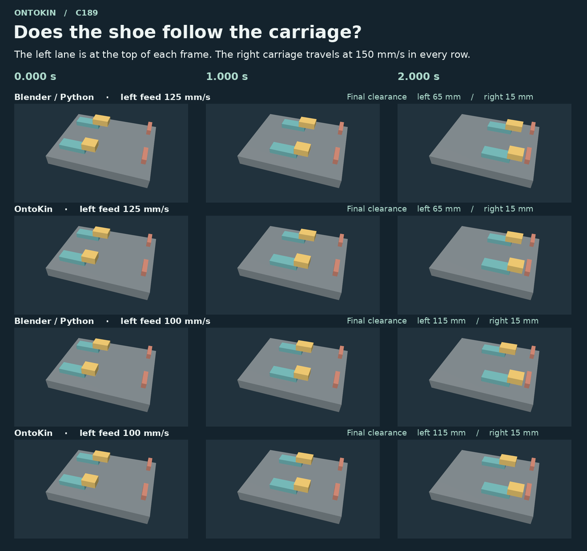

# C189 · Carriage drive and shoe following

C188 lengthened one shoe while the two lanes moved at the same speed. The accepted OntoKin design drove each shoe separately. C189 gave two fresh coding agents their respective [C188 repair](../linear-gauge-repair-c188/README.md) and asked each to make a left carriage speed edit carry through to its shoe. Both first submissions passed. [Experiment sources, controls and raw evidence](trial-evidence.zip)

| Left carriage feed | Minimum left gap | Minimum right gap | Source of the setting |
| ---: | ---: | ---: | --- |
| 125 mm/s | 65.000 mm | 15.000 mm | First formal setting |
| 100 mm/s | 115.000 mm | 15.000 mm | Second formal setting |
| 110 mm/s | 95.000 mm | 15.000 mm | Independent edit to each native design |

Both starting gaps measured 315.000 mm and all minima occurred at 2.000 s. The right carriage ran at 150 mm/s throughout. Removing 25 mm/s from the left feed for two seconds adds 50 mm to the final clearance. The upper lane in the captures shows that change. [Measured results](results.json)

## How the designs produced the motion

The Blender author kept each shoe parented to its carriage and added an X-location driver that reads the carriage's speed property. The independent review reopened the editable scenes, tested a third left feed and checked both carriage-to-shoe relationships at all 49 native frame times. Rebuilt Blender scene files differed at the byte level. The exported GLBs reproduced exactly.

The OntoKin author replaced the two independently moving shoes with massless prescribed followers. Each native `follow` declaration attaches a shoe to its carriage frame. The right carriage takes the class default. The two submitted programs differ by one left-carriage speed literal. The native exporter baked world motion into the GLB, and seven mesh names were normalized after export. All 11,552 binary payload bytes were preserved per file. [Editable 125 mm/s program](feed-125.ok)

The independent checker accepted four positive controls, rejected fourteen faulty exports and passed three analytic swept-intersection checks. It compared all seven solids and their colors to each route's original, checked constant velocity and attachment offset over every linear interval and tested all 21 pairs for penetration. Eight fresh formal-case builds reproduced the four final GLBs, twice per case. The six distinct raw/final files passed the Khronos validator with zero findings. The two agents worked on the same public fixture under a shared Linux environment. Token counts and costs were unavailable.

## Next experiment

C190 moves a fixed stop into the left shoe's path. Contact at the shoe should halt its carriage while the right lane keeps moving. In C189 the OntoKin shoes have no collision body, and the Blender scene uses transform drivers. Physical force transfer is the next unanswered question. Two fresh coding subagents should receive their own C189 designs and the two stop positions in the archive. A documented capability limit is a valid result. [Trial archive and next-task instructions](trial-evidence.zip)
