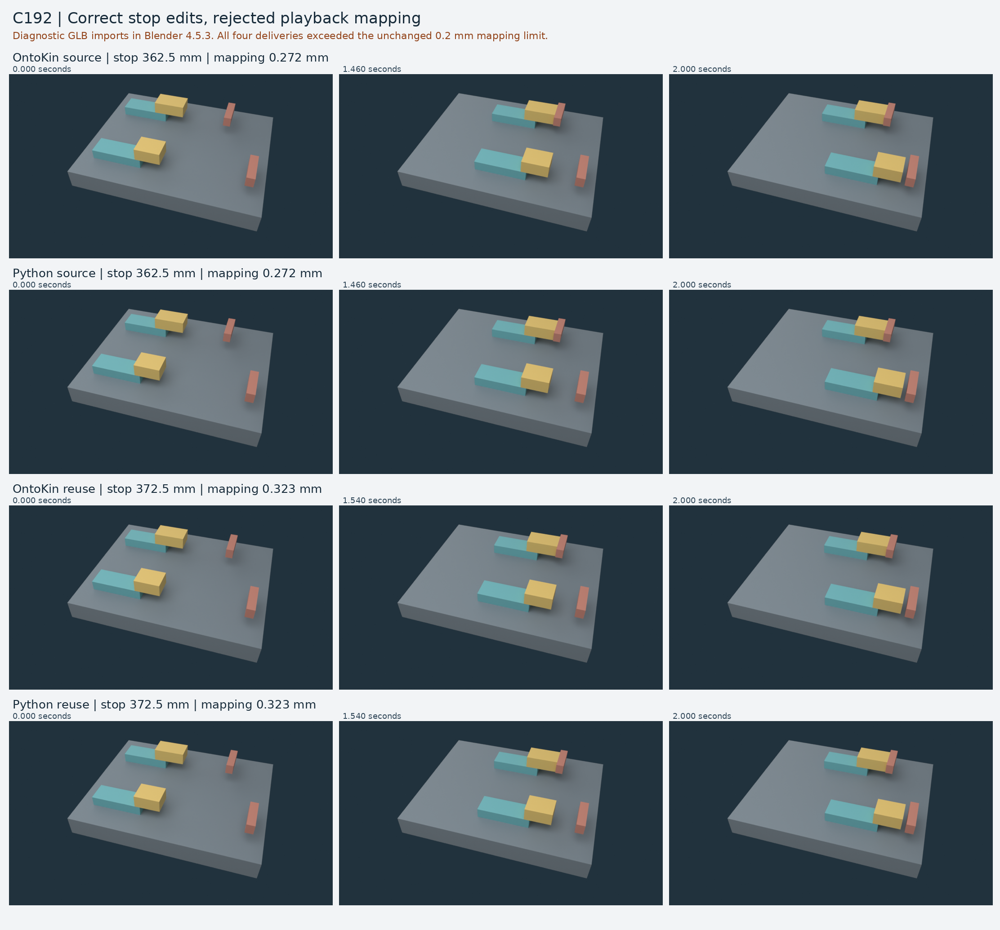

# C192: both source edits were correct; both deliveries were rejected

**The public comparison is complete. Neither route produced an accepted delivery
at either frozen target.** Two fresh default agents made the required localized
edits in experimental OntoKin source and direct Python. Both routes generated the
same native motion and the same raw/final animation bytes. The shared backend's
off-axis guide residual exceeded the unchanged 0.2 mm recording-mapping limit.
[Exact results](results.json) · [Frozen brief](frozen/BRIEF.md)

This is evidence of a shared backend limitation on this assembly. It does not
establish an authoring advantage for either route. The next task is to
[diagnose and repair the native guide/mapping failure](NEXT-TASK.md) before another
comparison or broader backend work.

## What was compared

The seven visible solids are a base, two carriages, their two attached shoes and
two fixed stops. A shoe is the contact block attached to a carriage. Both lanes
use solver-owned motion from constant-feed motors; contact must stop the left
carriage while the right lane continues. The original left stop was at 380 mm.

The coordinator prepared equivalent editable starters before either participant
began. The Python starter supplies a literal design dictionary to the **same
unchanged C191 native constructor** used by the .ok adapter; it parses no .ok
source. Both share the pinned Blender 4.5.3 executable, body/helper mapping,
compound colliders, guides, motors, solver settings, initialization, 240 Hz
capture and recorded-output binding. The [starter receipt](evidence/starter-equivalence.json)
records exact equality of canonical inputs, native transforms and raw/final GLBs.
Two fresh baseline builds and two saved-scene replays passed.

The [input freeze](frozen/INPUT-FREEZE.json) seals 116 files. It includes the
starters, brief, target values, helpers, and inherited implementation/contract/
checker inputs. The original C191 checker functions and every tolerance remain
unchanged. Twenty-eight analytic controls at the new targets produced their
expected outcomes: two valid controls and 26 rejected controls.

Exactly two fresh subagents started with empty histories and default settings in
separate directories and branches. This is a public shared-environment exercise;
no hidden-task or isolation claim is made. Each phase allowed 20 minutes, three
formal submissions and six native builds. Both participants stayed within those
allowances. No additional participant subagents were spawned.

## Measured outcomes

Both routes have the same measurements in this table. Values are rounded here;
the JSON records retain full precision.

| Frozen stop position | Expected left travel | Measured left travel | Native-to-final maximum | Continuous raw-to-final bound | Acceptance |
| ---: | ---: | ---: | ---: | ---: | --- |
| 362.5 mm, first edit | 182.5 mm | 182.500005 mm | 0.244638 mm | 0.271961 mm | **Rejected** |
| 372.5 mm, reuse target | 192.5 mm | 192.499995 mm | 0.292416 mm | 0.322647 mm | **Rejected** |

The right carriage travels approximately 300.000012 mm and retains 14.999983 mm
of final recorded clearance in every output. Final playback passes the unchanged
geometry, color, stable identity, attachment, feed, contact-onset, settled-speed,
rebound and unrelated-pair checks. All twenty unrelated pairs are separated over
all 480 recorded interpolation intervals. These successful checks do not make
the complete delivery pass.

### Why the recording fails

The native rigid-body solver permits small rotational and transverse residuals
around the intended straight guide. The qualified output mapping removes those
residuals for straight recorded playback while preserving native carriage X
coordinates and times. Every vertex must stay within 0.2 mm of the native/raw
motion under that mapping. These targets exceed that limit, including at actual
captured samples. The failure is not only a conservative bound between samples.

The .ok adapter returns `C191_E_MAPPING` and does not publish an accepted artifact
pointer. The direct runner also returns failure and retains its partial outputs.
Files named `final.glb` inside these failed stages are **diagnostic, unaccepted
outputs**. Their filenames and plausible appearance are not acceptance receipts.
[First submission scores](evidence/first-edit-scores.json) ·
[Native X/time field inspection](evidence/native-x-time.json)

The two new ideal contact times, 1.460 s and 1.540 s, fall between 240 Hz capture
frames. C191's three enabled reference cases had frame-aligned ideal times.
This observation is a diagnostic lead; no causal mechanism has been established.
Do not widen the tolerance or replace contact with a programmed stop.

## Reuse and independent verification

The coordinator scored the first submitted hashes before issuing the frozen
reuse phase. Each participant retained its exact first source, copied it and
changed only the left-stop scalar to 372.5 mm. Each also regenerated the original
362.5 mm source. Canonical inputs, all native-transform bytes, raw GLBs and final
GLBs exactly match the earlier outputs. This demonstrates reproducible literal
source variants, while the accepted-delivery reuse goal remains failed.

Four additional coordinator builds reproduced both targets for both routes in
fresh processes. Ten coordinator saved-scene inspections cover all six participant
builds and those four rebuilds. Every inspection verified stored configuration,
cleared the native cache, and replayed all 481 samples with exact parsed equality.
No scene was reconstructed or repaired during reopening. The two starter replays
and one optional participant reopen are counted separately. Native .blend files
may differ between saves; their byte identity is not required.

The [receiving checks](evidence/receiving.json) cover eight raw/final GLB paths,
representing four distinct hashes. Khronos reports zero errors and zero warnings.
Each of the four final paths has one informational unused-animation-sampler
finding. Three.js r186 loads eight clips and evaluates 24 poses. Pinned Blender
imports the four submitted final GLBs, checks their bounds against a separate
decoder, and renders twelve reviewed panels. Those checks establish loading and
playback facts for the identified rejected outputs, not mapping acceptance.

## Effort and limitations

| Route | First phase observed time | Reuse phase observed time | Native builds across both phases | Source edit actions | Repair rounds |
| --- | ---: | ---: | ---: | ---: | ---: |
| OntoKin source | 302.047 s | 229.610 s | 3 | 2 | 0 |
| Direct Python | 283.171 s | 218.203 s | 3 | 2 | 0 |

Each phase contains one formal submission. The phase times run from the first
participant timestamp to commit confirmation or submission readiness and include
inspection and reporting. The OntoKin author additionally reopened its first
scene; the Python route recorded two tool transport failures before process
creation. Each route also recorded one read-only search with no matches. These
are not equally timed authoring-only runs. No speed ranking is inferred.
[Full accounting](evidence/accounting.json)

Provider token totals, cost, exact model snapshot and hidden internal turns are
unavailable. Both agents requested the same default settings. No human intervened
during the pair. Coordinator instructions consisted of the frozen first task,
one instruction to preserve the first failure, and the frozen reuse follow-up
after independent scoring. Subsequent cross-review is outside participant effort.

C191's contract, adapter, native construction and checkers are reusable setup.
C192's prepared direct starter, runner, wrappers, baseline qualification and
controls are additional setup. They are not free participant work, and their
full token cost and total preparation time were not instrumented. This single
public pair does not establish general repair reliability, general classes or
libraries, live destination physics, comparative cost, a production backend or
the complete project goal.

## Preservation and continuation

Runtime, historical tests, adopted C191 contract, frozen checkers and hosted
workflows are unchanged. The inherited full legacy driver remains **FAILED**:
4,239 methods passed in C191, while thirteen torque artifact-read methods did
not run after their original 30,000 ms setup deadline. C192 does not rerun or
relabel that old gate. Sixteen external roles and other unexecuted compatibility
coverage remain open.

The archive preserves both failures, original and regenerated sources, native
scenes, raw/final GLBs, traces, commands, readback dependencies and receiving
images. The first phase also has a separately published recovery archive.
Reviews distinguish approval to integrate the experiment record from acceptance
of its failed deliveries. One reporting ambiguity was corrected: `rebuild_exact`
is now null when no additional coordinator rebuild was requested, with a separate
`fresh_rebuild_performed` field. Original metadata and script are retained in the
[review correction record](evidence/review-fixes/disposition.json).

See [verification instructions](tools/README.md) for recorded replay and fresh
native commands. The outgoing handoff's checkpoint identifies actual integration;
inspect remote main, PR and lease before continuing after any interruption.

## Interrupted-session recovery

The final local evidence checkpoint survived the earlier conversation limit.
A later continuation recovered that exact tree, retained both participant Git
histories and performed fresh independent numerical and protocol audits. No
participant trial was repeated. [Recovery and publication provenance](RECOVERY.md)
records the original and recovered identities and the remaining telemetry limits.
