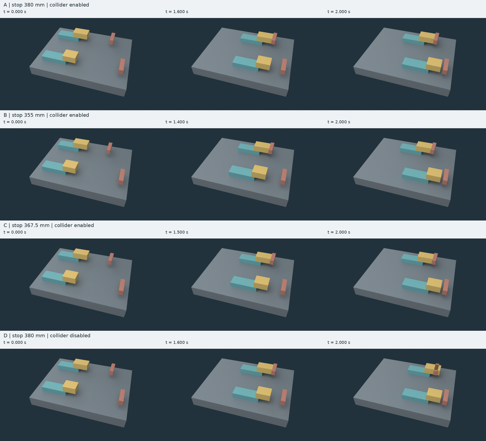

# C191: source-owned guided contact

**The bounded experimental adapter is qualified for this seven-part assembly.**
An `.ok` source file owns the carriage, its attached shoe collider, the fixed
stop and the feed request. The adapter constructs the declared scene in Blender
4.5.3; Blender/Bullet supplies the stopping response. This is an explicitly
invoked development capability. Existing native source/Agent/GLB `.22` behavior
and ordinary defaults remain unchanged.

The final continuation recovered the implementation and C191-R2 results after
the preceding discussion reached its length limit. It verified the surviving
evidence and finished delivery without repeating the nine native trials.
[Recovery and integration decision](FINALIZATION.md) ·
[Exact measurements](evidence/native-qualification.json) ·
[Independent source review](reviews/implementation/IMPLEMENTATION-REVIEW.md) ·
[Independent qualification review](reviews/qualification/REVIEW.md)

## What passed

The left shoe starts with its forward face at 180 mm and moves at a requested
125 mm/s until contact. The other lane requests 150 mm/s. Every clip lasts two
modeled seconds. These source values determine the expected outcomes; the
adapter receives no stopping-time table.

| Case | Left stop near face | Shoe collider | Measured left travel at 2 s | Expected contact time |
| --- | ---: | --- | ---: | ---: |
| A | 380 mm | Enabled | 200.000018 mm | 1.600 s |
| B | 355 mm | Enabled | 175.000012 mm | 1.400 s |
| C | 367.5 mm | Enabled | 187.500000 mm | 1.500 s |
| D | 380 mm | Disabled | 250.000000 mm | No stopping response |

The right lane travels 300.000012 mm and ends with approximately 15 mm of
clearance in all four cases. The three enabled cases meet the frozen contact,
settling, drift and continuous penetration limits. Disabling only the left
shoe's collision component preserves the visible shoe and unrelated native
motion while allowing the carriage to pass through its stop.

Two clean builds per case, plus a renamed/reordered source control, give nine
formal builds. Nine independent reopen executions clear the saved scene's cache
and reproduce all 481 native samples. Repeated canonical inputs, native
trajectories and raw/final GLBs match byte for byte. The renamed/reordered source
has a different source revision but the same physical input and final GLB.

The independent checker certifies all twenty unrelated visible-part pairs over
all 480 interpolation intervals. Maximum enabled-case near-face penetration is
0.0119573 mm against the 0.5 mm limit. The final playback removes small rotation
and transverse guide residuals while preserving every native carriage X sample
and timestamp. Its maximum continuous raw-to-final vertex-deviation bound is
0.0851883 mm against the 0.2 mm limit. The raw solve and final playback remain
separate artifacts.

## Contract and execution

The [adoption](../../language-design/guided-contact-v0.1/ADOPTION.md), exact
[specification](../../language-design/guided-contact-v0.1/SPECIFICATION.md),
grammar, schemas, diagnostic codes and backend mapping were published before
implementation. The original freezes remain unchanged. C191-A1 separately
clarifies the identity reported for source rejected at the byte-admission limit.

| Binding | Explicit identity |
| --- | --- |
| Experimental source | `c191-experimental-0.1` |
| Source profile | `guided-box-contact-0.1` |
| Solver mapping | `blender-bullet-c190-0.1` |
| Recorded output | `glb-guided-contact-0.1` |

The finite source declares two 1 kg mass owners, four shoe/stop collision boxes
and two massless spatial attachments. Stable keys own identity. The backend
mapping enumerates compound helpers, guides, constant-feed motors, frames,
units, collision settings and initialization. Scene construction starts empty.
The source has one motion authority per carriage: the native solver.

The [prototype guide](../../../prototypes/guided_contact_v01/README.md) gives
the exact `validate`, `run` and saved-scene `--reopen` commands. The prototype
uses Python's standard library and requires the declared external Blender
executable hash. Qualification explicitly requests and authorizes 1,000,000
operations and 80,000 ms; ordinary defaults remain 100,000 operations and
30,000 ms. A modeled clip's duration is separate from its computation deadline.

## Evidence and compatibility

The original [validation protocol](VALIDATION-PROTOCOL.md) separates native
response, saved-scene replay, recorded geometry, projection, lifecycle and
receiving-application claims. Both committed evidence archives remain exact:
[qualification evidence](qualification-evidence.tar.xz) and
[author failure/correction evidence](author-recovery-evidence.tar.xz).
The [finalization archive](finalization-evidence.tar.xz) adds current independent
audits, complete legacy-driver logs, exact test inventory and baseline/candidate
reproductions. [Its receipt](evidence/finalization.json) identifies the bytes.

Fresh source conformance passed 32/32 exact code/phase/span/blocked-level cases.
The archived final cohorts cover 42 lifecycle checks, all 19 frozen lifecycle
methods, seven admission checks, five lexical checks, thirteen malformed-native
checks, twenty-six output-alias checks and four receipt-failure checks. Native
cancellation returned in 521.803 ms against its 2,000 ms cap and reaped the
descendant process. Earlier failures are retained.

Eight raw/final paths represent seven distinct GLB hashes because case D's raw
and final files are identical. All eight format checks have zero errors and
warnings. Three enabled finals retain disclosed informational findings for
unused rotation-sampler data. Three.js reads eight clips at 24 poses. Twelve
actual GLB-import Blender render panels were reviewed. No browser capture or
live GLB collision behavior is claimed.

**The legacy local driver remains failed.** Of 4,252 discovered methods, 4,239
passed with no skips. The thirteen `TorqueArtifactReadTests` methods did not run
because their `.22` seed export hit its original 30,000 ms setup deadline. Fresh
candidate and unchanged-main attempts reproduce the same failure. Every
inherited runtime, test, shared verification tool and workflow is unchanged.
Under [OK-ENG-009](../OK-ENG-009-development-integration-and-branch-lifecycle.md),
this identified failure in a contained, incomplete `.22` feature does not block
the separately invoked C191 increment. It remains a failed torque obligation;
neither the full driver nor a complete release is declared passed. Sixteen
external conformance roles and broader interpreter coverage remain pending.

## Next step and limits

[C192](NEXT-TASK.md) proposes a public authoring-and-reuse comparison using this
same qualified backend. Its coordinator must first verify C191's actual merge,
then freeze equivalent editable starters, task inputs and evaluation limits
before dispatching two fresh subagents here. No separate host or isolation
preflight is required. Charge reusable adapter and starter preparation
separately from task effort.

C191 qualifies this finite seven-solid, two-mass guided-contact mapping. Direct
Bullet impulses, manifolds, native velocities and unrecorded substep poses were
not observed. General contacts, arbitrary mechanisms, a production backend,
live destination physics, comparative authoring benefit and completion of the
full OntoKin goal remain unproved.
