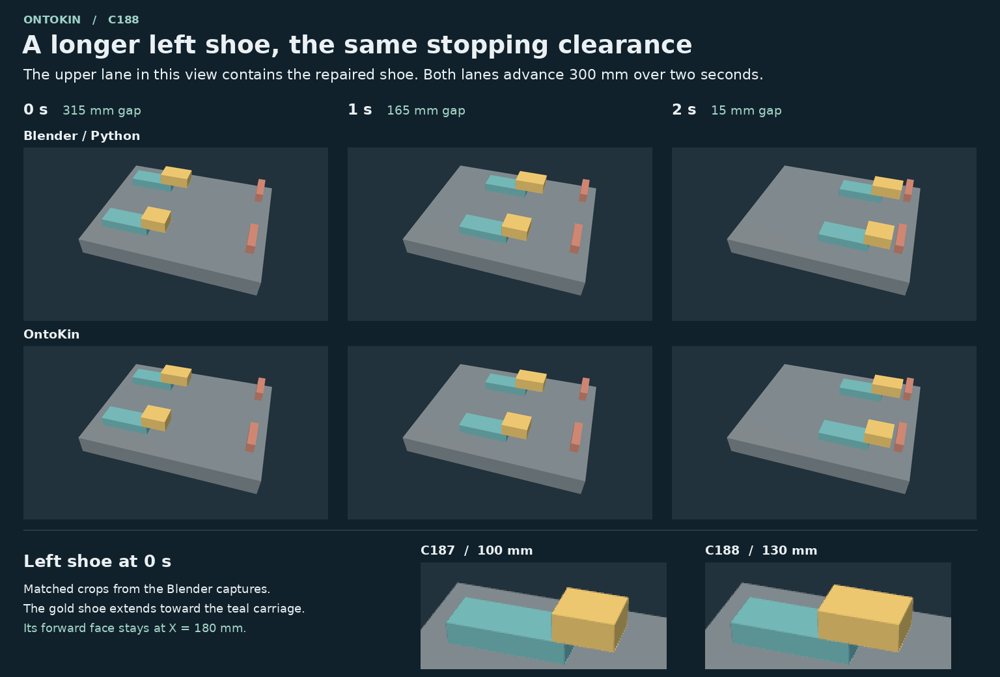

# C188 · Extend one shoe on a two-carriage gauge

Each author received the editable [C187 starter](../linear-gauge-c187/README.md) for one route. The task was to add 30 mm of rear contact surface to the left shoe while its front face still stopped 15 mm short of the fixed stop. The finished left shoe runs from X = 50 to 180 mm at the initial pose. The right shoe still runs from 80 to 180 mm. All dimensions use the exported glTF world frame. [Measurements](results.json) · [Evidence and editable designs](repair-evidence.zip)

| Native authoring route | Minimum gap, left | Minimum gap, right | Time of minimum | Intervals checked |
| --- | ---: | ---: | ---: | ---: |
| Blender/Python | 14.999993 mm | 14.999993 mm | 2.000 s | 48 |
| OntoKin | 15.000015 mm | 15.000008 mm | 2.000 s | 24 |

The checker verified the two-second clip and compared each export with its route's sealed starter. The base, both carriages, both stops and the right shoe retained their measured geometry, material colors, identifiers and trajectories. Both authors passed on their first formal submission. Two fresh rebuilds on each route reproduced the submitted GLB byte for byte. Exact elapsed model time, token totals and cost were unavailable.

The Blender author added an instance-size override and kept the front face fixed when building a longer cuboid. The shoe inherits motion from its carriage. The OntoKin author set the left `Shoe` instance to 130 mm long and placed its minimum corner at X = 50 mm. The right instance kept its class default. The typed source assigns the same velocity separately to each carriage and shoe. The checker measures the exported trajectories. Whether a shoe follows a change to its carriage drive requires another experiment.



## Replay the measurements

Unpack [repair-evidence.zip](repair-evidence.zip) into a new directory. The archive includes both repaired designs in `repair/deliveries/`, both C187 starters in `gauge/deliveries/`, the independent checker and controls, rebuilds, source diffs, and the six original rendered frames. The tools used Linux x86-64, CPython 3.12.14 and NumPy 2.3.5.

```sh
python3.12 -IB repair/replay.py > replayed-results.json
cmp replayed-results.json evidence/c188/results.json
```

For interactive playback, serve the extracted directory on loopback and open the gauge viewer. Select `repair/deliveries/blender/gauge.glb` or `repair/deliveries/ontokin/build/repaired.glb`. Both use the C187 camera and frame registration.

```sh
python3 -m http.server 8000 --bind 127.0.0.1
```

Open [the local viewer](http://127.0.0.1:8000/gauge/viewer/). The portable experiment archive includes its Three.js dependencies.

## Next experiment

The coordinator spawns two fresh coding subagents in the current execution environment, one for each native route. Give each its accepted C188 repair, the participant brief and the C189 dimensions inside the archive. The left carriage moves at 125 mm/s in one build and 100 mm/s in another. At two seconds, the left gap must be 65 mm and 115 mm respectively. The right carriage keeps its 150 mm/s drive and 15 mm end gap in both builds. Inspect the source and perturb the declared drive to distinguish a shoe that follows its carriage from a separately driven shoe with coincident motion. The archive's `NEXT-TASK.md` gives the dispatch and acceptance procedure.
