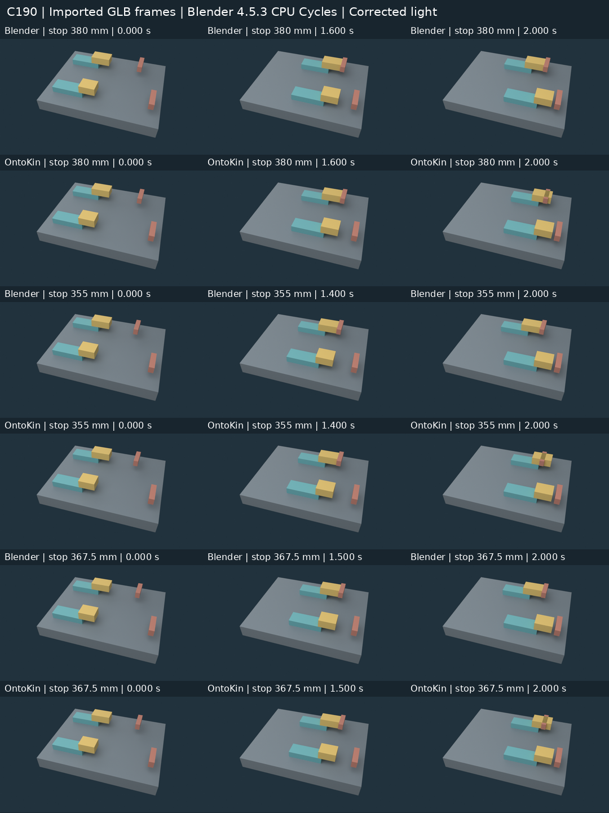

# C190 · Contact at an attached shoe

C189 showed that a shoe follows its carriage when the carriage speed changes. C190 moves a fixed stop into the shoe's path and asks whether contact there stops the carriage. The other lane must continue independently.

**Blender supplies the native contact response. The pinned OntoKin profile does not.** These are newly executed recovery replication results, identified as C190-R2. The original interrupted C190 discussion published its plan and evaluator identity but no recoverable trial outputs. [Recovery provenance](RECOVERY.md) · [Publication completion](COMPLETION.md)

## Measured result

| Left stop near face | Ideal contact | Blender final left travel | OntoKin final left travel | OntoKin signed final gap |
| ---: | ---: | ---: | ---: | ---: |
| 380 mm | 1.600 s | 200.000 mm | 250.000 mm | −50.000 mm |
| 355 mm | 1.400 s | 175.000 mm | 250.000 mm | −75.000 mm |
| 367.5 mm, independent edit | 1.500 s | 187.500 mm | 250.000 mm | −62.500 mm |

The signed gap measures the shoe's leading face against the stop's near face; a negative value means that face passed the stop. It is not a native contact-manifold penetration estimate. Both routes preserve the right lane's 15.000 mm final gap, rounded to three decimals, and all twenty unrelated pairs remain clear. [Exact results](results.json)

### Native physics and final playback

Blender uses one 1 kg compound carriage body per lane. The attached shoe is a native box collision child; a hidden carriage box supplies the other shape. Each lane has an X-unbounded guide and a continuously active feed motor. There is no timed stop or X-position clamp. Removing only the left shoe's rigid-body component makes the carriage travel 250 mm instead of 200 mm; the right lane and fixed-part records remain bit-identical. This independently reproduced control establishes the shoe collider's causal role within the measured setup.

The first Blender submission failed the frozen translation-only playback profile because its native solver retained a small rotation. Submission two preserves the native scenes, raw exports and traces byte for byte. Its declared final mapping removes one rotation channel and restores three transverse float values. **Every native carriage X sample and recorded timestamp remains unchanged.** All three projected final files pass; their raw files retain the original profile rejection. Independent inspection bounds continuous interpolated raw-to-final vertex deviation by 0.056596 mm. This is a playback bound, not a bound on unrecorded solver substeps. Maximum final near-face penetration is 0.007584 mm and final left gap is approximately 0.000001 mm.

The native run uses Blender 4.5.3 LTS build `67807e1800cc`, 240 Hz recording, 481 states, ten substeps per frame and 100 solver iterations. Contact flags and velocities in the audit are derived from native poses; Bullet manifolds and normal impulses are not exposed by this audit. The motor remains active at contact; no calibrated actuator-force claim is made.

OntoKin's unchanged source/profile .22 accepts independent carriage velocities and massless `no_body()` shoe following, with collision disabled and contact response unavailable. Its inherited carriage sphere does not represent the shoe face; visible stops have no collider. At all three positions the left carriage continues at 125 mm/s, while the right remains at 150 mm/s. The final export changes only seven mesh-name fields; the native binary payload remains identical. Minimal probes reproduce `OKL-E-NAME` for the unsupported collision value and `OKL-E-PHYSICAL-DOMAIN` for a mass-bearing following shoe. These are explicit capability limits, not a simulated collision failure.

## Evidence and reproduction

[trial-evidence.zip](trial-evidence.zip) contains the sealed submissions, failed first Blender submission, native sources and scenes, raw/final GLBs, frozen checker, independent rebuilds, causal control, validators and the visual comparison. [render-evidence.zip](render-evidence.zip) adds all actual rendered frames, import receipts and the retained lighting attempt. Extract both into the same directory and read `TRIAL-README.md`. The separate [frozen checker archive](recovery-r2-checker.zip) preserves the pre-submission checkpoint. The original [plan](plan.json), [cases](cases.json), [participant brief](participant.md) and [evaluator identity](evaluator-freeze.json) remain unchanged.

The reconstructed C190-R2.1 evaluator was frozen before submission readback. All 45 trajectory controls—ten positive and 35 negative—and three continuous swept-intersection controls received their expected classifications. Regeneration reproduced their bytes. Two fresh builds per formal route/setting and two per independent stop edit reproduced the raw and final outputs: twelve source builds. Two additional native Blender runs exercised the collider control. All 209 pinned OntoKin runtime files remained unchanged.

Khronos validation found zero errors and warnings across twelve distinct raw/final outputs. Each projected Blender final retains one informational unused rotation sampler; the other outputs have zero findings. Three.js r186 independently decoded six final clips at three poses each. The 18 images above use actual GLB reimport in Blender CPU Cycles with the fixed C187 camera. Their imported world bounds agree with independent GLB bounds within 0.000030 mm. Browser startup failed in this environment; these images do not claim browser playback or a new physics simulation.

The quick replay requires CPython 3.12.14 with NumPy 2.3.5 and Node 24.22.1. Run `python -IB replay.py` after extracting the trial archive. Native rebuild commands are in `audit/blender/README.md` and `audit/ontokin/README.md`; Blender is a separately installed, pinned prerequisite. The full user handoff additionally supplies the NumPy wheel, package manifest, repository checkpoint and restart instructions. [completion-evidence.zip](completion-evidence.zip) preserves the later continuation’s fresh checks of the recovered artifacts; it does not represent another authoring trial.

Both authors had fresh histories, default settings, 30 minutes from tool readiness and at most four formal submissions. OntoKin supplied one negative-result submission; Blender passed final playback on submission two. The earlier thread's reported outcomes were disclosed during recovery. This is a public shared-environment experiment, without a blind-isolation or comparative token/cost claim.

## Next unmet gate

C191 should adopt an explicit experimental source-to-solver binding for a shoe collider owned by one mass-owning carriage, then qualify a thin adapter to this measured Blender/Bullet setup. Preserve current native semantics, source identity, one motion authority, declared helper geometry and raw/final evidence boundaries. [Concrete next task](NEXT-TASK.md)

This documentation/evidence increment changes no product runtime, historical tests or hosted workflow. Documentation preservation and the scoped experiment checks apply. Full product regression, general contact dynamics, a production backend and comparative authoring advantage remain open.
