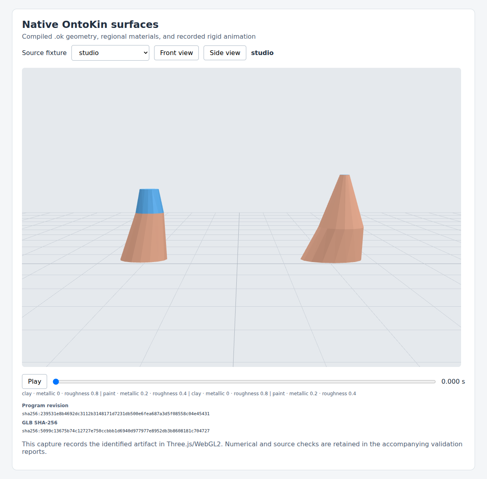
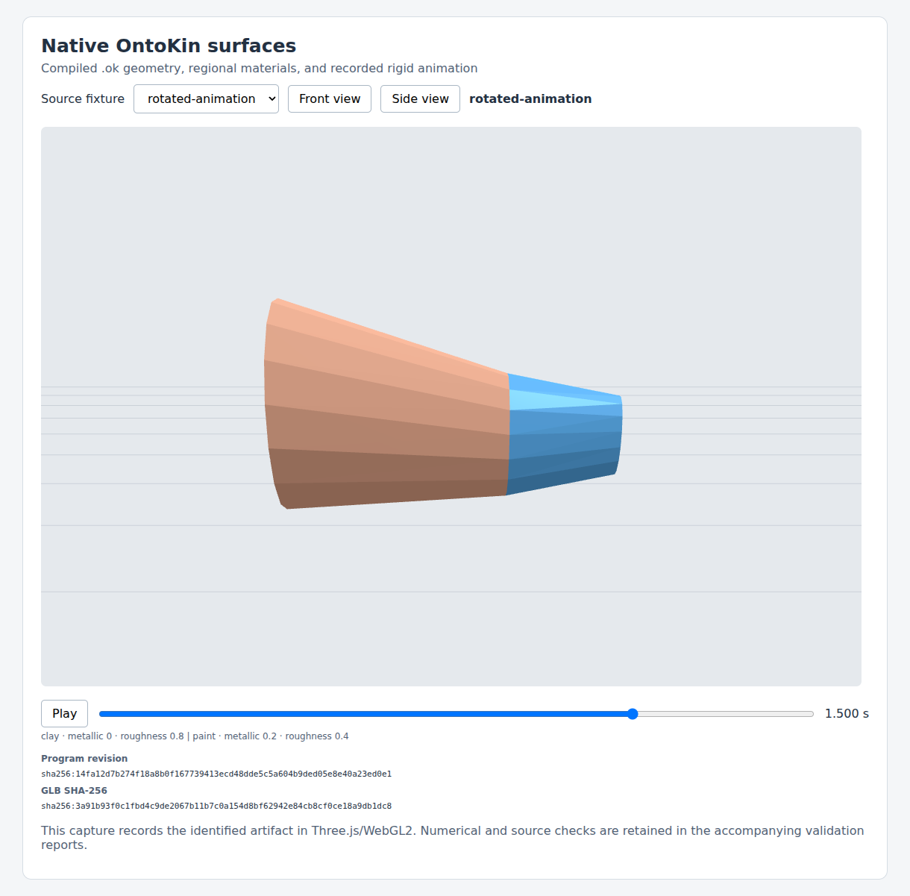

# Native GLB/0.3 validation checkpoint

This record establishes the native source-to-GLB adapter milestone at implementation [`908032be8762dfe533fcef06356bc0d768183d73`](https://github.com/Omegapy/OntoKin/commit/908032be8762dfe533fcef06356bc0d768183d73), integrated by [PR #7](https://github.com/Omegapy/OntoKin/pull/7) as main [`1976b615`](https://github.com/Omegapy/OntoKin/commit/1976b615935ee17ff45e7e6392cded85dc317e87). [STATUS](../../../STATUS.md) tracks the subsequent main checks and next work; [GOAL](../../../GOAL.md) remains authoritative for the complete language. This evidence does not close Agent/0.3 or all M01–M12.

## Retained evidence

- [Validation summary](validation-summary.json): exact revisions, runtime digest, measured results, environments and limits.
- [Evidence archive](evidence-908032be.zip): 12 actual source bundles and GLBs, scalar geometry/motion oracles, export/reference reports, independent destination results, six captures, the self-contained browser harness, full 390-test log, core/agent/construction results and documentation preservation report.
- [File manifest](files.json): byte lengths and SHA-256 hashes of the retained evidence files. The archive CRC and every manifest hash were checked after packaging.
- [PR CI 39148556348](https://github.com/Omegapy/OntoKin/actions/runs/39148556348) and [main CI 39148970424](https://github.com/Omegapy/OntoKin/actions/runs/39148970424): all four jobs passed independently, including existing legacy and new native GLB/browser paths.

| Check | Result |
| --- | --- |
| Python regression suite | 390 passed in 114.035 s |
| Core and agent conformance | 43 cases / 694 assertions; A01–A10 passed |
| Native source corpus | 12 compiled/evaluated programs; frozen pinned Studio, analytic cylinder/ellipse/taper, regional materials, all four held-outs, and rotated animated hierarchy |
| Khronos Validator | Zero errors and warnings across all 12 GLBs |
| Independent Three.js poses | 98 comparisons passed |
| Surface local float32 error | Maximum 2.727053982631844e-8 m; fixed limit 1e-5 m |
| Independent carrier error | Maximum 4.7683715642676816e-8 m position and 1.115960767712837e-7 rad rotation |
| Browser | Chromium141.0.7390.37, 28 pose comparisons, six captures, play/pause hold, no page/console/network errors |

The independent verifier compares actual buffers with source-derived ring points, oriented triangle sets, region membership, outward flat normals, palette PBR factors, local placement and carrier motion. It does not accept exporter metadata alone as a geometry oracle. The frozen binary64 geometry criteria remain unchanged; decoded float32 volume comparisons use an independently computed determinant perturbation bound and do not assert the binary64 volume limit for encoded bytes.

All six captures were visually inspected by the integration worker. Front views show both Studio objects and their material regions. The exact side view has expected depth occlusion. The separate rotated fixture shows the local orientation and authored hinge animation. Caps, shading, program labels and artifact hashes agree with the numerical records.





The build record retains its actual untracked `tools/node_modules` entry: it was a symlink to the pinned development verifier packages. Tracked runtime/source/tool bytes matched the identified commit, and the symlink is not committed. The complete dependency identities are recorded in the reports and `tools/package-lock.json`.

## Recheck the retained bytes

From the repository root, after installing the pinned verifier dependencies as described in [OK-ENG-003](../OK-ENG-003-native-surface-glb-export.md):

```bash
python3 -m zipfile -e docs/engineering/surface-native-validation/evidence-908032be.zip /tmp/ontokin-retained-native
node tools/verify_surface_native.mjs --demo-dir /tmp/ontokin-retained-native/corpus --output /tmp/ontokin-retained-native-recheck.json
node tools/verify_surface_viewer.mjs --demo-dir /tmp/ontokin-retained-native/corpus --output-dir /tmp/ontokin-retained-native-browser-recheck
```

The archived `browser/surface-viewer.html` is a self-contained offline inspection harness. A fresh rebuild uses the actual source builder in OK-ENG-003 and produces new evidence for that current implementation; it must not overwrite this historical checkpoint.

## Remaining gates

The source/export corpus supplies named aspects of M01–M06, M09 and M11. The full release still requires Agent/0.3 discovery/inspection/pagination, atomic M07/M08 source repairs and preserved siblings/library pins, composed/generated and independently checked release workflows, all M10 failures/bounds through the promised interface, and complete M12/current C20 attestation. Current C01–C19 pass; the old immutable C20 is preserved while the changed implementation awaits a new matching attestation. [Issue #8](https://github.com/Omegapy/OntoKin/issues/8) owns the next workflow implementation. No Blender, deformation, live physics or measured authoring-efficiency claim is made.
