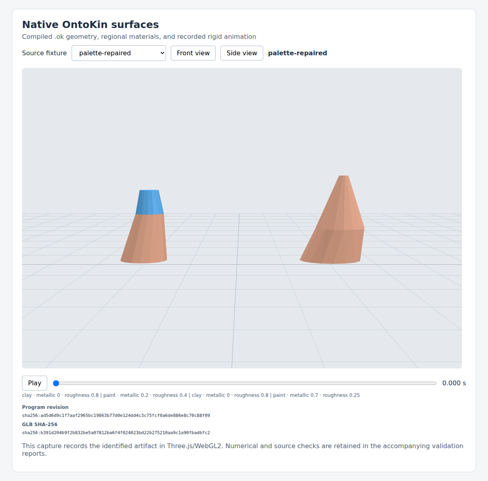
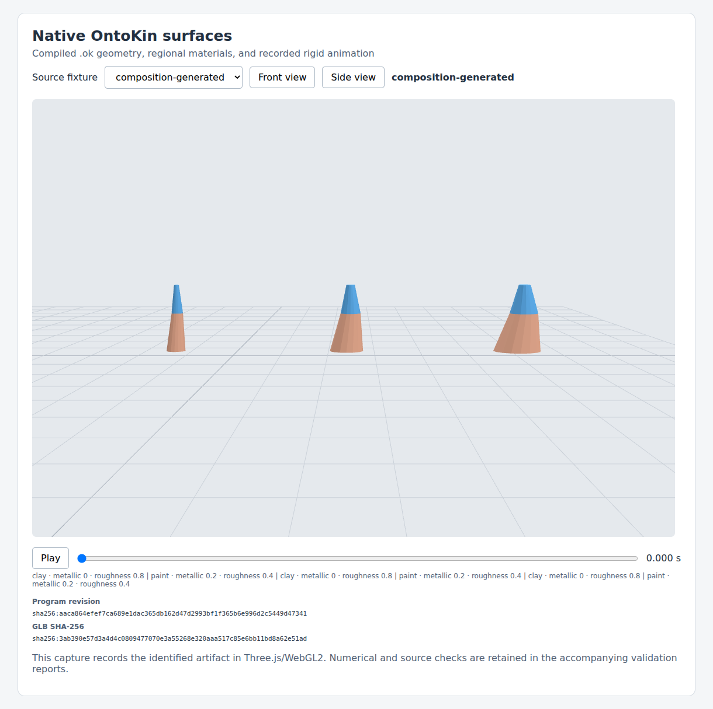
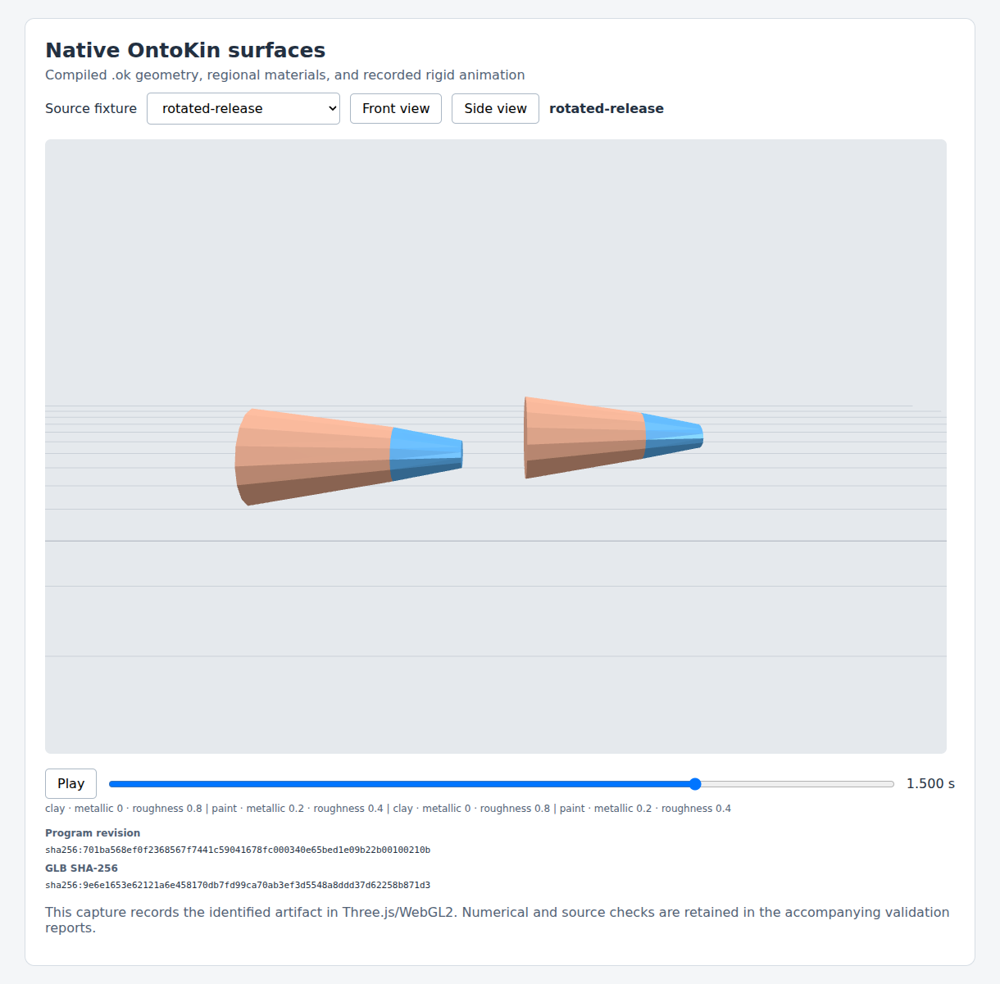

# Native surface release validation — October 18, 2026

The adopted **M01–M12 native surface release passed** for language `0.3`, `surface-0.1`, `ontokin.agent/0.3` and `ontokin.glb/0.3`. The complete OntoKin language remains in progress under [GOAL](../../../GOAL.md). [OK-ENG-004](../OK-ENG-004-native-surface-release-conformance.md) defines the evidence and reproduction contract; [OK-LANG-003](../../language-design/OK-LANG-003-parameterized-exterior-surfaces-and-material-regions.md) remains the semantic authority.

## Identified implementation and actual results

Implementation commit: `80d59bb2b09a5a57cad8e1b477d89f23a3e5a5a1`. Tree: `a2d9d8f6cc897fb6b5781ed06f2a89e9b256b60c`. Runtime: `sha256:abebb2fe7f5af46862db0c24a83c244113a2cfabea1b8a69a22260e4aef2d4d6`. The package version remains experimental **0.4.0**. This archival commit changes no implementation bytes.

| Evidence | Actual result |
| --- | --- |
| Native release | M01–M12: 12 passed, zero failed/pending; 61 unique mapped tests in 35.252839 s |
| Full Python suite | 464 passed in 167.052457 s; every discovered test identified |
| Source workflow | 492 actual request/response exchanges, 22 snapshots, 22 retrieved GLBs, 308 independent poses |
| Native destination | 22 fixtures, zero Khronos errors/warnings, 308 Three.js pose comparisons |
| Browser | Four fixed fixtures, 84 pose comparisons, 12 captures individually reviewed by the integrator |
| Original source/agent | 43 source cases / 694 assertions and A01–A10 passed |
| Current construction | C01–C20 passed; 128 required tests, fresh source/GLB/browser evidence and actual visual review |
| Remote CI | [39153863765](https://github.com/Omegapy/OntoKin/actions/runs/39153863765): Python 3.11, 3.12, 3.13 and GLB/visual jobs all passed for the exact implementation commit |

The native destination checked 38 actual geometry occurrences and 12240 triangles. Maximum local float32 vertex error was `2.8610229518832853e-08 m`; maximum world position error was `0.0003472566604614258 m` and rotation error `1.115960767712837e-07 rad`. The raw reports distinguish the fixed unencoded volume oracle from the measured float32 determinant perturbation bound. Finite fixtures and samples establish the named acceptance limits, not universal continuous accuracy.

## Retained evidence

- [validation-summary.json](validation-summary.json) records actual counters, maxima, source/artifact identities, all gate results and observed CI.
- [files.sha256.json](files.sha256.json) identifies every archived file by SHA-256, byte count and ZIP CRC-32, plus the complete archive hash/CRC and explicitly omitted superseded checkpoints.
- [evidence-80d59bb.zip](evidence-80d59bb.zip) retains exact source bundles and pins, all 492 raw requests and responses, immutable accepted/rejected snapshots, complete native triangle pages, 22 native GLBs, independent reference/oracle/export reports, the service database, native viewer harness, all 12 captures and their factual reviews, complete test reports, fresh legacy C20 assets and review, raw GitHub run/job responses, final release manifest, final audit and final conformance.

The archive contains **1247 files**, **37,742,514 uncompressed bytes**, and **6,325,076 ZIP bytes**. ZIP SHA-256: `sha256:8c49bdeee3cadd5d80883b57937da3c13c815e7ea3ffe56e49efd3324bae761d`; complete-ZIP CRC-32: `e1828bd1`. Every entry passed ZIP CRC verification and exact comparison with its frozen source bytes, including SHA-256. All input bytes remained unchanged during archiving. Earlier pending/pre-CI checkpoints are excluded from the principal archive and identified in the hash index; rejected candidate source and failed-request evidence remain included as required workflow evidence.

### Restore and verify

Extract the archive **at the repository root**; its member paths restore `build/surface-release/...`. Use a checkout with the identified implementation and verification inventory, with the actual Git commit available. Keep retained reports unchanged. Following [OK-ENG-004](../OK-ENG-004-native-surface-release-conformance.md), the retained evidence can be checked again with:

```bash
python3 -m zipfile -e docs/engineering/surface-release-validation/evidence-80d59bb.zip .
python3 tools/run_surface_conformance.py --external-evidence build/surface-release/release-evidence.json --evidence-root . --output build/surface-release/surface-conformance-recheck.json
```

The second command executes mapped Python tests and audits retained evidence; it does not rerun Khronos, the browser or GitHub. A fresh external execution uses the full commands in OK-ENG-004 and requires a new factual review of its exact captures. Runtime/spec/test/tool/workflow changes invalidate reuse of this release identity.

## Reviewed examples

These are copies of three already reviewed captures; all twelve originals and exact observations remain in the archive.







## Remaining product work

Native surfaces, scoped source repair, material regions, bounded agent inspection and recorded export are established for this release. They do not establish contacts, general rigid dynamics, forces, physical or closed mechanisms, purposeful locomotion/manipulation, textures and mapping, smooth or deforming skin, terrain/buildings, medium forces, fluids, live destination behavior, large-scale performance or a measured authoring benefit. Visual geometry and PBR add no physical matter or motion authority. Existing free-sphere gravity/release and prescribed connections retain their explicitly limited physics. The next finite implementation task must adopt its own semantics and predetermined acceptance cases while preserving earlier meanings.
