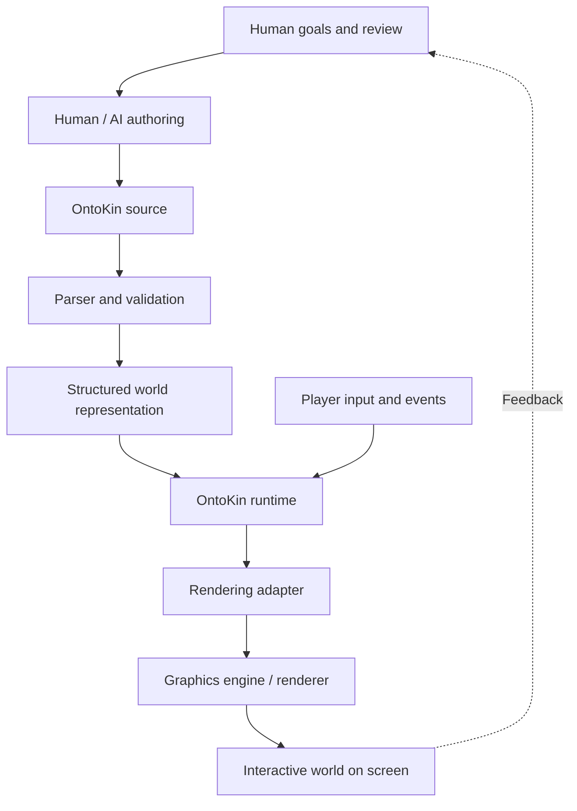

# Original OntoKin navigation

The current [documentation guide](../../README.md) consolidates the package navigation. This file preserves every replaced README exactly as it appeared at its recorded source commit. The fenced blocks are historical source text, including original paths, wording, examples, and diagrams; their links and code are not current navigation or an implemented language.

The two draft-branch texts are included as separate versions because they contain additional navigation context. The semantics document itself already has identical content on the starting main branch. Including these texts does not merge or approve the existing pull request.

| Preserved source | Origin | Section |
| --- | --- | --- |
| `Defining_Ontokin_Docs/OK-001/README.md` | main | [Original OK-001 package README](#main-ok-001-readme) |
| `Defining_Ontokin_Docs/OK-002/README.md` | main | [Original OK-002 package README](#main-ok-002-readme) |
| `Defining_Ontokin_Docs/OntoKin_003_Compilation_and_Runtime_Architecture_Package/README.md` | main | [Original OK-003 package README](#main-ok-003-readme) |
| `README.md` | main | [Original main-branch project README](#main-root-readme) |
| `Defining_Ontokin_Docs/OK-SEM-001/README.md` | semantics-branch | [Semantics draft-branch package README](#draft-sem-readme) |
| `README.md` | semantics-branch | [Semantics draft-branch project README](#draft-root-readme) |

<a id="main-ok-001-readme"></a>

## Original OK-001 package README

Original path: `Defining_Ontokin_Docs/OK-001/README.md`. Source: [2a2b39411922](https://github.com/Omegapy/OntoKin/blob/2a2b394119229031db78162ab7b82897f4a0064e/Defining_Ontokin_Docs/OK-001/README.md).

<!-- BEGIN ORIGINAL SRC-05 -->
````markdown
# OntoKin OK-001 package

Read `OntoKin_001_Project_Vision_and_Architecture.md` with the adjacent `OntoKin_001_Architecture_Diagram.png` file. The matching `.svg` version is editable vector artwork. Keep the Markdown and image in the same folder.

This is a conceptual architecture document, not an implementation.

````
<!-- END ORIGINAL SRC-05 -->

<a id="main-ok-002-readme"></a>

## Original OK-002 package README

Original path: `Defining_Ontokin_Docs/OK-002/README.md`. Source: [2a2b39411922](https://github.com/Omegapy/OntoKin/blob/2a2b394119229031db78162ab7b82897f4a0064e/Defining_Ontokin_Docs/OK-002/README.md).

<!-- BEGIN ORIGINAL SRC-07 -->
````markdown
# OntoKin OK-002 package

Read `OntoKin_002_Language_Foundations_and_Minimal_Specification.md` with the `diagrams` folder kept alongside it. The Markdown embeds PNGs; SVG versions of both figures are editable vector artwork.

The specification remains a brainstorming draft. No language grammar has been finalized.

````
<!-- END ORIGINAL SRC-07 -->

<a id="main-ok-003-readme"></a>

## Original OK-003 package README

Original path: `Defining_Ontokin_Docs/OntoKin_003_Compilation_and_Runtime_Architecture_Package/README.md`. Source: [2a2b39411922](https://github.com/Omegapy/OntoKin/blob/2a2b394119229031db78162ab7b82897f4a0064e/Defining_Ontokin_Docs/OntoKin_003_Compilation_and_Runtime_Architecture_Package/README.md).

<!-- BEGIN ORIGINAL SRC-14 -->
````markdown
# OntoKin Document 003 package

**Official document name:** OntoKin (earlier documents used OntoKine).  
**Document:** OK-003, *Compilation and Runtime Architecture*, conceptual proposal, version 0.1, October 15, 2026.

## Included

- `OntoKin_003_Compilation_and_Runtime_Architecture.md`: original editable Markdown for humans and AI agents.
- `OntoKin_003_Compilation_and_Runtime_Architecture.html`: browser-readable edition (open locally, no internet required for viewing diagrams).
- `diagrams/*.png`: diagrams embedded in both Markdown and HTML.
- `diagrams/*.svg`: editable vector representations, suitable for zooming.
- `diagrams/*.dot`: Graphviz source for changing diagrams.

Extract the ZIP before opening the Markdown or HTML file. Keep the `diagrams` directory beside the document so relative image links work.

The diagrams show **proposed architecture**, not working implementation. The text distinguishes confirmed decisions, proposed options, and questions awaiting design review. LLVM reference hyperlinks point to LLVM's official documentation.

No compiler, runtime, or benchmark was created as part of this document.

````
<!-- END ORIGINAL SRC-14 -->

<a id="main-root-readme"></a>

## Original main-branch project README

Original path: `README.md`. Source: [2a2b39411922](https://github.com/Omegapy/OntoKin/blob/2a2b394119229031db78162ab7b82897f4a0064e/README.md).

<!-- BEGIN ORIGINAL SRC-27 -->
````markdown
# OntoKin

**An AI-native mathematical programming language for interactive virtual worlds.**

OntoKin (pronounced **ON-toh-kin**) is a proposed programming language for describing, creating, and animating virtual worlds through mathematics and explicit rules. The goal is to make it possible for **AI agents and human developers** to work with the same structured world descriptions, rather than requiring an AI to operate a graphics editor through its interface.

OntoKin is intended for interactive 2D and 3D environments, video games, animation, and simulation. A world could define its objects, geometry, properties, motion, relationships, and responses to input. The language would describe the world; a runtime would execute its behavior; and a renderer would turn the current scene into visible images.

> **Project status:** Early concept and architecture exploration. The documentation records goals, proposals, and open questions. A working OntoKin compiler, runtime, or rendering engine has **not** been released.

## The idea

Existing tools such as Blender and game engines already use mathematics for geometry and animation. OntoKin's proposed focus is **AI-native authoring and verification**: a language designed from the beginning so that AI agents can inspect, generate, validate, and modify individual parts of a world, while humans can understand the definitions and direct or approve changes.

The aim is to support:

- **Mathematical world descriptions:** Shapes, spatial properties, transformations, and motion expressed as data and mathematical rules.
- **Interactive behavior:** Events, state changes, constraints, and responses to player input.
- **Human and AI collaboration:** Readable source for developers and structured, verifiable representations for AI agents.
- **Renderer independence:** The same underlying world definitions should not be tied permanently to one graphics engine.
- **Incremental development:** Validate the language with small examples before attempting a full virtual-world engine.

## Proposed architecture



The proposed compiler would first check and transform OntoKin source into a structured representation. The **runtime** would manage time, world state, and behavior as the scene changes. A **rendering adapter** would connect that state to an existing graphics system. Using an interpreter first, and potentially an LLVM-based compilation backend later, are architectural options under investigation, not finalized implementation decisions.

### Conceptual example

The following is **illustrative pseudocode**, not a finalized OntoKin syntax:

```text
world Demo {
    entity Ball {
        geometry: sphere(radius: 1.0)
        position(t): (3 * sin(t), 0, 0)
        color: rgb(0.2, 0.6, 1.0)
    }
}
```

The moving sphere is defined by an equation rather than a stored sequence of animation frames. During execution, the runtime would evaluate its position over time, and the renderer would draw the current result.

## Defining OntoKin: project documents

The [`Defining OntoKin Docs`](Defining_OntoKin_Docs/) directory contains the numbered documents created during the initial human–AI design discussions:

| Document | Topic | Purpose |
| --- | --- | --- |
| **OK-001** | Project Vision and Initial Architecture | Explains the origins, goals, intended use cases, and high-level system design. |
| **OK-002** | Language Foundations and Conceptual Minimal Specification | Explores what the language should describe and how people and AI might work with it. |
| **OK-003** | Compilation and Runtime Architecture | Examines parsers, intermediate representations, interpretation, LLVM, the runtime, and rendering integration. |

These documents are **design records**, not finished technical standards. Where relevant, they distinguish ideas already agreed upon from recommendations and unresolved decisions. Their diagrams are intended to help both people and future AI collaborators understand the architecture.

## Direction of development

The first proposed milestone is intentionally small: define a valid OntoKin world containing a sphere, move it with a mathematical expression, and respond to a simple player input. This would test the complete path from authoring and validation to runtime execution and real-time rendering.

Later work may explore more expressive geometry, physics integration, game-engine adapters, optimized compilation, AI-guided structured editing, and possibly a dedicated renderer. Those capabilities remain research and engineering goals.

## About the name

**OntoKin** combines **onto-**, referring to ontology (what exists and how entities relate), with **kin-**, referring to kinematics (motion). Earlier drafts used the working name *OntoKine*; **OntoKin** is the current project name.

---

*OntoKin is currently a concept-stage research and development project. This README describes its intended direction, not implemented functionality.*

````
<!-- END ORIGINAL SRC-27 -->

<a id="draft-sem-readme"></a>

## Semantics draft-branch package README

Original path: `Defining_Ontokin_Docs/OK-SEM-001/README.md`. Source: [c1fbd96721a2](https://github.com/Omegapy/OntoKin/blob/c1fbd96721a205e4de3e0118a9d756a02513bcbc/Defining_Ontokin_Docs/OK-SEM-001/README.md).

<!-- BEGIN ORIGINAL SRC-28 -->
````markdown
# OntoKin OK-SEM-001

[Read **Core Object, Motion, and Physics Semantics**](OntoKin_Core_Object_Motion_and_Physics_Semantics.md).

**Status:** Conceptual language design, version 0.1. The semantic rules are proposed for review.

This document defines how objects contain parts, how local and whole-object motion relate, how mechanical connections and physical influences affect behavior, and how concurrent actions resolve their control. A modular character that walks, looks, reaches, and releases a prop provides the main example.

The document includes 28 proposed semantic rules, 24 conceptual behavior checks, and traceability to the existing requirements. The checks describe expected outcomes; no OntoKin implementation has been tested by this document.

## Context

- [OK-CAP-001: Modeling, motion, and object structure](../Product_Requirements_Docs/OntoKin_Modeling_Motion_and_Object_Structure.md) explains the current modeling focus.
- [OK-PRD-001 v0.2: Product requirements](../Product_Requirements_Docs/OntoKin_PRD_v0.md) records the broader intended product.
- [Project overview](../../README.md) links the current documents and founding design records.

Exact language syntax, compiler architecture, physics and rendering engines, internal data structures, and implementation plans remain later decisions. OK-SEM-001 establishes the meaning those choices must preserve.

````
<!-- END ORIGINAL SRC-28 -->

<a id="draft-root-readme"></a>

## Semantics draft-branch project README

Original path: `README.md`. Source: [c1fbd96721a2](https://github.com/Omegapy/OntoKin/blob/c1fbd96721a205e4de3e0118a9d756a02513bcbc/README.md).

<!-- BEGIN ORIGINAL SRC-29 -->
````markdown
# OntoKin

**An AI-native, object-oriented language for physical 3D models and animation.**

OntoKin (pronounced **ON-toh-kin**) is a proposed programming language designed primarily for AI agents to create reusable 3D objects, characters, and animations. An agent describes an object's form, parts, appearance, physical properties, mechanical connections, and intended actions. The language system supplies supported construction and behavior, while people can inspect the definitions, review the results, and direct changes.

The [current capability definition](Defining_Ontokin_Docs/Product_Requirements_Docs/OntoKin_Modeling_Motion_and_Object_Structure.md) focuses first on exterior models and short animations. Those objects should remain reusable in larger scenes, video games, and eventually complex virtual worlds. Physics and mechanics are central to their meaning, supported by mathematics and explicit rules.

> **Project status:** Conceptual language design. Product requirements, capabilities, and the new core semantic model are review drafts. This repository does not yet provide a working OntoKin compiler, runtime, or renderer.

## Current design work

The new document is [**OK-SEM-001: Core Object, Motion, and Physics Semantics**](Defining_Ontokin_Docs/OK-SEM-001/OntoKin_Core_Object_Motion_and_Physics_Semantics.md).

It proposes how classes, instances, nested parts, coordinate frames, joints, physical laws, and concurrent actions relate. Its central example is a character that walks, turns its head, and controls one hand while maintaining coherent mechanical and physical behavior. Carrying and releasing a prop makes the transition between connected and independent motion explicit.

The document contains 28 proposed semantic rules, a worked character sequence, and 24 conceptual behavior checks. These are design rules and expected outcomes, not implementation test results. Exact syntax and implementation choices remain later work.

## Project documents

The [Defining OntoKin Docs](Defining_Ontokin_Docs/) directory contains the current design documents and the founding records.

### Current definition and semantics

For a concise introduction, start with OK-CAP-001. Use the PRD for the broader requirements and OK-SEM-001 for the proposed rules that make the core concepts precise.

| Document | Purpose | Status |
| --- | --- | --- |
| [**OK-CAP-001 v0.1 — Modeling, motion, and object structure**](Defining_Ontokin_Docs/Product_Requirements_Docs/OntoKin_Modeling_Motion_and_Object_Structure.md) | Explains the current modeling focus, modular objects, physical behavior, and scope progression. | Draft for concept review |
| [**OK-PRD-001 v0.2 — Product requirements**](Defining_Ontokin_Docs/Product_Requirements_Docs/OntoKin_PRD_v0.md) | Defines the intended product's capabilities, support contracts, and acceptance scenarios. | Draft for product review |
| [**OK-SEM-001 v0.1 — Core Object, Motion, and Physics Semantics**](Defining_Ontokin_Docs/OK-SEM-001/OntoKin_Core_Object_Motion_and_Physics_Semantics.md) | Defines object relationships, movement authority, physical participation, and transitions such as release. | Conceptual language design; proposed for semantic review |

### Founding design records

These documents explain the project's origins and earlier architecture exploration. The newer owner direction and capability definition govern the current modeling focus. Historical implementation proposals remain options for later evaluation.

| Document | Topic |
| --- | --- |
| [**OK-001 — Project Vision and Initial Architecture**](Defining_Ontokin_Docs/OK-001/OntoKin_001_Project_Vision_and_Architecture.md) | Origins, goals, intended uses, and initial system proposals |
| [**OK-002 — Language Foundations and Conceptual Minimal Specification**](Defining_Ontokin_Docs/OK-002/OntoKin_002_Language_Foundations_and_Minimal_Specification.md) | Early concepts for objects, state, behavior, and human/AI authoring |
| [**OK-003 — Compilation and Runtime Architecture**](Defining_Ontokin_Docs/OntoKin_003_Compilation_and_Runtime_Architecture_Package/OntoKin_003_Compilation_and_Runtime_Architecture.md) | Compiler, interpreter, runtime, and rendering-integration proposals |

The earlier roadmap reserved **OK-004** for renderer integration. **OK-SEM-001** identifies the semantic-design work without renumbering those records.

## What the core model distinguishes

A character can contain a hand without that containment alone specifying how the hand moves. Its frame relationship describes placement; a wrist joint permits and limits relative movement; an action supplies a goal; and the physical model determines the supported response.

The proposed semantics therefore distinguish:

- Classes and shared definitions from individual objects and their state.
- Object ownership from spatial following and mechanical connection.
- Logical parts, visible surfaces, animation controls, and physical bodies.
- Prescribed movement from dynamic response and physically driven actions.
- Independent action targets from the physical coupling between connected parts.
- Valid definitions, constructed models, successful behavior, and delivered output.

These distinctions let agents make focused changes and inspect why a part moved. They also keep the result understandable to the people reviewing it.

## Direction of development

| Stage | Question |
| --- | --- |
| Product requirements and capability definition | What should OntoKin create and accomplish? |
| Core semantic model | What do objects, movement, mechanics, and physics mean? |
| Language specification | How do agents express those meanings precisely? |
| Implementation architecture and prototype plan | How is that meaning executed, verified, and connected to external tools? |

The current stage is review of the core semantic model. The initial examples concern complete exterior models, nested parts, concurrent short actions, attachments, contact, gravity, and a simple environmental response.

The earlier moving-sphere proposal remains a possible small pipeline experiment. It does not establish the current goals for modular modeling, mechanics, or independently controlled parts. Broader environments and physical domains remain part of the longer-term direction described in the existing PRD and capability document.

## Language, execution, and rendering

OntoKin describes objects and behavior. Execution evaluates their state over time. Rendering turns the evaluated scene into visible images. These responsibilities remain distinct even when existing tools perform some of the work.

The founding documents explore interpreters, compilation, and rendering adapters. The semantic model does not select those mechanisms or require a dedicated graphics renderer.

## About the name

**OntoKin** combines **onto-**, referring to ontology, or what exists and how entities relate, with **kin-**, referring to kinematics, or motion. Earlier drafts used the working name *OntoKine*; **OntoKin** is the current project name.

---

*This README describes the intended language and its current design documents. Documented capabilities remain proposals until implemented and verified.*

````
<!-- END ORIGINAL SRC-29 -->
