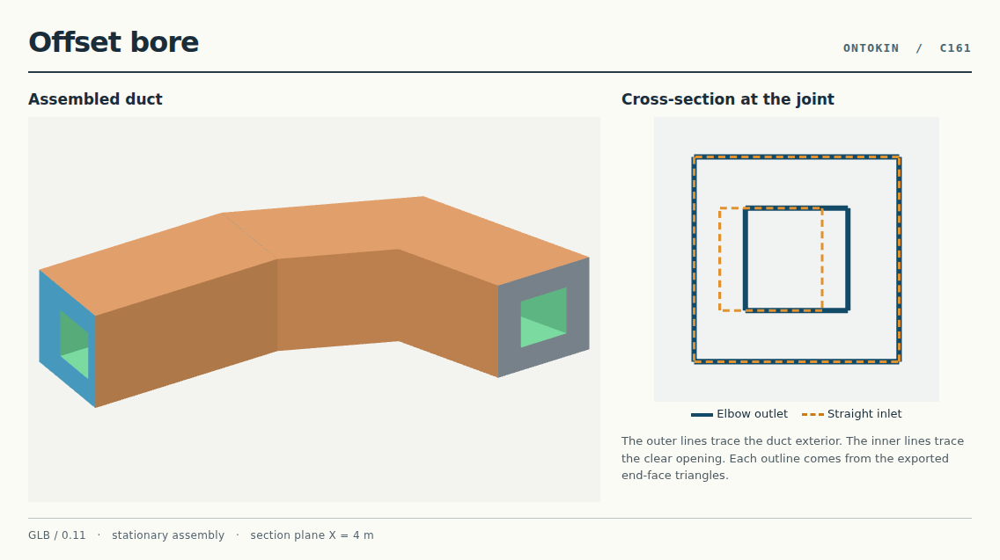
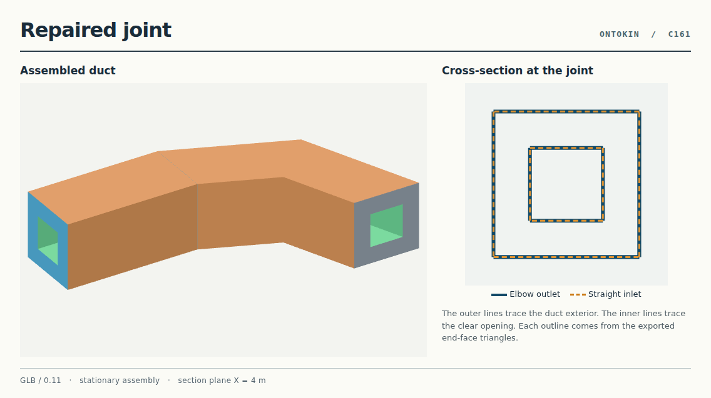
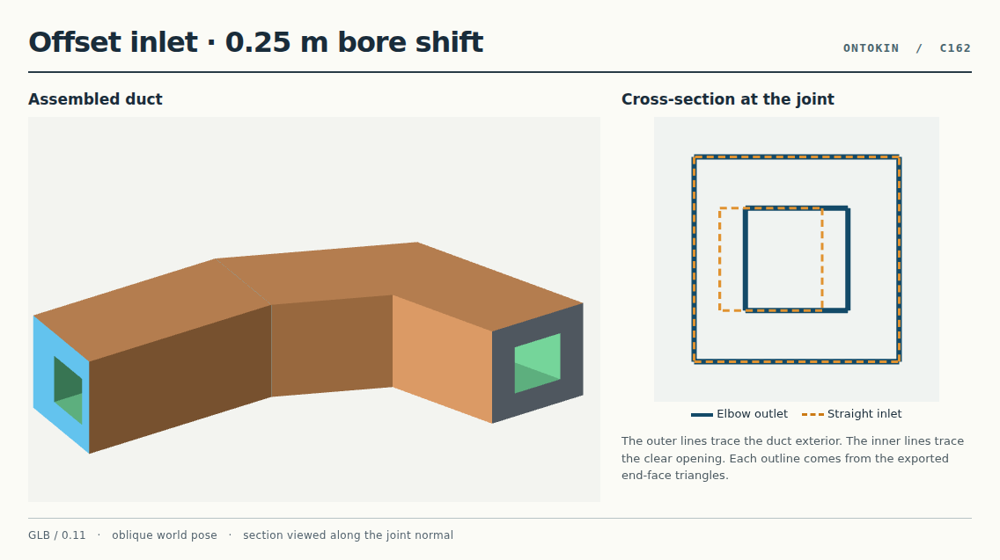

# Join and repair a hollow duct

An elbow and a straight duct meet at (4, 0, 4) m. Their 2 m square exteriors line up even when the straight duct’s bore is offset. The editable example shows how an agent can detect that hidden obstruction in the delivered GLB, change one parameter and verify the repair.



## Run the example

From the repository root, choose new output directories. Use Python 3.12 with the repository’s verification dependencies. The [nominal assembly](assembly.ok) and [wider variant](assembly-wide.ok) import the same [pinned parts module](parts.ok).

```sh
python3 examples/connected-duct/export_cases.py /tmp/duct-cases
python3 examples/connected-duct/agent_repair.py examples/connected-duct/assembly.files.json /tmp/duct-agent
python3 tools/verify_connected_duct.py /tmp/duct-agent/repaired.glb
```

Inspect the six direct exports and their measured results in `/tmp/duct-cases/cases.json`. The Agent run writes its request/response pairs under `exchanges/` alongside each accepted source bundle and GLB. The checker returns a nonzero exit status for the deliberately defective export.

## What changes at the seam

Both parts use the adopted framed polygon loft. A shared function constructs their outer and inner rings. The straight duct’s `bore_shift` moves only its opening. A 2 m shift puts that opening outside the exterior and the Agent rejects the edit. A 0.25 m shift produces a valid individual part but leaves only 0.75 m² open where the two 1 m square bores meet. Restoring the shift to zero reproduces the original artifact.



The independent [checker](../../tools/verify_connected_duct.py) reads the delivered triangles, checks both complete boundary loops, looks for triangles crossing the opening, and verifies the two opposite face directions and plane spacing. The [joint contract](joint-contract.md) specifies the tolerances. The wider opening measures 1.5625 m². A quarter-turn about the straight duct’s own axis preserves the square opening. Tilting the axis 90° or shrinking only one bore fails.

Both parts remain stationary and retain separate annular end faces on the same plane. The checker measures the cross-section at this joint and the centerline of the straight segment. The two meshes remain separately editable. Airflow and wall integrity away from the joint require separate checks.

## Move the assembly and repair the same opening

The [oblique assembly](assembly-oblique.ok) rotates both parts about the axis (0, 0.6, 0.8) and then translates them by (3, −2, 5) m. The elbow outlet and straight inlet now meet at (6.424, 2.4544, 5.6592) m. The [placement contract](oblique-contract.json) gives both port normals and both boundary polygons in world coordinates.



Run these commands from the repository root with fresh output directories. The Agent workflow first rejects an edit that would put the opening outside the duct, then exports the valid offset and its repair.

```sh
python3 examples/connected-duct/export_oblique.py /tmp/duct-oblique-direct
python3 examples/connected-duct/agent_repair.py examples/connected-duct/assembly-oblique.files.json /tmp/duct-oblique-agent
python3 tools/verify_connected_duct.py /tmp/duct-oblique-agent/defective.glb --placement oblique
python3 tools/verify_connected_duct.py /tmp/duct-oblique-agent/repaired.glb --placement oblique
```

The defective check exits with status 1. Its measured world displacement is approximately (−0.144, −0.0864, −0.1852) m. The two square bores overlap by 0.75 m². Setting `bore_shift` back to zero restores the full 1.00 m² opening and the original source revision and GLB bytes. The checker projects the delivered triangles into the selected port frame. The `fixed` and `oblique` settings correspond to the two authored placements in this example. [View the repaired joint](oblique-repaired.png)

## Place the straight duct from its exported geometry

The [misplaced assembly](assembly-misplaced.ok) starts with the inlet 0.375 m away from the elbow outlet and tilted 12°. The authoring script gives the [placement solver](fit_placement.py) the GLB bytes. The solver uses end-face triangle winding to recover each outward normal and boundary edges to locate the square rims. Four rotations can match a square. It chooses the one that moves the straight duct through the smallest angle.

Run these commands in the repository root with the verification dependencies and fresh output directories.

```sh
ex=examples/connected-duct
python3 "$ex/agent_place.py" "$ex/assembly-misplaced.files.json" /tmp/duct-placement
python3 tools/verify_duct_placement.py /tmp/duct-placement/defective.glb /tmp/duct-placement/repaired.glb
python3 "$ex/placement_controls.py" /tmp/duct-placement/defective.glb /tmp/duct-placement-controls
```

The Agent changes the straight occurrence’s placement in the accepted source and retrieves the new GLB in chunks. Inspect the two `.ok` files, `fit.json`, `summary.json` and the protocol records under `exchanges/`. The [independent reference](third-contract.json) fixes the expected world positions and directions before the repair. The verifier compares both complete rims, the straight axis and the 1.00 m² opening to that reference. The controls exercise a straight duct with its opposite end at the seam and a flush joint with a half-turn of unnecessary roll.

This example selects the two stationary root occurrences named `elbow` and `straight`. It uses the rectangular, concentric ports of this parts module.

[See the gap and tilt before repair](placement-before.png) · [See the flush joint after repair](placement-after.png)

## C164 · Select one of two identical elbow outlets

The straight duct `link` starts 0.375 m from the outlet of `bypass` and 4.018 m from the requested `outbound` outlet. Both elbows use the same imported part and expose a region named `top`. The authoring script accepts an occurrence name and a region name for each side of the joint. It fits the selected rims from their exported triangles and sends one Agent/0.11 edit to the placement of `link`. [Assembly source](assembly-selection.ok) · [Frozen joint contract](selection-contract.json)

| Initial placement | Requested joint | Flush decoy control |
| --- | --- | --- |
| [View the gap and tilt near bypass](selection-before.png) | [View link fitted to outbound](selection-after.png) | [View link fitted to bypass](selection-decoy.png) |

From the repository root, run these commands with the verification dependencies installed. Each invocation writes the source, delivered artifacts and Agent exchanges into its own directory.

```sh
ex=examples/connected-duct
out=$(mktemp -d)
fit_joint() {
    python3 "$ex/agent_select.py" "$ex/assembly-selection.files.json" "$out/$1" \
        --elbow "$2" --elbow-region top --straight link --straight-region bottom
}

fit_joint target outbound
fit_joint decoy bypass
python3 tools/verify_duct_selection.py "$out/target/defective.glb" "$out/target/repaired.glb" \
    --decoy-control "$out/decoy/repaired.glb" > "$out/measurements.json"
```

The independent verifier measures both rims, the opposing face normals, the straight axis and the shared opening. Four rotations align the square profiles. The shortest correction is 12°. The repaired target has a maximum rim-corner separation of 0.56 μm against a 10 μm tolerance, and the opening measures 0.99999970 m². The control is flush against `bypass`, 4 m from the requested joint.

The next two runs exit with status 2. An unknown name has no matching occurrence. The shared elbow class matches both. Each run saves the rejection reason in `summary.json`. The two `cmp` commands verify that the accepted source bundle is byte-identical after rejection.

```sh
fit_joint unknown missing || test "$?" -eq 2
fit_joint ambiguous package/example.connected-duct-parts/duct-parts/definitions/elbow || test "$?" -eq 2
cmp "$out/unknown/defective-bundle.json" "$out/unknown/after-rejection-bundle.json"
cmp "$out/ambiguous/defective-bundle.json" "$out/ambiguous/after-rejection-bundle.json"
```
